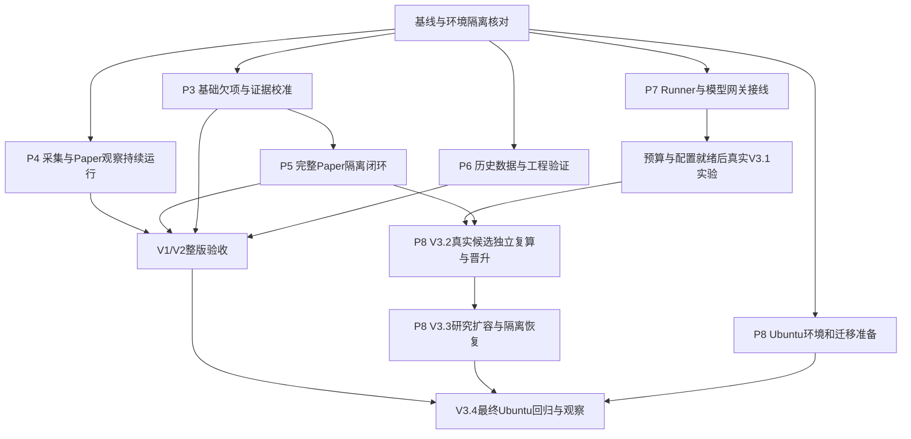

# StockQuant 并行开发与分阶段验收执行计划

> 2026-09-27 执行方式收口：用户已要求结束当前契约切片并冻结广泛持续扩展。当前排期入口改为[开发收口与下一纵向交付](./2026-09-27-delivery-closeout-plan.md)。本文件保留历史工作包与执行证据，原文IN_PROGRESS不表示授权继续自动选择所有剩余项；实际暂停状态见新入口。下一主工程限定为隔离Fixture Paper完整链，观察自动任务继续。

P7.2采集运维读取身份增量（2026-09-27）：Market Data 内部调度状态/计划、订阅、运行状态、缺口、回填和来源健康读取新增平台API Bearer门禁；DC-08A Platform代理新增用户会话校验并携Bearer转发；健康监督、订阅选择、健康报告、促活与`data-cli`使用共享本机凭据读取助手，服务Bearer与采集控制Token独立。抽取真实随机端口的Market Data HTTP smoke，9类读取匿名/错身份401、有效Bearer越过身份门禁；公共日历与容器`/live`/`/ready`保留。Market Data 62、Platform 54、运维96项测试通过，两服务build及HTTP smoke通过；完整`pnpm verify:stage -- --stage V2.1 --suite code`退出0，包含22项隔离Market Data PostgreSQL集成及分区HTTP smoke。活动Compose未重启，避免打断观察；故运行态部署及其余直读端点分类尚未验收。详见[P7.2采集读取身份审计](../../evidence/audits/2026-09-27-p7-2-market-data-collection-read-identity.md)。

P8.B V3.3 队列游标与身份边界复验（2026-09-27）：所有者确认服务身份采用每服务独立 Bearer Token；在已有实现基础上继续验证平台代理携带 Platform Bearer，Runner Host 不能读取用户队列。新增 keyset cursor HTTP/Platform/Web 路径和分级容量对照；发现并修复 Runner 单 Job GET 路由匹配游标查询串的问题。PostgreSQL集成还验证首屏后新任务到达时，续页按稳定顺序恰好返回一次且不串入相邻TestRun。全 V3.3 code suite退出0；容量探针扩大至每run 50,000条，尾页 OFFSET p95 42.150ms、游标 p95 2.954ms，EXPLAIN确认游标头/中/尾均走复合索引，深页OFFSET尾页为并行顺序扫描+排序；4/8读请求并发fanout不涉及Runner派发。全部66,100条合成记录已清理核验。该本机缓存测量不代表生产容量或Runner调度并发。详见[V3.3 队列读取审计](../../evidence/audits/2026-09-27-v33-runner-queue-read.md)。

P3.R 配对备份恢复当前工作树复验（2026-09-27）：`backup:paired-smoke`对专用`research_automation_test`及随机Artifact卷实际执行pg_dump/pg_restore和文件恢复，PUBLISHED引用/字节SHA吻合；随机恢复库、精确源引用及临时卷事后独立核验均已清理。随后对活动Artifact卷只读快照并对活动DB 28个PUBLISHED引用逐文件核Hash，0缺失/0错配；活动卷为33个文件/1,945字节。活动PostgreSQL/Research Automation仍healthy、未重启。此为小数据隔离恢复及当前低容量一致性复验；周期调度/保留、异地副本、活动PG与卷原子一致恢复、RPO/RTO和Ubuntu恢复仍缺，P3.R不关闭。详见[P3.R Artifact边界与恢复审计](../../evidence/audits/2026-09-25-p3-r-artifact-boundary.md)。

P8.C 当前 Research Automation 与 Web AMD64 镜像预检（2026-09-27）：按冻结lockfile从当前源码分别重建独立`linux/amd64`镜像。Research Automation构建阶段TS build及25文件/144单测通过；最终生产镜像在无网络、只读根、drop capabilities/no-new-privileges、64 PID限制下报告Linux/x64及Node 24.1.0，`pg`可解析且TS/Vitest未进入生产层，ID=`sha256:98512b277f2862fae3a358371a658bcc4d2e337b6d5c57361a9caea869b009b0`。Web容器构建通过并在同等级网络/根文件系统隔离下实际响应`/acceptance/v3/v3.3`及JS/CSS静态资产均为200、零API调用，ID=`sha256:f2cea05a1387bb16906cffa6538d97e5798234b47a5b7ca850bcbeff930f147c`。一次性容器均已清理；活动PostgreSQL/Research Automation/Platform API/Web仍运行且未重启。只属Mac上的AMD64仿真，不是原生Ubuntu、全栈迁移恢复或V3.4验收。详见[V3.4兼容矩阵审计](../../evidence/audits/2026-09-27-v34-compatibility-matrix.md)。

P7.2 V2.2入口补充（2026-09-27）：继续盘点发现固定Fixture分钟预览和quality/coverage纯计算入口缺少服务Bearer，V2.2 scenarios/preview Platform代理也未要求本地session。现均补齐；认证smoke验证预览匿名401/Bearer200、计算匿名401/带身份抵达校验器422，Platform单测验证拒绝未登录/错误用户和Session后Bearer转发。完整V2.2 code suite退出0，Market Data 62、Platform 56单测及运维96测试通过；Vite+真实Chromium的V2.2上传相关E2E 3/3通过（Mock API边界）。活动容器仍未部署；见[P7.2采集读取身份审计](../../evidence/audits/2026-09-27-p7-2-market-data-collection-read-identity.md)。

V3.2 code suite与场景边界同步（2026-09-27）：`pnpm verify:stage -- --stage V3.2 --suite code`完整通过，新增Platform API build/52单测、Web production build，已有Quant 38单测、Worker 11 Python测试、Research Automation 135单测、随机隔离PG/HTTP smoke均通过；定向V3.2 Playwright 1/1通过。CLI的normal/rejection/recovery blockers现准确列出权威V3.1前置验收、隔离复算/报告生命周期、Quant Registry版本失效和Web TestRun/证据导出；四项状态测试通过且仍WAITING，不冒充业务PASS。

V3.2只读 Web 证据页增量（2026-09-27）：增加 Quant `GET /v1/promotions/{id}/detail`，仅供持有 Platform Bearer 的 `platform-api-service` 读取已持久化的不可变 PromotionRequest；Platform 新增登录会话保护代理，同时读取已有独立验证报告；Web `/acceptance/v3/v3.2` 显示请求身份、候选来源、哈希、验证状态和 Registry 未变更事实。缺报告显示 `NOT_RUN`，不提交验证/审批、不创建业务 TestRun。补充 detail JSON Schema、OpenAPI 和兼容规则。V3.1 TestRun 前置门禁与 V3.2 场景业务验收仍未通过，此页面仅是证据查看切片。Platform/Quant builds、Platform 50 单测、Quant TS 38 单测、Worker Python 11 测试、Web unit 1 项、Web production build 均通过；针对该页面的 Playwright 用例1/1通过；`pnpm baseline:check` 通过（769 Markdown links、100 JSON、53 schema、34 Fixtures、40兼容规则、7 OpenAPI文档）。

V3.2固定候选复算增量（2026-09-27）：Quant Research新增并注册到标准V3.2 code suite的纯参考复算命令，输入为冻结的合成SMA Fixture。它逐日重算5/20均线，验证决策时点可用性和次日开盘执行，计算样本外成交/收益、逐边费用和事后容量，并通过规范PromotionRequest解析器生成固定报告。6个TS测试文件/31项、Worker 3项边界测试和Quant build通过；完整`pnpm verify:stage -- --stage V3.2 --suite code`退出0。固定Fixture报告5项门禁PASS并标为`ELIGIBLE_FOR_REVIEW`，但身份来源是未持久化静态契约Fixture；这只是Node进程内合成参考计算，不是隔离Qlib/Runner、真实候选复算或已持久业务TestRun，故阶段业务验证和人工验收保持NOT_RUN、Registry保持NOT_PERFORMED。详见[V3.2固定候选复算审计](../../evidence/audits/2026-09-27-v32-fixture-reference-recomputation.md)。

V3.2双实现复算增量（2026-09-27）：另以独立Python标准库脚本重新读取冻结原始CSV、单独计算PIT、SMA成交、逐边成本和容量；标准V3.2复算命令逐成交核对两实现并比较费用/收益，不能匹配即失败。只读Fixture还在缓存的Qlib Worker Linux/AMD64镜像中复算一次；此脚本没有调用Qlib API，故Qlib执行仍为NOT_RUN。新增Python复算拒绝OHLC不一致、非正价/量的测试；V3.2 code suite通过（Quant TS 33项、Python 6项：3跨实现/3 Worker loopback，Research Automation 135项及持久化PG/HTTP smoke，Web type/unit）。复算报告SHA-256为`5b71182752ad0717b5cee8a31eeb23525ff22f9ee7f803c6c31d2dde67105f1e`。仅证明冻结合成样本上独立跨运行时结果一致，不是Qlib候选评估或业务TestRun；人工验收NOT_RUN、Registry未变更。详见[V3.2复算审计](../../evidence/audits/2026-09-27-v32-fixture-reference-recomputation.md)。

V3.2复算隔离边界纠正（2026-09-27）：当前源码核对发现标准复算命令此前仍通过宿主`python3`执行，与旧文字记录不符。现正式命令必须在解析后的Qlib Worker固定镜像ID `sha256:4135861adbf3617ae1b2e578caf7d2eb3f3835e0f5f42cf257b7a0d7b6991094`中运行标准库Python复算，拒绝镜像缺失/非AMD64并禁止宿主回退；容器为网络隔离、非root、只读根/输入、无额外capability及有界资源。Mac ARM64上测得的是AMD64仿真。完整V3.2 code suite重跑退出0，新增报告SHA `0c319afed9e970497673aa006bfabb144112f53d074cc6e33916bc7bf4eda33c`。仍不调用Qlib API、不执行候选源代码、不持久化/晋升或代替Ubuntu/人工验收。见[V3.2隔离边界纠正审计](../../evidence/audits/2026-09-27-v32-fixture-reference-recomputation.md)。

V3.2固定复算输入防御增量（2026-09-27）：复算器拒绝非正OHLC价及成交量，并要求容量参与率限制为有限且`(0,1]`，避免无效输入或NaN配置导致容量门禁假通过。Quant 6个测试文件/33项、Worker loopback 3项、build及完整V3.2 code suite通过；合成报告5项仍PASS，刷新证据SHA为`7af5924453b20d7d342e959af86826846fc9f3fd9deec7b82d830e3d37e5de55`。仅加固固定样本，不改变其FIXTURE/未持久化边界、V3.2业务验证/人工验收NOT_RUN及Registry未变更。详见同一[V3.2固定候选复算审计](../../evidence/audits/2026-09-27-v32-fixture-reference-recomputation.md)。

V3.2提交门禁续进（2026-09-27）：负向验证扩展至失败阶段、人工拒绝、错误证据SHA-256及跨TestRun门禁记录；V3.2提交客户端23文件/135单测通过。失败门禁均在打开journal和调用Quant之前停止，跨Run记录直接拒绝。完整V3.2 code suite重跑退出0，结果仍为代码PASS、业务验证/人工验收NOT_RUN、Registry未变更。平台`acceptance_records`仍仅关联旧V1.1 `test_runs`，没有V3.1人工接受的权威写入/读取源；不得将场景完成、Fixture结果或该审计当作人工签署，故服务路由和Quant提交继续关闭。详见[提交门禁客户端审计](../../evidence/audits/2026-09-27-v3-2-submit-gate-client.md)。

V3.2报告门禁运行时复核（2026-09-27）：独立验证报告构造器增加运行时状态枚举及SHA-256格式校验，任何PASS缺Hash/坏Hash都被拒绝，防止仅靠静态类型放行JSON来源的值。Quant 26项TypeScript单测、3项Worker loopback测试及build通过；完整V3.2 code suite再次退出0，Research Automation 135单测及持久化PG/HTTP smoke均通过；首次受限沙箱运行的loopback绑定EPERM与获准本机复跑均保留。code PASS不改变业务验证/人工验收NOT_RUN及Registry未变更。此改动仅校验报告输入，不执行Qlib复算、不产生验收证据或修改Registry。详见[V3.2报告门禁审计](../../evidence/audits/2026-09-27-v32-validation-report-runtime-validation.md)。

V2.3 Qlib Fixture Fit 端点与服务身份闭环（2026-09-27）：新增 request/result JSON Schema、固定请求 Fixture、`quant-qlib.v1` OpenAPI、兼容矩阵规则和生成类型。量化 Worker 仅接受固定 `sourceMode=FIXTURE`、有限数值和连续互斥的 train/valid/test 窗口；平台专属 `POST /v1/research/qlib/fit-fixture` 限制 1 MiB 并以单独 `STOCKQUANT_SERVICE_TOKEN_QUANT_RESEARCH_SERVICE` Bearer 代理到 Worker。真实隔离PG/HTTP smoke验证平台访问通过、其他服务及Token错配403且不触达Worker；Qlib Worker 单测11/11。实际锁定依赖 `linux/amd64` 离线容器在120行合成数据上连续两次调用 Qlib 0.9.6 `LGBModel.fit/predict`，均得到24个有限预测且模型/预测SHA完全一致；重叠切分422拒绝。模型Hash=`08d29ca3ccefc37e887928d5a4512a9f63d53edef6cc91b4289e1731ec675695`，预测Hash=`09d1563ed1102a87f6e71672e9b1238ce844094aa336cb33efeea6ac995bdbe3`。容器无网络、只读根、2GiB/1CPU/128PID，临时镜像与SQLite随容器清理。`pnpm baseline:check`通过（757链接、99 JSON、52 schema、34 Fixture、39兼容规则、7 OpenAPI组）；量化服务集成测试通过。只证明合成内存输入上的真实Qlib工程调用，Qlib独立验证仍`NOT_RUN`，无市场Fixture/PIT或候选执行、业务TestRun、Registry/模型晋升、V2.3 Web/CLI研究验收或人工确认；活动容器未升级。详见[Qlib Fixture Fit endpoint 审计](../../evidence/audits/2026-09-27-v23-qlib-fit-endpoint.md)。

制定日期：2026-09-25（Asia/Shanghai）。代码基线：`3282ee648dc3afcff5f2eee7734877b4cbb22230`。状态：`IN_PROGRESS`（2026-09-26：P3.12隔离容器Web/API/专用DB/同run CLI闭环通过；P6已验证CSV/Parquet映射、每日分区、合成容量、冻结500×60真实5m归档HTTP→PostgreSQL导入及最大100,000行重复/错误解析内存；Parquet 100,000行合成文件经本机和Linux/ARM64受限容器HTTP上传、Preview、Finalize、幂等重试及14块进程重启续传通过，损坏输入拒绝/取消恢复通过；macOS RSS峰值258,160 KiB、Docker容器2GiB/2CPU/128PID限额下RSS采样峰值178,995 KiB，隔离库约72.6MB；发现并修复最终Docker层缺失PyArrow helper；三只冻结BaoStock证券通过登录Web→平台API→Market Data→PG并绑定同一TestRun/CLI核对；新增Market Data单实例重型任务闸门，重复/错误10万行并发拒绝HTTP/PG容量烟测通过，峰值RSS 449,664/498,208 KiB；V2.2完整code suite及真实Web同run CSV/Parquet上传通过。冻结500文件双worker、双真实服务进程共享PG有界并发复验已通过；共享PG生产负载/余量、Ubuntu容量、备份恢复仍待完成；P5.4/P5.5准备边界及持久预留API、确定性快照风险判定、P5.7 FakeBroker Outbox预留绑定及隔离PG/跨服务丢响应与重启恢复已验证、V3.2 PromotionRequest契约准备、P3.R Artifact修复、配对备份清单/生产器/隔离恢复验证和dry-run保留清理器、P5.6 FakeBroker存储复核、P7.1/P7.2鉴权与租约安全底座已有实现/验证。P3.R周期调度/异地介质/活动资源恢复演练等其余交付、P5.5风险/订单接线与OD-007/P5.6整链、P5.7正式授权与Web/CLI/人工验收、真实Parquet压缩率、双实例生产负载与共享PG成本敏感度、原生Ubuntu和人工验收、P7.3+及所有阶段门禁继续推进）。

本轮续进（2026-09-26）：P3.R V1.1统一阶段存储 API 在隔离 PostgreSQL 中完成完整 `V1.1 code` 套件，`pnpm test:integration:v11-stage-storage` 退出 0。构建、lint、契约/Fixture 检查及 273 项工作区单测通过；正常、拒绝、恢复三场景全部 PASS，恢复路径确认只重启隔离 Portfolio 容器。隔离 Compose 项目与日志诊断项目均已清理；活动 `stockquant-v12-*` 服务保持健康、未重启，活动 API 仍默认 `legacy`。这仅是代码/隔离数据库证据，Web/人工验收、活动切换及回滚窗口仍未完成。详见[V1.1统一存储代码套件审计](../../evidence/audits/2026-09-26-v11-stage-store-code-suite.md)。

P7.2 身份方案再次确认与复验（2026-09-27）：项目所有者确认每服务独立 Bearer Token。`pnpm test:service-auth:http` 重新构建治理、历史回放和量化服务，并通过随机临时 PostgreSQL 库中的23项真实HTTP断言，覆盖缺失/错配/伪造身份、由Token确定身份、路由scope、命令绑定、并发单次消费、授权轮换与过期拒绝；临时库已删除并核验不存在，未输出凭证，未修改活动服务。沙箱内首次连接被本机网络策略以EPERM拒绝；按批准的仅本机测试库执行后完整退出0。此复验不覆盖浏览器用户会话、所有服务的部署/轮换操作及运行监控；OD-004仍为PARTIAL，详见[P7.2身份审计](../../evidence/audits/2026-09-25-p7-2-service-identity.md)。

同日补齐研究 API 身份路由复验：`pnpm --filter @stockquant/research-automation-service v31:service-bearer-http-smoke` 构建通过，真实临时loopback HTTP服务4项断言通过，确认Platform身份从Bearer派生、伪造服务头拒绝、Runner Host不能提交研究Job、仅Platform能调用取消路由；纯内存、零数据库/模型/订单调用，临时进程已停止。该项补足本地服务路由验证，不代表当前活动服务已部署，也不完成用户会话、秘密轮换/部署监控及V3阶段人工验收。详见[P7.2身份审计](../../evidence/audits/2026-09-25-p7-2-service-identity.md)。

同日完成组合与交易执行身份边界复验：Portfolio Risk build及专用`portfolio_risk_test` HTTP smoke通过（随机TestRun `06021277-f73a-408d-b3e7-47ed0abb779c`），验证401/403、owner隔离、资源预留/Fill幂等、UNKNOWN保留和取消释放，精确账户数据已清理；Trade Execution build及专用`trade_execution_test` HTTP smoke通过，验证伪造/缺失身份拒绝、路由scope、BACKTEST/FAKE零成交量拒绝和出站Governance Bearer，随机namespace已清理。与前述治理/回放/量化/研究API验证合并后，当前所有已实现的服务身份HTTP边界均有本地复验；活动部署、轮换/监控、浏览器用户会话与业务人工验收仍未完成。详见[P7.2身份审计](../../evidence/audits/2026-09-25-p7-2-service-identity.md)。

V3.2 候选提交准备增量（2026-09-27；后续持久化准备路由已见本节末）：研究自动化域新增纯构造器，依据已完成Runner Job中由验证计划精确路径绑定的已发布OUTPUT ArtifactRef和结算预算事实构造不可变PromotionRequest；另新增严格数据Manifest/Validation Plan sidecar Schema、Fixture及兼容规则。构造器从精确UTF-8字节自行计算sidecar Hash，绑定TestRun/experiment、验证计划到Manifest的Hash引用，并从计划派生候选来源。Research Automation producer/Runner bundle focused tests 30/30、build及完整V3.2 code suite通过。Runner输入包验证sidecar绑定和数据文件字节Hash；套件报告business validation/human acceptance `NOT_RUN`、Registry mutation `NOT_PERFORMED`。本段记录的是当时状态；随后已完成持久化证据准备和平台认证准备路由，但尚未连接Quant提交或独立复算。V3.1前置、V3.2阶段/业务验收保持NOT_RUN。详见[V3.2 producer准备审计](../../evidence/audits/2026-09-27-v3-2-promotion-producer-preparation.md)。

V1.1 同日 Web 增量：真实 Chromium 经本机 Vite 访问新的隔离 stage-mode API/PostgreSQL，页面创建并显示 TestRun，随后由 CLI `--run <同一UUID> --check-only` 读到同一 `COMPLETED` 记录；normal、rejection、recovery 三场景 Web 测试均自动核对同 run CLI，最终 Playwright 3/3。recovery 先校验目标容器与隔离项目一致，重启后等 Portfolio 健康检查通过再继续；早期未等待ready导致的失败保留，修复后集成入口全流程退出0。`pnpm test:integration:v11-stage-storage` 现包含全代码套件和三条Web场景；阶段操作手册同步实际URL/端口/清理步骤，版本验收表保留2026-09-09签署并校准当前活动仍legacy的限制。隔离服务已清理，活动 V2 服务保持 healthy。活动切换与回退窗口、人工新范围接受仍待完成。

本计划根据本次用户“减少数据等待、复核本地完成进度、给出详细执行计划”的要求制定。承接[9月24日执行计划](./2026-09-24-execution-plan.md)，沿用 P0～P8 工作包，不新增产品版本或验收阶段。本文件作为后续排期入口；旧计划保留已完成记录和历史证据。并行仅调整独立工作的开始时间，不更改[三版规则](../prd/05-three-version-delivery.md)、阶段前置、观察期限或人工签署。

执行进度（2026-09-25）：P5.4政策准备、P5.5 Mandate阻断器与持久预留API、P5.7 FakeBroker Outbox预留绑定及隔离PG/跨服务HTTP丢响应重启恢复（34项单测、专用测试库集成通过）、P3.R Artifact/历史TestRun处理、配对备份manifest Schema与安全保留清理器、P5.6 FakeBroker存储复核、P7.1/P7.2身份与Runner安全底座已有实现/验证。项目所有者已明确P7.2使用每服务独立Bearer Token。Portfolio预留HTTP smoke及V2.4完整code suite通过。V3.2已完成PromotionRequest/场景契约、TS/Python生成类型、独立验证结果fixture，以及量化侧持久提交API：研究服务使用专属Bearer身份仅可POST提交，平台身份仅可GET查询；规范化指纹、并发幂等键和请求ID唯一约束通过隔离PG/HTTP验证，数据库状态固定为`AWAITING_INDEPENDENT_VALIDATION`，不含批准或激活写权限。契约69 JSON/37 schema/24 fixture/26兼容规则、量化20单测和候选登记+PromotionRequest两组隔离PG smoke通过。量化独立复算、Registry状态转换、研究侧生产者、Web/TestRun及V3.1前置仍未完成，V3.2业务场景继续NOT_RUN。P5.5风险/Mandate/订单接线与OD-007仍缺，Paper仍HOLD。V3.1 code suite及同run Artifact用户读取验证通过；隔离HTTP/PG smoke验证Host 1被SIGKILL、租约过期后Host 2以fence token 2接管并完成Artifact回写，旧容器清理确认，无遗留任务/引用/容器。P3.12容器化Web/API/PG/CLI同run验证已通过；P6受限CSV映射/预览/持久化及来源许可标记通过HTTP/PG重启与幂等smoke。治理/回放/量化HTTP身份smoke的13项断言通过，RunnerJob领取现强制跨TestRun全局并发1并有隔离PG验证。活动容器未部署新身份代码，Runner Host未常驻；生产资源压力、原生Ubuntu及真实RD-Agent未验收。Runner/Gateway仍NOT_CONFIGURED、外连DENY、模型调用NOT_RUN；Paper调度和数据观察按原任务继续。详见[服务间Bearer边界](../../evidence/audits/2026-09-25-p5-service-bearer-boundary.md)、[P5.5资源预留](../../evidence/audits/2026-09-25-p5-5-resource-reservations.md)、[P7.2](../../evidence/audits/2026-09-25-p7-2-service-identity.md)、[P7.3离线Runner smoke](../../evidence/audits/2026-09-25-p7-3-offline-runner-smoke.md)、[V3.2 PromotionRequest提交边界](../../evidence/audits/2026-09-25-v3-2-promotion-intake.md)、[P3.R Artifact边界](../../evidence/audits/2026-09-25-p3-r-artifact-boundary.md)、[P6 CSV分钟导入](../../evidence/audits/2026-09-25-p6-csv-minute-import.md)、[P5.7 Outbox预留绑定](../../evidence/audits/2026-09-25-p5-7-outbox-reservation-binding.md)。

本轮续进（2026-09-25）：P5.5/P5.7 在 Portfolio 落地了隔离测试库可验证的预留资金/证券与 Fill 单事务结算、部分成交剩余占用和 BUY/SELL 双向账本更新；FakeBroker也已把预留身份、side和币种纳入Outbox及幂等指纹。Portfolio部分的Schema/OpenAPI/Fixture同步，构建、单测、专用PG集成和HTTP smoke通过；trade execution集成测试也通过真实Portfolio/执行服务与双专用PG库模拟回写响应丢失、执行进程重启、同Fill幂等重投、订单从LEDGER_PENDING恢复、账本仅记一次及UNKNOWN余额继续占用。治理端使用固定测试stub，只验证数据面，不验证Mandate或Paper授权。P5.5仍未整体完成：Mandate/风险/报价门禁、生产治理授权及Web/CLI人工接受缺失，Paper继续HOLD。证据：[原子Fill审计](../../evidence/audits/2026-09-25-p5-5-fill-reservation-atomicity.md)、[P5.7 Outbox预留绑定](../../evidence/audits/2026-09-25-p5-7-outbox-reservation-binding.md)。

本轮研究链续进（2026-09-25）：P7.5新增固定模型响应到Runner执行的隔离HTTP烟测：Experiment→输入Artifact→冻结离线镜像→输出Artifact→Qlib指标→预算结算通过；外部模型调用为0。随后新增平台V3.1 TestRun固定Pipeline测试入口：隔离双临时库由真实Chromium经Vite→平台→研究API→Runner完成同一TestRun并读取owner-scoped Artifact；跨owner 403、生产模式固定入口隐藏且调用403。页面会保存当前TestRun ID；真实浏览器关闭页面、重开后恢复同一TestRun，再刷新至Runner完成并读取指标通过。V3.1页面合同测试3/3通过；V3.1 code suite通过（研究85单测/10 PG集成、平台40单测、Web/平台类型检查），契约63 JSON/34 schema/23 Fixture/23兼容规则及580个Markdown链接通过。固定流水线本地Web/API/关页恢复验收完成；完整故障恢复矩阵、真实模型与用户接受仍待完成，OD-009未关闭。详见[P7.5固定Pipeline烟测](../../evidence/audits/2026-09-25-p7-5-fixed-pipeline-smoke.md)。

## 1. 本地完成进度与证据可信度

本次复核证据：[本地检查与命令退出码](../../evidence/audits/2026-09-25-parallel-plan-review/local-review.json)、[运行时快照](../../evidence/audits/2026-09-25-parallel-plan-review/runtime-review.json)、[采集观察快照](../../evidence/audits/2026-09-25-parallel-plan-review/observation-summary.json)、[采集健康快照](../../evidence/audits/2026-09-25-parallel-plan-review/health-report.json)。运行时快照时间为 `2026-09-25T03:00:42Z` 左右，即北京时间11:00；状态会随运行变化。

| 范围 | 核对结果 | 仍未完成 | 证据性质 |
|---|---|---|---|
| 本地运行环境 | 13个容器运行；配置健康检查的容器均显示 healthy；Web运行，平台API为 ready/FAKE | 容器运行不等于当前所有代码已部署或全阶段验收通过 | 本次 Docker/HTTP 只读实测 |
| P0/P1/P2 | 已有观察保护、专用测试库、空断言/退出码保护、版本检查及契约校验 | 版本脚本仍主要读取Markdown状态，不能替代完整业务证据验证 | 既有工程证据＋本次源码检查 |
| V1基础收尾/P3 | TS/Python契约生成、部分OpenAPI及消费者、双市场账户、V1.2～V2.2 TestRun持久化、owner隔离已有实现；V3.1 Artifact owner/run授权API与Web准备页读取/下载控件已通过隔离HTTP/UI验证；V1.1活动历史已影子复制统一表，stage模式API具备校验后读与事务双写 | 活动Web会话/统一表模式部署及切回旧版演练、备份生产和周期调度、活动PG/Artifact一致性恢复及RPO/RTO演练、新增范围人工验收仍需核实 | 当前代码＋P3.1～P3.12及[P3.R保留审计](../../evidence/audits/2026-09-25-p3-backup-retention.md)；本轮运行V1.1双存储隔离PG与HTTP验证、V3.1套件及P3.R隔离恢复 |
| P3.12观察历史 | API/Web容器已部署；owner 200、跨owner 403；临时容器化Web→API→专用DB→同run CLI已通过 | 真实自然产生的正式观察修订行仍不可用；工程烟测不增加20日计数，也不构成V2.4验收 | [P3.12](../../evidence/audits/2026-09-25-p3-12-v24-observation-history.md) |
| V1.2～V1.5、V2.1～V2.3 | 已有阶段范围自动验证及人工签署 | 不能扩展为新增功能、全量规模或整版通过 | 各版99-acceptance历史记录 |
| 共享采集/P4 | 唯一启用订阅 `dc08a-20260917-20-v1`；20只；PostgreSQL、采集调度与执行器启用；2026-09-27 11:10 check-only 返回HEALTHY/HTTP 200、无动作；下一调度为9/28 09:37，见[当日只读复核](../../evidence/audits/2026-09-27-p4-current-readonly-check.md) | 来源盘中稳定性、备用源独立覆盖/许可、模块人工验收 | 本次只读监督＋归档快照；观察归档仍5/20且不增加观察日 |
| 采集长期观察 | 稳定完整4日＋恢复后完整1日＝5/20，剩余15日，WAITING | 稳定日与恢复日分别报告；最终门槛按冻结规则判定 | 本次读取的观察归档 |
| V2.4 Paper观察 | 最近档案计数8/20（此为既有快照）；2026-09-27只读预检：PAPER/FAKE调度RUNNING、30分钟、20证券，下一采样9/28 09:30，日历CLOSED | 报价observedAt仍为9/24（仅ingestedAt新）；闭市时预检延后新鲜度判断，故配置PASS不等于行情新鲜或新增观察；HOLD-only，观察门槛未满 | [当日Paper只读预检](../../evidence/audits/2026-09-27-p5-paper-preflight-readonly.md) |
| P5.1/P5.3快照执行 | 首个合格快照筛选和固定CN样本投影已有领域实现；P5.3记录22项单测通过 | `PROJECTED_ONLY`尚不产生FakeBroker订单、Fill或Portfolio账本；未部署 | [P5.1](../../evidence/audits/2026-09-25-p5-1-snapshot-eligibility.md)、[P5.3](../../evidence/audits/2026-09-25-p5-3-snapshot-fixture-projection.md) |
| P5.2幂等加固 | 请求指纹、同键并发串行、异载荷409、专用`trade_execution_test`数据库集成已有PASS记录 | 未部署；升级前无指纹订单的查询/兼容/回滚步骤需落实 | [P5.2](../../evidence/audits/2026-09-25-p5-2-fakebroker-idempotency.md) |
| V2.5历史与在线数据 | 当前工作树重验20/100/500×60分钟档，分别57,600/288,000/1,440,000根通过Hash、逐日数量、OHLCV和重复键；5,219只多年日线6,260,343行逐文件Hash/行数匹配；当前V12运行态以只读侧车复验在线监控池50/80/100只均PASS，原3只watchlist精确恢复 | 真实交易时段新鲜度/延迟、长期限频、第二来源60日及PIT修订链仍有缺口 | 冻结Manifest/Hash及[P6重验](../../evidence/audits/2026-09-25-p6-scale-archive-revalidation.md)、[在线监控池审计](../../evidence/audits/2026-09-26-v25-monitor-capacity-linux-arm64.md) |
| V3.1/P7 | Experiment、RunnerJob、Artifact、预算账本与宿主执行组件已有准备实现 | 容器Runner/Gateway为NOT_CONFIGURED、外发DENY；实际模型与研究闭环NOT_RUN | 本次研究服务ready及源码 |
| V3.2～V3.4/P8 | V3.2已有独立Fixture候选执行、持久验证报告/精确版本决定、受门禁保护的提交协调和只读Governance指纹核对；当前工作树code suite及V3.2 Mock API Chromium入口已复验通过 | V3.2仍缺V3.1权威人工前置、非Fixture/RD-Agent候选执行与Qlib独立验证、正式治理/Paper消费、业务TestRun/导出；normal/rejection/recovery入口存在但均WAITING。V3.3正式入口/扩容和V3.4真实Ubuntu发布验收未完成 | 当前工作树V3.2 code/E2E/scenario实测及对应审计；P8.B/C计划 |
| 整版门禁 | V1、V2、V3均INCOMPLETE，三个检查分别退出2 | 不是单纯等待满20日即可全部PASS | 本次运行版本脚本 |

2026-09-27 01:18（北京时间）P0只读快照已更新：[运行基线审计](../../evidence/audits/2026-09-27-p0-live-baseline-recheck.md)。V2.4 Paper为8/20，DC-08A采集归档为5/20，属于不同门槛，不相加；采集守卫HEALTHY且无动作，下一交易日调度为9月28日09:30。活动API可读但样例quote时间停在9月24日，预检PASS不等于新鲜行情或新观察日。工作区/容器/锁指纹与本次只读结果已记录。

2026-09-27 03:52（北京时间）再次只读复核：[活动观察快照](../../evidence/audits/2026-09-27-p0-live-baseline-recheck-2.md)。活动订阅仍唯一启用，20证券与POSTGRES采集管线健康；Paper仍8/20、DC-08A仍5/20，9月25日因休市不计日，Paper下一采样为9月28日09:30。采集守卫与Paper预检均退出0，但Quote observedAt仍为9月24日；没有新交易日证据或业务写入。

### 1.1 优先校准的记录与验证缺口

1. V1.1状态冲突已于2026-09-27按证据校准：阶段文档拆分标记已验证子项与未完成边界，明确活动存储仍`legacy`并保留9月9日签署原范围；V1版本表已同步Schema/类型、账户、隔离Web/CLI证据及Calendar、OpenAPI/客户端、通用Artifact和新增签署缺口。V1.1仍`PARTIALLY_IMPLEMENTED`，不将局部实现扩大为整阶段通过。
7. 2026-09-27发现V1.1 `--suite code`曾调用默认目标为`localhost:3000`的业务集成脚本，并在recovery重启默认Compose Portfolio服务；该轮意外在活动V12创建3条FakeBroker TestRun/账户记录并重启Portfolio服务。容器随后恢复healthy、Platform `/ready` 返回ready。记录与ID见[活动栈误路由审计](../../evidence/audits/2026-09-27-v11-active-suite-misroute.md)。现已从code suite移除有副作用场景调用，并要求V1.1场景显式指定API URL；隔离入口`pnpm test:integration:v11-stage-storage`随后退出0，V1.1 Web normal/rejection/recovery 3/3 PASS，恢复只重启受校验的隔离容器，临时容器/卷/网络全部清理。意外活动记录保留，不做清理；不得将该轮计作隔离验收。
2. V2.4阶段曾写P5.2数据库集成因权限未运行，与后续P5.6隔离库PASS记录不一致；2026-09-27已在阶段文档补充时序更正，保留首次受阻事实并链接后续通过证据。该校准仅关闭这项文档冲突，P5.5/P5.6整链及活动部署仍未完成。
3. P3.11/P3.12部署描述已于2026-09-27按先后证据校准：P3.11首份审计是隔离库、尚未部署；后续P3.12记录其后构建/部署的API与Web镜像及活动revision读取路由200。正式revision表为空，活动数据失效迁移与日终冲突行为没有实测，不能写成活动业务验证。详见[旧执行计划P3.11/P3.12](./2026-09-24-execution-plan.md)及两份P3审计。
4. 已确认本机 `.env.local` 有两个凭据引用值，但活动研究容器因启动时未加载该文件而缺失；使用 `docker compose --env-file .env.local ... up -d --no-deps research-automation-service` 修复注入。重建后容器只验证布尔存在性，GET预检中凭据缺项消失；Runner/Gateway仍未配置、外连仍DENY默认、modelCalls=NOT_RUN。详见P7.1执行记录。
5. 观察计数需标规则版本：截至2026-09-25归档摘要为5/20（4 completed + 1 recovered）；已对五个计入日逐个只读复核coverage/daily-report并记录SHA。旧`dc08a-coverage-v1`仅能证明20只×48条的Bar覆盖和零缺口，不含新规则所需十个定时采样窗、requestedSymbols及逐证券报价时间，因此保留历史计数但不认定已按2026-09-26规则重验；活动事件只读核验或新自然观察日仍待。见[归档观察规则审计](../../evidence/audits/2026-09-27-observation-history-rule-audit.md)。
6. （2026-09-26已完成本地代码与隔离PG验证）`qualityForDate`现按十个固定A股采样调度时刻去重，缺窗、重复窗、超时调度均拒绝计日；以Market Data明确返回的requestedSymbols逐窗检查缺失/重复/多余证券、各证券LIVE_SOURCE状态和0～1800秒新鲜度；执行窗口要求唯一09:31调度且同样通过逐证券行情校验。旧正式观察Finalization未批量改写/重算，当前计数保持历史原值；该规则尚未部署到活动观察容器、真实交易日重算或用户验收。详见[V2.4观察质量审计](../../evidence/audits/2026-09-26-v24-observation-quality.md)。
8. P0.2跨服务契约覆盖审计（2026-09-27）：Portfolio账户快照、Fill及预留/resolve已有OpenAPI；实际历史回放→Trade Execution `POST /internal/v1/historical-orders/execute`补齐请求/结果Schema、OpenAPI与兼容登记。Research Automation Runner Host claim/input/heartbeat/complete新增契约、Schema类型化wrapper及OpenAPI生成HTTP client，并纳入`contracts:check`漂移门禁。历史回放Worker单Bar/多Bar同步及异步提交、读取/生命周期/UNKNOWN恢复路由也新增请求、Bar、响应与运行态Schema、OpenAPI和兼容登记；其命令解析器校验闭合字段、UUID、种子、场景、时间戳、价格精度和非负成交量。Platform→Historical Replay客户端现从OpenAPI生成，已替换手写回放提交与读取/暂停/继续/取消HTTP路径，生成漂移检查纳入`contracts:check`；新增客户端测试覆盖平台身份头、Bearer、同步/异步URL、生命周期路由及HTTP错误状态。此子项当时的契约基线为89 Schema、34 Fixture、75兼容消费者规则；当前基线及新增Research Automation client见本计划P0.2续进。Research Automation build、150单测通过；生成client驱动的隔离专用PG+HTTP/Docker smoke退出0，验证Host SIGKILL后fencing token 2接管、旧容器移除、heartbeat延长租约、OUTPUT Artifact Hash正确、旧fence发布409，且精确清理Job/Artifact/Experiment/Budget；Historical Replay Worker build及17单测通过；Platform build及76单测通过。身份HTTP烟测现逐一覆盖回放提交（单Bar、多Bar同步/异步）、读取、暂停/继续/取消和UNKNOWN恢复：7条写路由各以Runner Host身份及错配Platform头/Bearer进行拒绝探测（14项均403），合法身份的三种畸形提交均422、缺失运行的生命周期操作均404、无原订单证据的恢复422，随机专用PG库清理后核验不存在；该smoke已加入V2.3 code suite，`node --test scripts/code-suite-plan.test.mjs`5/5及最终`pnpm verify:stage -- --stage V2.3 --suite code`均退出0，另含Market Data 22项PG集成及锁版Qlib容器拟合。V2.3阶段仍为`PARTIALLY_IMPLEMENTED`，本轮code suite不改变研究独立验证/人工验收状态。真实RD-Agent、常驻Host仍未配置；其他服务全路由盘点仍待。Research Automation自身route inventory已更新为[独立审计](../../evidence/audits/2026-09-27-p0-2-research-automation-route-inventory.md)。证据见[历史FakeBroker契约审计](../../evidence/audits/2026-09-27-p0-2-historical-execution-contract.md)、[Runner Host契约审计](../../evidence/audits/2026-09-27-p0-2-runner-host-contract.md)和[Historical Replay契约审计](../../evidence/audits/2026-09-27-p0-2-historical-replay-contract.md)。
9. P0.2/V3.3 Research Automation只读消费者续进（2026-09-27）：Platform访问Research Automation的offset队列、keyset cursor和按页预算只读端点从三操作client起步，当前已扩展为覆盖V3.1及V3.3的12操作client；Bearer/service identity与query序列化由client统一负责，用户会话及V3.3 TestRun owner验证仍先执行，cursor/budget绑定请求run/page。新增client测试；完整`pnpm verify:stage -- --stage V3.3 --suite code`最终回归退出0，Playwright 3/3。V3.3业务工作流仍`NOT_IMPLEMENTED`、业务验证及人工验收`NOT_RUN`，不派发研究Job/模型调用。其他未消费的Research Automation路径及全服务路由盘点见[Research Automation路由盘点](../../evidence/audits/2026-09-27-p0-2-research-automation-route-inventory.md)。
10. P0.2/V3.1 Research Automation接线续进（2026-09-27）：Research Automation Experiment创建/取消、预算读/结算、Runner dispatch/read、Artifact publish/read和测试Fixture模型调用新增版本化Schema、OpenAPI及兼容消费者；V3.2 guarded Promotion submit新增生成Platform client；V3.1的所有上述Platform调用切换至生成client，仅`/ready`健康探测保留直接读。V3.1/V3.2 Bearer均使用Platform服务身份，TestRun绑定与RESERVED预算拒绝继续有效。契约检查验证99 Schema/34 Fixture/87兼容消费者/98生成类型；Research queue client当前13操作，Promotion client 1操作，共14个生成操作。两client定向8单测通过。Platform build通过；完整V3.1 suite在隔离PG授权环境退出0（Research Automation 150单测+19 PG，Platform 83单测、Web typecheck、Artifact/Gate smoke）；完整V3.3 code suite退出0并含Chromium 3/3。最新固定Pipeline浏览器→Platform→Research Automation→独立Runner Host运行通过，TestRun `0912efd2-23f4-4097-bee6-33fca459e2cd`，Fixture无外部模型调用，Runner完成、23 cents结算、输出Hash/6 bars指标正确、异主403且生产模式禁用。真实RD-Agent、自然观察、Ubuntu、V3.1/V3.3业务阶段接受和人工确认仍NOT_RUN；V3.3正式业务工作流和全阶段预算仍NOT_IMPLEMENTED；详见[V3.1 Runner dispatch契约审计](../../evidence/audits/2026-09-27-p0-2-v31-runner-dispatch-contract.md)。
11. P0.2 Research Automation静态HTTP路由盘点（2026-09-27）：逐项核对Research Automation bootstrap内的`/live`、`/ready`和全部`/v1/*`路由、前置Bearer中间件、三份既有OpenAPI、生成client及Platform调用。当前Platform V3.1/V3.2/V3.3业务调用均已契约化/生成client，健康`/ready`探测除外；Runner Host lease四个动作单独生成且使用Runner Host Bearer。已授权的Runner cancel也补了Platform OpenAPI/client，但尚无产品调用方或已接受的恢复流程；retry仍未授权且无契约。剩余无契约路径记录为未调用的Experiment单条读取、in-process promotion prepare、validation-only工具及legacy `/start` 410等。逐条路径及限制见[Research Automation路由盘点](../../evidence/audits/2026-09-27-p0-2-research-automation-route-inventory.md)。

## 2. 并行原则、依赖图和资源安排

四条持续工作线：A观察运行；B基础与Paper；C研究运行时；D历史数据/Ubuntu准备。只有A天然后台并行；单个开发执行者在B/C/D间按可验收切片切换，不把一个人的多项工作估成多人同时完成。

- V3.1开发和满足其前置后的真实小实验不等待V2整版20日；依赖V2已验证的小样本数据/回放、研究运行时、预算及有效实验授权。
- V3.2契约、固定候选和UI可提前准备；真实候选端到端验收仍等V3.1通过。V3.3接口/队列设计可提前，扩容验收仍等V3.1/3.2。
- Ubuntu可以提前做主机核验、构建、备份恢复、网络隔离；V3.4正式阶段仍满足其前置。提前的环境预演不自动折抵最终版本观察。
- 默认计算并发1。正式采集优先保留现有资源；Qlib训练、研究实验、容量导入、镜像大构建错峰执行，先测CPU/内存/磁盘余量，避免抢占导致观察失效。
- 工程使用隔离账户、数据库、事件/Artifact前缀；已有`market_data_test`、`platform_api_test`、`trade_execution_test`可复用其受控入口，研究测试环境另核。故障注入不指向活动观察库。
- 修改公共Schema、平台入口或Web公共组件时先冻结接口、控制合并顺序；如以后采用多人开发，按服务边界分工，禁止多人同时直接部署正式栈。

## 3. 详细工作包

以下耗时是从当前基线出发的工程投入估算（人日），不含不可压缩的交易日、外部配置等待或用户验收时间；首个切片完成后据实际耗时修订。技术任务由开发执行者负责，观察由既有自动任务执行，策略/预算/晋升及人工验收由项目所有者确认。不把准备工作完成记成整个阶段完成。

### P0/P3.R：基线、证据与基础收尾（1～3人日，立即）

- [ ] 将上述1.1的状态冲突逐条对照源码、镜像、数据库测试和Web证据，更新版本计划、对应阶段第2/7/8节及追踪矩阵；保存历史签署。
- [ ] 逐项盘点剩余生成契约和客户端，优先补Paper/研究接线必需边界；对其执行生成漂移、兼容、非法参数和跨owner检查。进展：新增V3.2研究→量化PromotionRequest及候选验证场景Schema/兼容规则/生成类型；固定可审核和未来数据泄漏拒绝Fixture；2026-09-27补齐历史回放→Trade Execution FakeBroker命令/结果Schema、OpenAPI和类型；Research Automation Runner Host claim/input/heartbeat/complete已有OpenAPI生成HTTP client与契约漂移检查。契约检查当前为84 Schema、34 Fixture、72兼容规则、15 OpenAPI组。生成client驱动的真实HTTP/PG/Docker Host smoke通过SIGKILL租约接管、fence递增、Artifact Hash和过期fence拒绝并精确清理。仍缺其他Research/Replay路由全量盘点、其余客户端生成、非法参数契约矩阵和跨owner场景映射；V3.2独立复算/Registry业务仍未实现。见[V3.2契约准备审计](../../evidence/audits/2026-09-25-v3-2-contract-preparation.md)、[历史FakeBroker契约审计](../../evidence/audits/2026-09-27-p0-2-historical-execution-contract.md)、[Runner Host契约审计](../../evidence/audits/2026-09-27-p0-2-runner-host-contract.md)。
- [ ] 对Artifact发布/读取/Hash、会话/服务身份、历史TestRun迁移区分“已完成、仍缺、范围外”；旧内存证据无法恢复时明确缺失，不合成历史记录。进展：P7.2研究服务Bearer身份已落地；平台Artifact读取限定PUBLISHED ref、用户拥有的精确V3.1 TestRun及相符RunnerJob namespace，8 MiB/Hash检查通过，Runner Host无读取权限；隔离`research_automation_test` pg_dump→随机恢复库及Artifact文件复制Hash复核通过；活动`stockquant-v12_research-artifacts-v1`只读快照解压副本全28文件Hash一致，并对活动DB全部23个PUBLISHED引用完成文件/Hash核对。V1.1历史TestRun已先在恢复快照验证、再加法复制活动统一表，44条状态/字段/接受历史一致且源表保留；`STOCKQUANT_V11_RUN_STORAGE=stage`现具备启动全量parity门禁、owner scoped stage读、创建/状态/断言事务双写与失败回滚。platform_api_test集成覆盖双存储原子性，真实临时Platform API stage-mode HTTP验证同run读/证据及跨owner拒绝。活动Compose仍默认legacy、活动服务没有切换；统一表模式部署/回退窗口、Web会话现场联核、周期备份与活动PG/卷恢复演练仍缺。详见[历史TestRun迁移审计](../../evidence/audits/2026-09-25-p3-history-inventory.md)。
- [x] 在隔离环境创建合成观察修订行，完成容器Web→真实API→专用DB→CLI同run核对；临时本地进程链与容器化链均通过，容器链由Playwright核对精确日期/旧证据，并以同一TestRun执行只读`--check-only`（期望退出1且status=FAILED）。日期精确性由隔离PG断言覆盖；专用合成行由烟测精确清理，正式观察表与订阅未改动。见[P3.12同run审计](../../evidence/audits/2026-09-25-p3-12-v24-observation-history.md)。
- [ ] 待后续自然出现合格正式观察修订时，核验其用户owner页面与同run CLI读取；不为测试故意使正式观察日失效。该观察仍WAITING且此工程烟测不增加20日计数、不代表阶段验收。
- [ ] 新增或变更范围准备一份可操作验收包；用户确认后才记录新的人工结论。

退出证据：基础必需边界有真实DB/容器/Web证据，剩余问题逐项列明。这里只要求P5/P7适用基础可用；不以无关文档整理阻塞独立研究工作。需求映射：DV-01/02/03、SYS、POR、XMK；沿用VT01～03。

P3.R执行进度（2026-09-25至26）：V1.1状态描述已校准；Artifact引用不可变性、隔离PG集成、受限读取API和平台owner/run授权均已有实现/测试，见[P3.R审计记录](../../evidence/audits/2026-09-25-p3-r-artifact-boundary.md)。研究服务身份已有平台/Runner独立Bearer和claim fencing；portfolio-risk调用方已按平台/执行/回放分立Bearer，HTTP鉴权/owner smoke通过；本轮将平台→回放、回放→治理/量化研究、执行→治理身份链和路由scope补齐，各相关单测/构建通过；trade execution HTTP scope smoke与V2.4完整code suite已通过，活动容器未更新。详见[服务间Bearer边界](../../evidence/audits/2026-09-25-p5-service-bearer-boundary.md)。V3.1准备页同run Artifact操作、隔离HTTP和Playwright页面测试通过。P3.12本地进程和容器化Web→API→专用PG→同run CLI隔离闭环均通过；自然正式修订事件仍待发生，见[P3.12审计](../../evidence/audits/2026-09-25-p3-12-v24-observation-history.md)。隔离测试库/临时Artifact目录配对pg_dump/pg_restore通过；活动卷28个文件只读快照/恢复副本Hash一致，活动数据库23个已发布引用均指向匹配内容。历史记录只读盘点确认V1.1旧表44条（含2 RUNNING、1 WAITING），新增影子迁移已在platform_api_test与恢复的活动快照验证状态/断言/接受记录/时间保真、幂等重跑及ID冲突整体回滚；2026-09-26将44条复制至活动`acceptance_stage_runs`，完整映射差异0。新增stage存储模式通过启动parity、owner scoped HTTP读、证据读取及新旧表事务双写/rollback集成验证；活动Compose仍legacy，不部署切换。周期备份保留、活动PG与卷一致恢复、统一表模式现场部署/回滚、浏览器会话现场验证仍未完成，因此本工作包不勾选完成。详见[历史TestRun迁移审计](../../evidence/audits/2026-09-25-p3-history-inventory.md)。

### P4：观察与来源短期交付（工程0.5～2人日＋后台市场时间）

- [ ] 保持当前唯一活动订阅，沿用晨间/盘中/日终及TDX候选探针自动任务；不新增重复定时器。
- [ ] 逐日检查实际调用是否触发、48个分钟窗口/证券集合、缺口、Outbox、来源恢复与日终归档；Paper按其独立采样和执行窗口核验。
- [ ] 核对DC-T19/T25短期要求：3只跨沪深证券2个真实交易日，20只至少1个真实交易日，以及恢复/Web/CLI证据。已存在归档按冻结口径复核，不从零重新累计。
- [ ] 短期交付满足后单独进行模块人工验收；采集长期20日和Paper20日继续WAITING，不能把新增长期门槛误当所有主线工作的开始条件。
- [ ] TDX保持只读候选，检查正式20只清单、自动任务权限、至少两个实际交易日的上午/收盘证据、字段/单位/许可。未通过不切换正式来源。
- [ ] 第二来源60日覆盖与真实盘中稳定性分别评估；确认接口确实无能力时提交有证据的替代方案，不反复等待天数期待功能自动出现。

观察基线：Paper剩余12个合格日；采集总观察剩余15日，其中恢复日单独列。今日本机版本化日历返回CLOSED，采集归档下一执行为2026-09-28 09:37（北京时间）；这只是运行时日历安排，不承诺届时所有来源可用。自动任务配置校验本次PASS，晨间守卫到期为2026-10-30 08:45；到期前检查预计剩余窗口，必要时按既有通知意图更新原任务，不能让任务静默到期。本次没有更改自动任务。

退出证据：来源能力、短期交付、长期观察三份独立结论；既有失败、恢复和未计入日保留。需求映射：DC-T19/T25、DV-05、VT05。

### P5：接通完整Paper交易链（5～9人日，优先推进）

复用P5.1～P5.3，后续按以下切片串联；每个切片同步正式页与验收中心。

| 次序 | 新工作 | 输入与依赖 | 完成标准 |
|---|---|---|---|
| P5.4 | 冻结SimulationExecutionPolicy和信号接口 | 现有快照筛选、Fixture；OD-007未决时仅隔离样例 | 明确策略版本、日频asOf、市场/币种、执行窗口、价格偏离、费用、等待/取消规则；不虚构快照间OHLCV/参与率。进展：准备态政策契约已通过合同/类型/单测检查；实际策略版本及偏离/费用参数仍UNSET，不能执行 |
| P5.5 | 治理授权、风控及资源预留 | P3适用契约＋P5.4 | Mandate绑定精确策略/账户/范围/限额；现金/证券并发预留；拒绝过期、陈旧、越权和重复预算消费。进展：UNSET Mandate准备契约/阻断器已完成；现金/证券预留已有owner/namespace/TestRun绑定的持久仓储，并有trade-execution独立Bearer保护的reserve/resolve API及OpenAPI契约。Portfolio Fill已新增与预留同事务的BUY/SELL部分成交累计、净现金/持仓、幂等核对和剩余占用计算，专用PG 3/3与真实临时HTTP smoke通过。2026-09-26新增注入评价时刻的确定性快照风险门，并接入固定Fixture投影helper；2026-09-27将风险价格比较改为BigInt四位小数定点运算，禁止把行情/参考价转成binary float，偏离阈值比较不使用舍入值，异常大偏离无法有限表示时失败关闭。新增零容差微小偏离、精确边界、非法精度回归测试。该门仍只供FIXTURE生成`PROJECTED_ONLY`，缺参数阻断，不产生授权/持久订单。OD-007策略仍UNSET，正式Mandate审批、风险门接入生产下单流程、FakeBroker下单调用、Web/CLI完整场景和活动容器仍未完成，P5.5/Paper保持未完成。见[快照风险门审计](../../evidence/audits/2026-09-26-p5-5-snapshot-risk-gate.md)、[资源预留审计](../../evidence/audits/2026-09-25-p5-5-resource-reservations.md)、[Portfolio Bearer](../../evidence/audits/2026-09-25-p5-5-portfolio-bearer.md)及[原子Fill审计](../../evidence/audits/2026-09-25-p5-5-fill-reservation-atomicity.md)。 |
| P5.6 | FakeBroker接受→首个合格快照→持久Fill | P5.5＋现有幂等指纹 | 真实隔离DB订单/Fill/独立券商资产可查；同键只一笔，异载荷409；P5.3投影不再被误作成交。进展：FakeBroker底层并发幂等、持久Order/Fill/Event/Outbox及重连重放在trade_execution_test通过；本轮复验trade execution 31项单测/类型检查及隔离PostgreSQL持久化＋HTTP身份集成通过。Mandate/资源预留到snapshot→FakeBroker的受治理接线仍缺，不能计整切片通过。详见[P5.6复核](../../evidence/audits/2026-09-25-p5-6-fakebroker-persistence.md)。 |
| P5.7 | Outbox投递、Portfolio入账、对账与恢复 | P5.6 | 响应丢失查原单；重复/迟到报告不重复入账；重启保留UNKNOWN/占用；资金/费用/持仓精确一致。增量：Portfolio侧预留与部分Fill同事务；FakeBroker现将side、币种、owner/TestRun/订单预留标识与Fill原子写入持久Outbox，幂等指纹覆盖绑定信息，订单ID不符则拒绝。`pnpm --filter @stockquant/trade-execution-service test:integration`通过：双专用PG库与真实临时Portfolio/执行服务验证Portfolio提交后响应丢失、执行服务重启、Outbox重投、同一Fill仅入账一次、订单由LEDGER_PENDING恢复PARTIALLY_FILLED、精确现金/费用、部分预留累计及UNKNOWN余额拒绝超额占用。治理端使用固定stub，故此测试不证明Mandate/risk策略或正式Paper授权；Web/CLI/人工验收仍未完成。见[P5.7 Outbox绑定审计](../../evidence/audits/2026-09-25-p5-7-outbox-reservation-binding.md)。 |
| P5.8 | Web/CLI全链路与观察质量 | P5.4～7 | 正常、HOLD、拒绝、恢复场景；关闭浏览器后台继续；同Web run只读核对；唯一采样窗口及逐证券新鲜度独立断言 |
| P5.9 | 受控部署及正式模拟授权 | P5.8＋确切策略/Mandate有效批准 | 部署前记录镜像/备份/回滚；处理旧无指纹订单兼容；缺批准保持HOLD，不中断既有采集 |

### V2.4/P5.5 exact-decimal risk regression (2026-09-27)

修复快照报价风险门把十进制价格转为binary float的阈值误差；现使用BigInt四位小数tick和未舍入微bps交叉乘积，极端不可有限展示的偏离失败关闭。零容差微偏离、恰好10bps、非法精度及溢出用例新增后，Trade Execution单测42/42、typecheck、build通过。完整`pnpm verify:stage -- --stage V2.4 --suite code`随后退出0：契约/Fixture、全仓build/lint/typecheck、九包285项单测、Qlib Worker Python 3/3、Trade Execution隔离PG持久化/HTTP身份、P5.7双PG Outbox恢复、Portfolio PG 3/3和HTTP、Python Adapter 58/58、Ops 94/94、Market Data PG 22/22均通过。首次受限沙箱运行在Qlib Worker ephemeral loopback bind处停止；同命令在获准的本机测试环境复跑通过。未写活动Paper/观察服务或正式数据。本修复仍限固定Fixture `PROJECTED_ONLY`，Mandate/Paper业务接线、Web/CLI与人工接受继续未完成。完整记录见[P5.5快照风险门审计](../../evidence/audits/2026-09-26-p5-5-snapshot-risk-gate.md)。

固定正常用例先沿用版本化CN Fixture：100股×10元、测试费5元。只有先明确隔离账户初始现金10000元、无其他订单/费用，并核对占用释放和账本后，才能断言剩余现金8995元、持仓增加100股。US使用单独规则/币种Fixture，不直接复制CN交易限制。

### P5.7 Cross-instance FakeBroker Outbox claim lease（2026-09-27）

FakeBroker持久Outbox增加原子PostgreSQL claim、随机fencing token及有界租约。双repository并发争抢同一事件恰有一个获得claim；模拟租约过期后由另一worker接管并换token，旧worker迟到ack和旧失败回调均被拒，不能更改新claim或重置订单。失败状态及订单修复现在同事务提交。投递HTTP设5秒超时、默认租约60秒，进程内轮询改为single-flight并捕获轮询数据库异常；失败按原三次门限进入人工补偿。Portfolio丢响应后服务重启重投仍只有一笔Fill，账本和UNKNOWN剩余预留保持正确。Trade Execution 42单测/build、`pnpm --filter @stockquant/trade-execution-service test:integration`及随后`pnpm verify:stage -- --stage V2.4 --suite code`全套通过（build/lint/typecheck、服务/Web单测、交易执行/Portfolio双PG、Python Adapter 58、Ops 94、Market Data PG 22）。详见[P5.7 Outbox lease审计](../../evidence/audits/2026-09-27-p5-7-outbox-lease.md)。此为跨实例可靠投递增量，不代表P5.5治理/Mandate/risk接线、Paper全链、部署、观察或人工验收完成。

拒绝至少覆盖：授权失效/版本错配、资金或可卖量不足、报价陈旧/证券错配、跨owner、LIVE/非FAKE、同键异载荷。恢复至少覆盖：券商已接受但响应丢失、Fill重复/迟到、投递后确认丢失、进程重启、错过窗口不补旧单。

观察升级规则：旧HOLD运行继续保留；新执行政策单独记录strategyVersion、policyVersion、calendarVersion、实际部署版本及生效日。先定义哪些旧证据可复用，哪些行为必须新增观察；不能把旧8日自动迁成新交易策略8日，也不预先认定必须把全部已有观察清零。真实运行允许合法HOLD，不强制每天制造订单。

退出证据：真实隔离DB＋容器Web＋同run CLI＋独立账本/券商对账＋用户对新增范围的签署；真实观察不足时仍PARTIALLY_IMPLEMENTED。需求映射：AUT/GOV/POR/EXE、DV-03/05、VT03/05。

### P7：真实研究运行时（6～10人日，可与Paper观察及独立开发交错）

| 次序 | 工作 | 完成标准 |
|---|---|---|
| P7.1 | 配置存在性与构建基线 | 查明活动容器凭证引用缺失原因；固定RD-Agent/Qlib/依赖/镜像digest；不暴露凭证；复用已冻结预算和来源配置。2026-09-26复建锁定Runner镜像ID与冻结证据一致，六项网络隔离容器smoke通过；仅Mac ARM64/Linux amd64仿真，原生Ubuntu、真实RD-Agent仍待验收，详见[P7.1/P7.2复核](../../evidence/audits/2026-09-26-p7-1-and-p7-2-recheck.md) |
| P7.2 | 宿主任务领取与鉴权 | RunnerJob领取、租约、重复领取、重启接管、start/complete回写具有可信身份与run范围；API/Web无Docker Socket。进展：项目所有者已确认每服务独立Bearer Token；身份由独立凭据推导并按路由scope授权，`service-id`仅作一致性核对。原子SKIP LOCKED claim、租约接管/fencing、受限INPUT API、严格JSON bundle parser/materializer已验证；单任务编排按fencing token分离目录、周期心跳，租约失效时取消执行且禁止发布/完成，并对OUTPUT Artifact采集、Hash、尺寸/文件数限制及发布客户端建立协议。安全容器执行器默认接入编排；独立Host入口按显式TestRun scope运行、默认NOT_CONFIGURED；新fence运行前按Job清理上一fence容器，失败则拒绝启动。2026-09-26复验研究服务Bearer HTTP 4项、95单测、build通过；隔离HTTP/PG smoke验证Host 1 SIGKILL后租约接管为fencing token 2、移除旧容器、心跳及Artifact Hash回写成功、旧fence发布返回409；详见[P7.1/P7.2复核](../../evidence/audits/2026-09-26-p7-1-and-p7-2-recheck.md)。其他服务身份和量化Bearer修复分别见[服务身份审计](../../evidence/audits/2026-09-25-p7-2-service-identity.md)及[量化Bearer修复审计](../../evidence/audits/2026-09-26-p7-2-quant-bearer-identity.md)。常驻Runner仍为NOT_CONFIGURED；活动服务未部署，Ubuntu/生产负载及长期运行仍未验收 |
| P7.3 | 真正受控执行 | 复用启动计划/执行器，验证超时后容器和子进程确实终止、OOM/输出/目录容量限制、输入只读、输出隔离；不能只证明Docker CLI退出。进展：固定镜像六项离线容器smoke及隔离Host HTTP任务实际运行固定镜像（Apple Silicon上的Linux/amd64 emulation）通过；新增容器内`/proc/mounts`与写入实测确认根文件系统及`/run/input`为只读，`/run/output`和`/tmp`按预期可写；输出使用32 MiB tmpfs并经有界docker exec JSON/base64传回，Host超时后容器已由daemon检查确认清理。PG RunnerJob领取现经事务锁强制跨TestRun全局并发1，双Host/双TestRun并发PG测试、完成后槽位释放及无租约旧RUNNING行fence接管通过（专用PG 10/10）。执行器使用最小PATH/HOME环境，镜像以image ID/digest运行并强制`--pull never`。仍未验证生产主机汇总CPU/内存压力及原生Ubuntu；Runner模式继续关闭，详见[P7.3证据](../../evidence/audits/2026-09-25-p7-3-offline-runner-smoke.md) |
| P7.4 | 模型网关与费用接线 | 实际请求前reserve，已知费用settle，超时UNKNOWN保留预算；有界重试，限额下不产生未授权新请求；底层网络出口限制有效。增量：HTTPS authority预检、独立PostgreSQL请求级账本和Coordinator已接入显式`NODE_ENV=test`固定Fixture HTTP路径；隔离临时PG真实服务烟测验证预留后调用、23美分结算、幂等不重发、超时/超额UNKNOWN持留及预算拒绝；真实预检仍BLOCKED，Fixture零外部调用。尚无生产Provider客户端、实际用量/账单对账、有界重试或底层出口限制证据；真实模型授权门禁仍独立，见[预检审计](../../evidence/audits/2026-09-25-p7-4-gateway-preflight-security.md)和[请求预算账本审计](../../evidence/audits/2026-09-25-p7-4-request-budget-ledger.md) |
| P7.5 | 固定代码贯通与研究Web | 先用明确Fixture/录制响应验证Experiment→Job→代码执行→Artifact→指标→费用状态和恢复；失败日志保留，不宣称真实模型通过。增量：固定Fixture生成的Qlib代码经离线冻结Runner镜像执行，真实Chromium经Vite→平台→研究服务完成同TestRun，关闭页面后重开并恢复该运行，读取owner-scoped Artifact、指标和23美分结算；跨owner拒绝，生产模式测试入口隐藏并拒绝。固定流水线Web/API/关页恢复本地验收通过；exit-17、1秒超时、128 MiB OOM、TEST-NET连接拒绝及持久取消活动容器均通过隔离HTTP/PG smoke，验证无输出Artifact、容器清理和费用只结算一次。生产网络出口、真实模型和用户接受仍未验收，见[P7.5固定Pipeline烟测](../../evidence/audits/2026-09-25-p7-5-fixed-pipeline-smoke.md) |
| P7.6 | 一轮真实RD-Agent实验 | 运行时前置齐备，且确切输入/Provider/模型/轮数/预算已有有效授权；真实模型生成代码并由Runner运行Qlib，成本与结果可核验 |
| P7.7 | 拒绝/恢复与人工验收 | 越权、预算耗尽、未知费用、取消、重启、页面关闭覆盖；候选无效也保留；完成Web/CLI同run及证据包 |

已冻结的配置基线为单轮默认300 cents、单实验上限1000 cents、阶段总上限3000 cents，并发1；这些是软件配置，不保证供应商外部计费绝对封顶。模型网关的`LIVE`指真实模型调用，交易环境始终FAKE且禁止LIVE交易。本计划不发起任何付费调用。

真实调用前先完成可审阅的实验请求和预算/出站证据；检查是否已有针对该确切实验的授权，缺少时再由所有者确认，其他不依赖授权的工作继续。Runner与Gateway配置字符串变为READY不是闭环证据。

退出证据：真实请求与代码生成、真实Qlib执行、Artifact Hash、实际/未知费用、Runner限制、前后Paper可用性及人工验收。需求映射：RES-01～03、AGT-03/07/08必要子集、DV-07/VT07。

### P6：历史数据、模型验证和整版收口（2～5人日工程，观察另计）

- [x] 固定已校验的20×60数据版本，复用100/500只和多年日线证据；先比较当前代码/依赖/规则变化并对适用输入复验，避免全量重采。当前工作树重新验证20×60归档57,600/57,600并由V2.3引擎回放，100×60为288,000/288,000，500×60为1,440,000/1,440,000，Hash/OHLCV/逐日数量/重复键均PASS；5,219只多年日线6,260,343行重新核对逐文件Hash/行数，零差异。实现影响审查发现当前minute import和portfolio Bearer变化未触及在线池容量器、日线导入器或V2.3回放算法。2026-09-26另外在市场关闭期间重跑活动运行态50/80/100在线监控池测试，三个规模configured/sampled/live一致、58/61/64ms，finally及独立读取均确认原3只watchlist准确恢复；未改变持久采集20只证券集合。见[P6小样本回放](../../evidence/audits/2026-09-25-p6-frozen-minute-archive.md)、[规模档案重验](../../evidence/audits/2026-09-25-p6-scale-archive-revalidation.md)及[V2.5在线容量审计](../../evidence/audits/2026-09-26-v25-monitor-capacity-linux-arm64.md)。
- [ ] 把Fixture中的分区/分页、取消、缓存键、配额、断点恢复、Hash不变检查接到实际持久服务；不以纯函数成功代替真实队列和磁盘行为。进展：分钟Fixture持久导入与分页已接PostgreSQL；受限CSV已实现登录页面512 KiB分块、64 MiB/100,000行上限、逐块/整文件SHA、PostgreSQL会话与分块、owner隔离、配额/取消、刷新及进程重启续传、预览和幂等最终导入。848,055字节/16,000行隔离PG双进程重启HTTP smoke通过；真实Chromium→Vite→平台API→市场服务→双临时PG smoke通过，V2.2 normal TestRun断言PASS、CSV 16,000行PUBLISHED、异主读取403；浏览器Mock续传2/2及V2.5完整code suite通过。V2.2页面和CLI现支持`uploaded-csv`：另建用户CSV TestRun，断言绑定owner-scoped uploadId/importId/DataVersion/SHA/行数/许可用途；同一浏览器触发按钮，CLI `--run ... --check-only`退出0且数据库行数不变。实现和边界详见[P6可续传分钟上传审计](../../evidence/audits/2026-09-25-p6-resumable-minute-upload.md)。Finalize现将Bar按最多1,000条批次暂存至事务临时表，整文件Hash/质量校验通过后原子发布；重复键索引和错误详情仍驻留内存但受100,000行上限约束。Parquet列映射/导入、Asia/Shanghai每日物理分区、1.44M行合成仓储层容量已落地；容量后V2.2完整code suite通过，详见[容量与代码套件复验](../../evidence/audits/2026-09-26-p6-capacity-suite-reverification.md)。边界：V2.2合同现按显式频率支持CN_A/1m或5m、按显式BAR_START/BAR_END映射源时间；BaoStock紧凑时间戳、`sh.600259`代码及5m BAR_END语义已落地。冻结500×60归档500个原文件现已逐文件经Market Data HTTP小文件入口导入隔离PostgreSQL：逐SHA/行数吻合、1,440,000行/500版本/60日分区、首条OHLCV独立核对，许可保持UNCONFIRMED且不可用于研究；199,629ms、7,213 rows/s、数据库962,810,339 bytes，随机测试库确认删除。详见[冻结BaoStock归档导入审计](../../evidence/audits/2026-09-26-p6-baostock-archive-import.md)。本轮再以三个Hash已核验的原始证券文件组成768,637字节/8,640行样本，通过当前源码Chromium→登录平台API→市场服务→隔离PG分块预览/发布；真实5m/BAR_END/TestRun关联断言PASS、同一run CLI `--check-only`退出0且无变更、异主403、许可UNCONFIRMED/不可研究，详见[归档Web同run审计](../../evidence/audits/2026-09-26-p6-baostock-web-testrun.md)。P6已验证10万行错误/重复输入经HTTP分块上传、完整Preview/Finalize和专用PG拒绝持久化，加入进程内闸门后两坏样本并发压力峰值RSS为449,664/498,208 KiB，每种同时请求均为一个成功/一个429，零Bar发布且数据库删除；预览仅返回最多100条Bar样本，错误明细完整。双真实进程共享PG和双容器HTTP Preview/Finalize跨副本背压已验证；生产PG余量、跨主机故障/容量、Ubuntu、备份恢复和人工验收仍缺，P6保持未完成。详见[HTTP容量审计](../../evidence/audits/2026-09-26-p6-minute-parser-memory.md)。
- [ ] 冻结训练/验证/测试、预热、样本外保留集、成本和浮点容差；已冻结20×60分钟数据的工程切分、20日预热、10日验证、10日留出及研究指标容差，见[研究切分审计](../../evidence/audits/2026-09-25-p6-research-split.md)；费用仍不完整且不证明该样本适合实质性研究或候选晋升。
- [ ] 分开登记真实PIT字段缺口、第二来源覆盖与分钟级容量；无历史修订链的财务/行业策略继续不激活。先冻结本轮必测档位，未测更大范围不扩大承诺。
- [ ] P3适用基础、P4短期及长期门槛、P5交易链和本包必需证据齐备后，分别完成V1/V2整版核对与人工验收；缺项仍退出2。

P6 Parquet增量（2026-09-26）：Parquet 已接入现有V2.2分块上传→预览→质量校验→PG原子发布及上传TestRun链，增加锁定PyArrow、限64 MiB/100,000行的批流解析器和2行固定合成Fixture。真实Chromium→平台→市场服务→隔离PG上传发布、同TestRun CLI只读核对、异主403及容器内Arrow解析均通过；CSV 16,000行回归通过。当前Web已提供八个目标字段的Parquet源列名映射；不同于标准列名的Fixture经浏览器→平台→市场服务→隔离PG实际发布，映射逐字段持久化，TestRun/CLI与异主拒绝均通过。日期物理分区、大规模容量与坏样本/恢复阶段验收、人工签收仍未完成，P6保持未完成。证据：[P6 Parquet导入审计](../../evidence/audits/2026-09-26-p6-parquet-minute-import.md)。

退出证据：真实服务工程验证、数据用途/规模边界、模型验证报告、来源能力清单和版本门禁逐项证据。需求映射：DAT/QNT/OPS、DV-02/04/05、VT02/04/05。

P6传输边界续进（2026-09-25）：市场数据服务通用HTTP body reader由字符数限制改为UTF-8字节限制；超限请求释放已缓存块并以413 `REQUEST_BODY_TOO_LARGE`返回。3项多字节/边界单测、服务全量44单测、类型检查与临时真实HTTP进程413 smoke通过，证据见[P6 body-limit审计](../../evidence/audits/2026-09-25-p6-http-body-limit.md)。该修复只限定单请求JSON上传体；此路径仍为700 KB/10,000行。独立分块上传现支持续传、配额/取消并在Finalize逐块流式读取；Bar有界批次落库、Parquet和物理分区仍待实现。

P6增量（2026-09-25）：修复CSV持久导入只用原始SHA去重导致相同字节、不同列映射串版的风险；现在身份绑定原文哈希、规范映射和固定语义，并对旧DB主键回填迁移。随后将排序列映射和市场/频率/复权/时区/时间戳/单位语义存入`import_manifest`；旧行显式回填空清单。为导入返回体新增版本化Schema、Fixture、兼容规则、生成类型及OpenAPI引用；CSV解析器拒绝闭引号后的非法字符。市场服务构建/41项单测、专用PG 19/19、两种映射真实HTTP导入/幂等/服务重启后清单与证券映射读回、基线检查均通过。P6上传Finalize已逐个读取持久分块并以增量SHA/UTF-8 CSV解析；Bar仍以数组累积。尚缺有界批次落库、Parquet、日期分区、资源容量压测和完整Web→平台→市场数据服务同run接受，不能结束本包。详见[CSV导入身份审计](../../evidence/audits/2026-09-25-p6-csv-import-identity.md)。
P6 provenance增量（2026-09-25）：CSV来源名、引用、许可声明、操作者确认和取得时间现随导入身份及版本manifest持久化；旧行回填未知来源、`researchUseAllowed=false`。页面允许显式标记UNCONFIRMED但相应记录不可用于研究；OPERATOR_CONFIRMED仅是操作者声明，不代表系统完成许可证审查。市场服务构建/41单测、专用PG 20/20、同源字节不同映射/同映射不同许可声明三身份的HTTP重启读取及幂等烟测、Web Playwright 1/1、合同基线均PASS。2026-09-09人工签署保持原样。P6现有上传支持分块续传且Finalize流式读取数据库分块；仍缺有界批次落库/Parquet/日期分区/容量压测和完整Web→平台→市场服务同run验收；详见[CSV导入身份审计](../../evidence/audits/2026-09-25-p6-csv-import-identity.md)。

P6/V2.5 当前工作树回归（2026-09-25）：`pnpm verify:stage -- --stage V2.5 --suite code`在专用本机测试库可用时退出0；构建/lint/typecheck、242项服务与Web单测、交易执行及Portfolio隔离PostgreSQL/HTTP smoke、55项Python Adapter、92项运维测试、市场数据20项PG集成全部PASS。普通沙箱首次因loopback权限退出2，未形成测试失败；在本机隔离测试环境重跑通过。该次代码回归不改变V2.5部分完成状态，也不增加真实来源/20日观察计数；见[当前代码套件复验](../../evidence/audits/2026-09-25-p6-code-suite-reverification.md)。

### P8.A：V3.2候选晋升（3～5人日，准备提前、真实验收依赖P7）

- [ ] 提前定义PromotionRequest及实验/代码/数据/指标Hash关联；冻结可通过/必拒绝候选Fixture、保留集与容差。当前PromotionRequest、Manifest/Plan sidecar、固定合成Fixture及绑定Hash已落地；合成SMA候选已在独立容器执行并由第二容器复算，PIT、OOS、成本、规则和容量报告可持久化。该证据仅对冻结Fixture成立；RD-Agent/用户候选合同和真实研究输入仍待实现/验证。
- [ ] 在独立环境复算；研究服务仅提交，量化Registry拥有晋升事实；检查PIT、成本、样本外、资源和失败原因。已完成限定Fixture的双容器候选执行、独立重算、不可变报告持久化、精确版本批准/拒绝和`DISABLED_UNTIL_MANDATE` Registry状态；Governance可通过独立Bearer只读核对精确版本/Artifact并拒绝错配。当前工作树完整code suite通过。Qlib API并未参与V3.2独立复算；真实非Fixture候选、真实数据与正式Paper消费仍未完成。
- [ ] Web完成候选对比、复算、精确版本批准/拒绝/暂停；更改代码/参数使旧批准失效。精确版本批准/拒绝、旧报告冲突和Web操作已实现并以随机隔离DB/Mock API覆盖；Governance通过独立Bearer直接精确读取Quant Registry，Platform要求owner session与已接受V3.1源run后提供只读Mandate绑定检查，V3.2页面仅在精确版本已批准后显示该操作并明确账户验证/持久化/激活未执行。`pnpm test:e2e -- --stage V3.2`现支持且4项Mock API Chromium测试通过。Paper尚未消费指纹，无Mandate持久化/激活；候选仍固定禁用。
- [ ] 真实候选联调等待V3.1通过；批准候选进入Paper还依赖P5完整链和相应Mandate。候选质量不达标就记录拒绝，不以追求通过反复污染保留集。
- [ ] 实现V3.2正式场景工作流、同run CLI核对及证据导出；当前有可执行的`verify:stage -- --stage V3.2 --scenario {normal|rejection|recovery}`和`test:e2e -- --stage V3.2`入口，但前者真实运行均为WAITING/exit 2、不创建TestRun，后者4项Mock API Chromium用例通过。Gate-aware提交、PG journal恢复、Worker专属候选Artifact读取、候选执行/独立评估、报告持久化与Registry精确版本决定已实现并通过隔离code suite；这些代码级证据不能替代正式V3.2 TestRun。剩余阻塞已收敛为：权威V3.1用户接受、非Fixture候选执行与适配的真实研究证据、Governance/Paper实际消费批准指纹、完整业务TestRun与同run CLI/证据导出。V3.1/V3.2业务和人工验收继续NOT_RUN。早期提交准备/接线审计保留其当时状态，当前情况以[最近code suite复验](../../evidence/audits/2026-09-27-v32-code-suite-reverification.md)、[最近浏览器/场景复核](../../evidence/audits/2026-09-27-v32-browser-scenario-recheck.md)、[Worker Artifact读取审计](../../evidence/audits/2026-09-27-v32-worker-artifact-fetch.md)及[精确版本治理绑定审计](../../evidence/audits/2026-09-27-v32-governance-mandate-binding.md)为准。

退出证据：独立复算、越权/旧版本拒绝、精确版本人工批准、仅模拟激活及同run证据。映射RES-04、QNT/STR/GOV、DV-07/VT07。

### P8.B：V3.3扩容与恢复（3～5人日，正式验收依赖V3.1/3.2）

- [ ] 复用队列/预算/检查点接口，按数据规模→轮次→并发逐档扩容；单并发先通过，增加并发需新资源预算。
- [ ] 验证任务取消、重启接管、产物原子发布、UNKNOWN费用不重复消费、所有尝试保留。进展：Runner Job新增持久取消状态和平台专属Bearer取消路由；最近完整套件包含PG集成14/14、单测95/95。活动容器取消TestRun `p7-5-6f6198e5-47a7-4529-9e5a-fa0c7478b457`通过心跳fence/容器移除/零输出，旧fence迟到发布返回409且不落文件/ArtifactRef；PG并发断言验证取消胜出时Artifact发布回调不运行，发布胜出时取消等待且Job保留已发布ref；fence token 1→2接管完成后两个attempt的输出引用均保留。最新正常冻结Runner HTTP输出Hash smoke `p7-5-28a88d37-c59e-4f32-8710-b1e4e7e754b7`通过。本轮新增子进程SIGKILL故障点实测（TestRun `crash-b92cfa3d81474fde8aea765b1a9bae48`）：在文件写入后、ArtifactRef提交前杀死发布进程，父进程确认PG事务回滚并通过巡检发现59字节、SHA一致的孤儿；测试Job与临时卷清理，模型调用/订单均为0。另新增只读Artifact孤儿巡检/显式隔离，检测PUBLISHED引用缺文件和Hash不符，并拒绝research目录外候选及research根符号链接。预算PG集成重建新ledger实例后读取原UNKNOWN modelRun，确认不会创建第二个请求；核实费用可重复提交同额而金额不可改写，不代替真实供应商账单核对。Docker daemon或宿主掉电故障、供应商账单核对及生产级恢复演练仍需覆盖，P8.B保持未完成。增加独立retry-2 job并验证原attempt与ArtifactRefs仍可读取，且重复retry幂等；PG集成14/14通过。详见[P7.5事务取消审计](../../evidence/audits/2026-09-25-p7-5-fixed-pipeline-smoke.md)、[P7.2/P3.R审计](../../evidence/audits/2026-09-25-p7-2-service-identity.md)及[P7.4预算审计](../../evidence/audits/2026-09-25-p7-4-request-budget-ledger.md)。
- [ ] 在隔离环境制造研究OOM/网络失败，确认采集、模拟订单处理和对账仍可用；不得通过故意破坏正式观察获得故障证据。增量：128 MiB Runner OOM 与TEST-NET网络拒绝各有隔离HTTP/PG证据；两次分别将相应Runner故障与Market Data PG 21/21、FakeBroker→Portfolio丢响应重启恢复/精确账本 smoke同时执行且均通过（OOM TestRun `p7-5-6068a3b9-4626-47c1-9950-76db9ad0b806`；网络TestRun `p7-5-2dfbe703-2e84-44d5-a7ae-0a1d85b83e0b`）。该固定小样本不构成容量/连续服务保证，统一恢复演练仍未完成，P8.B保持未完成。见[P7.5故障证据](../../evidence/audits/2026-09-25-p7-5-fixed-pipeline-smoke.md)。
- [ ] 实现V3.3正式页面和统一命令入口，分别报告录制响应、固定代码复算、真实模型实验。

退出证据：资源/费用/时间报告、恢复和Paper可用性、Web/CLI及人工验收。映射RES/QNT/OPS、DV-07/VT07。

### P8.C：Ubuntu准备与V3.4最终发布（准备1～3人日＋发布2～4人日＋实际观察）

- [ ] 提前核对目标Ubuntu主机、发行版、x86_64、CPU/内存/磁盘/网络、部署路径；已有兼容人工签署保留，原始日志缺失部分补实证。主机未就绪时继续本地构建/迁移脚本，不把模拟架构结果标Ubuntu PASS。
- [ ] 提前在独立目标环境验证镜像构建、依赖锁、DB/Artifact备份恢复、权限、哈希及回滚；研究执行环境与Web/API分离。
- [ ] 确保Ubuntu预演没有启用第二个相同正式订阅：使用独立namespace/只读归档；新增实时采集前核对来源配额和订阅归属。
- [ ] 三版必需前置达到后冻结发布候选，注册V3.4命令入口，完成实际Ubuntu Qlib/RD-Agent、固定场景、Web/CLI、备份恢复和差异核对。
- [ ] 按现有交付口径完成至少5个实际A股交易日的Ubuntu Paper观察、日终和恢复证据。环境准备可早做；若希望提前累计为正式证据，须先明确冻结版本和阶段前置的适用关系，不能自行把预演日数折抵。
- [ ] 全部必需门禁及用户签署齐备后发布最终模拟平台证据包；不包含真实券商、六角色Agent或Memory全部交付。

## 4. 推荐执行顺序与投入窗口

### 4.1 开始后的前两个工作日

1. 读取本计划快照并做最小只读复核，保护当前订阅、8/20及5/20历史记录。
2. 已完成P5.4准备态执行政策、P5.5准备态Mandate契约，以及P3.R Artifact/身份审计；P5.6 FakeBroker持久幂等基础已用隔离DB复核。P3.R现在有显式暂停写入门禁的配对备份生产器，并在专用测试DB与随机Artifact卷做真实dump→随机库恢复、ArtifactRef/字节/hash核对；周期调度、独立备份介质、活动PG/卷一致恢复及RPO/RTO演练仍待实施。历史迁移/Web同run及P5.5真实风险评估/资源预留、P5.6治理接线和旧无指纹订单兼容仍待实施。
3. 已定位并修复P7.1凭据注入；P7.2服务身份、claim/lease/fencing、严格输入物化、租约绑定输出Artifact、独立Host循环入口和安全执行器已落地。P7.3五项离线镜像smoke及临时隔离服务中的实际Host进程→Docker→Artifact任务通过；一次SIGKILL→30秒租约超时→fencing token 2接管/旧容器清理恢复也通过。下一步是继续评估并发资源边界及Ubuntu验证；新路由仍不得直接部署到活动Paper/采集服务。Runner/Gateway保持关闭，直到相应运行授权与边界明确。
4. 冻结Paper与研究使用的隔离库、数据版本、测试账户、资源上限和唯一写入责任；准备完整业务和真实模型前的待确认参数表。

本轮产出是两条可开工链及可追踪缺口；不会以“满20日”为开工条件。前两日是投入安排，若发现适用前置缺失则如实调整。

### 4.2 后续推进节奏

| 窗口 | 主开发投入 | 同时进行 | 本窗口结束应交付 |
|---|---|---|---|
| 第一批切片 | P3.R必需部分、P5.4～P5.6 | 既有观察；P7.1～P7.2设计/配置诊断；Ubuntu主机核验 | 隔离的治理/预留/持久FakeBroker闭环；研究领取/鉴权明确 |
| 第二批切片 | P5.7～P5.9与P7.2～P7.5交错 | 来源短期验收；历史数据工程验证 | 完整Paper隔离验收；固定代码真实Runner闭环 |
| 第三批切片 | P7.6～P7.7、P8.A真实候选联调 | P6剩余工程；观察继续；Ubuntu迁移预演 | 真实RD-Agent证据；候选复算/批准闭环 |
| 第四批切片 | P8.B、V1/V2满足条件的整版收口 | Ubuntu候选镜像与恢复演练 | 研究扩容与隔离恢复；可冻结发布候选 |
| 最终汇合 | P8.C最终回归、Ubuntu观察和人工验收 | 仍未完成的来源/市场观察 | 三版逐项证据；只有全部必需门槛齐备才整版PASS |

单开发执行者应把上表当作优先队列，不是同时投入多份满负荷人力。工程投入粗估合计约24～46人日，允许并行的背景观察可与之重叠；这不是最终交付日期承诺，也不是已经批准的额外工作量。完成第一批切片后重新估算。若来源能力确实缺失、模型配置或Ubuntu主机未就绪，工期不能仅由交易日计算。

总交付时间由工程依赖链、剩余市场观察、外部来源能力、配置/人工决策及最终Ubuntu门槛共同决定。优化目标是观察结束时工程已接近完成，而非观察结束后才开始接线。现有剩余12/15日不能当作所有工作的统一倒计时。

## 5. 验证入口、执行边界和证据模板

工作目录统一为仓库根目录 `/Users/huangbosong/Documents/ChatGPT/StockQuant`。下列是后续工作包的执行合同；本次只实际运行第1节列出的只读检查，未重跑代码/业务套件。

| 用途 | 已有入口 | 使用条件/预期 |
|---|---|---|
| 采集配置只读检查 | `pnpm dc08a:supervise -- --check-only`、`pnpm dc08a:verify-automation` | 不使用repair；0表示当前检查通过，不代表长期观察PASS |
| 基础验证 | `pnpm contracts:check`、`pnpm fixtures:check`、`pnpm docs:check` | 只验证对应契约/Hash/链接，不能提高业务状态 |
| 平台持久化 | `pnpm test:integration:platform` | 使用确认的`PLATFORM_API_TEST_DATABASE_URL`，专用测试库；会创建/清理隔离测试数据 |
| 账户资源预留 | `PORTFOLIO_RISK_TEST_DATABASE_URL=postgresql://portfolio_risk@127.0.0.1:5433/portfolio_risk_test pnpm --filter @stockquant/portfolio-risk-service test:integration` | 仅 portfolio_risk_test；用随机账户并精确清理预留/Fill/Position/Ledger/Account记录；不得指向 portfolio_risk |
| 执行持久化 | `pnpm test:integration:trade-execution` | 使用确认的`TRADE_EXECUTION_TEST_DATABASE_URL`，拒绝正式库 |
| 数据持久化 | `pnpm test:integration:market-data` | 使用确认的`MARKET_DATA_TEST_DATABASE_URL`，不得影响正式租约/订阅 |
| 阶段代码检查 | `pnpm verify:stage -- --stage V2.4 --suite code` | 当前包含合同/Workspace质量检查、FakeBroker隔离PG集成、Portfolio资源预留隔离PG集成及市场数据集成；各服务使用专用测试库。V3.1走单独research/platform/web套件。 |
| 场景验收 | `pnpm verify:stage -- --stage V2.4 --scenario normal --seed 20260907` | 同时覆盖rejection/recovery；会产生隔离业务事实，不在活动观察账户运行 |
| Web端到端 | `pnpm test:e2e -- --stage V2.4` | 自建本机Vite、Platform API和Trade Execution临时进程，使用隔离`platform_api_test`/`trade_execution_test`；Web readiness卡片使用固定响应测展示，真实Platform→Trade Execution HTTP代理另行实测 |
| 同一运行复核 | `pnpm verify:stage -- --stage V2.4 --run RUN_ID --check-only` | RUN_ID必须取自该Web真实运行；不初始化、不重放、不发模型请求 |
| 导出 | `pnpm evidence:export -- --run RUN_ID` | 导出脱敏Manifest/Hash、断言、业务ID与命令结果 |
| 研究Runner烟测 | `pnpm v31:runner-smoke` | 实际会启动受控容器，需确认目标/资源；结果只覆盖Runner smoke |
| 整版 | `pnpm verify:version -- --version V1` / `V2` / `V3` | 当前均应退出2；脚本结果不能替代底层事实审查 |

V3.2已有code suite、Mock API E2E和正常/拒绝/恢复WAITING场景入口；还未形成正式业务TestRun和同run CLI闭环。准备态PromotionRequest快照导出命令已实现，但不等于V3.2业务Evidence Bundle。V3.3/V3.4统一场景/E2E/证据导出仍未形成完整入口；各阶段未实测前保持DRAFT_NOT_EXECUTABLE。代码测试使用各服务自己的锁定环境；Qlib/RD-Agent/DB/NATS/Temporal称为实测时必须真正运行该组件。

正式页面：基础账户 `/acceptance/v1/v1.1`；观察/执行 `/acceptance/v2/v2.4`；数据扩容 `/acceptance/v2/v2.5`；研究准备 `/acceptance/v3/v3.1`。这些路径在本次计划中用于定位，未重新进行浏览器操作。V3.2～V3.4页面属于待开发目标。

每个切片完成时提交：需求/测试ID、代码与镜像版本、运行环境/架构、Fixture/DataVersion/规则Hash、命令与退出码、独立断言、Web截图/trace、同run及领域业务ID、恢复/回滚步骤、限制和人工状态。0=必需自动项全通过，1=失败，2=缺前置/观察/未完成。工程PASS、已部署、观察WAITING、人工NOT_RUN分别展示。

部署需要先核对镜像与当前活动版本、执行兼容迁移、保存精确回滚目标，在不影响采集的维护窗口只更新受影响服务。不要通过`stack:up`无差别重建整栈，不删共享卷，不迁移或回滚业务事实来让测试通过。

## 6. 待决定事项与触发时机

| 事项 | 先由开发完成的材料 | 最迟确认点 | 缺确认时可继续的工作 |
|---|---|---|---|
| OD-007策略及模拟Mandate | 精确策略/参数、账户/市场、股票池、资金/风险/窗口、Fixture与回测结果 | P5.9启用前；若已有精确授权直接复用 | 隔离Fixture治理/执行/账本和页面开发，正式策略HOLD |
| OD-009真实实验 | 已接通的预算/Runner/外发证据、具体Provider/模型/数据/轮数/费用上限 | P7.6真实调用前；已有授权先核实，不重复索取 | 无模型准备、固定代码/录制响应测试 |
| OD-008来源限制/备用源 | 能力/许可/字段/覆盖报告及替代方案 | 正式切源或声明来源门槛通过前 | 现有合格路径和离线回放；受限策略不激活 |
| OD-010 Ubuntu主机 | 目标架构、主机资源/网络、部署路径、备份恢复结果 | 目标机部署与正式V3.4前 | 本地镜像构建、迁移/恢复脚本和兼容烟测 |
| 观察规则升级 | 旧/新政策、可复用证据矩阵、缺口与新增观察要求 | P5新策略观察开始前 | 保留原观察与计数，继续隔离验证 |

六角色Agent、Memory、真实券商/实盘仍属于长期路线。此次计划不扩大它们的交付范围；未来若纳入，应另行列明阶段/预算/测试，避免占用当前Paper与研究闭环的关键开发投入。

## 7. 本计划交接与更新方式

当前排期以[2026-09-27收口计划](./2026-09-27-delivery-closeout-plan.md)为准：结束当前契约切片后停止广泛自动续进，下一唯一主工程为隔离Fixture Paper纵向链；后台观察按原任务继续。下文旧建议保留在历史工作包中，不再据此同时启动P3/P6/P7/P8。每个切片记录实际耗时、可开始条件、完成证据和下一步，避免“工程未完成”和“等待交易日”混成一个WAITING。

本计划不更改任何人工签署或业务验收结论。实施时对照相应版本`00-version-plan`、阶段第2/7/8节、`90-test-plan`、`99-acceptance`及`01-feature-traceability`同步更新；需求或安全边界改变时补ADR/未决事项。观察规则或验收范围发生变化必须追加说明与证据，不覆盖历史。

### 2026-09-25 持续执行记录

P3.R新增本地Artifact与PostgreSQL配对备份/恢复烟测：专用`research_automation_test`全库dump恢复到随机临时数据库，复制独立Artifact文件树，验证PUBLISHED ArtifactRef、sourceRef、字节和SHA-256；临时恢复库及精确源测试行均清理。新增`pnpm backup:create`生产器，要求绝对已存在备份目录及每次显式确认数据库写入方/Artifact发布方已暂停；本地helper以不可变镜像ID、无网络、源卷只读运行，manifest最后提交。新的真实隔离烟测仅使用专用`research_automation_test`和随机测试Artifact卷，实际pg_dump/pg_restore至随机库，并校验引用及文件Hash；恢复库、精确测试行和卷均确认清理。现无周期调度/异地介质；活动PG/卷一致性恢复及RPO/RTO仍未验证。研究服务单测76/76、PostgreSQL集成7/7、构建通过。随后新增平台owner/run范围Artifact读取API；两服务单测平台40/40、研究76/76，隔离HTTP烟测 owner 200、缺身份401、异主403、未关联Artifact404，并清除精确测试记录；Web准备页读取/下载同一run输入已做隔离Playwright验证。平台仅能读取当前用户V3.1 TestRun列明的精确输入Artifact或对应RunnerJob输出namespace；活动Web会话部署及正式研究工作台仍待做。P6对冻结20/100/500×60分钟归档分别重验57,600/288,000/1,440,000条并通过，20只档由V2.3回放实际消费；5,219只多年日线6,260,343行逐文件Hash/行数零差异。分钟固定Fixture导入现已接入PostgreSQL持久记录/行、事务Hash幂等、拒绝记录及游标分页，服务重启HTTP烟测通过。见[P3.R Artifact边界与恢复](../../evidence/audits/2026-09-25-p3-r-artifact-boundary.md)、[P6冻结归档验证](../../evidence/audits/2026-09-25-p6-frozen-minute-archive.md)、[P6规模归档复验](../../evidence/audits/2026-09-25-p6-scale-archive-revalidation.md)和[P6持久分钟导入](../../evidence/audits/2026-09-25-p6-persistent-minute-import.md)。历史TestRun迁移、在线池变更下的压力行为、任意用户分钟文件导入和完整Web上传产品链也仍未关闭。详见[备份保留审计](../../evidence/audits/2026-09-25-p3-backup-retention.md)。

P3.R收口更新：生产器现在只在实际隔离恢复通过后提交`restoreValidation: PASS`清单；保留器拒收无验证旧清单。定向测试4/4、保留测试2/2、研究服务构建和全仓基线（572链接/34 schemas/22 contract fixtures/23 compatibility rules/13 data fixtures）通过。2026-09-25 11:02 UTC专用DB+随机卷真实烟测逐项校验1个PUBLISHED ArtifactRef，恢复数据库、测试引用及卷均确认清理。详见[备份保留审计](../../evidence/audits/2026-09-25-p3-backup-retention.md)。该工作包仍不关闭：周期调度、异地介质和活动数据库/卷的恢复、RPO/RTO测量仍缺。

### P5.5 / P3.R 后续切片（2026-09-25）

已增加 `v24-paper-mandate-v1` 准备Schema/Fixture和领域readiness检查。授权身份、账户、TestRun、策略/证券范围、限额、有效期及批准证据均保持UNSET，所有CN_A请求BLOCKED；US_EQUITY拒绝。该实现只表达治理输入边界，不创建授权、风控结论、资源预留或订单。Artifact/身份源码审计见[P3.R边界记录](../../evidence/audits/2026-09-25-p3-r-artifact-boundary.md)。

### V3.2 当前工作树复验与P7.2决策确认（2026-09-25）

项目所有者确认P7.2使用每服务独立Bearer Token。V3.2 code suite在本机隔离环境退出0：69 JSON/37 schema/24 Fixture/26兼容规则和588条Markdown链接；量化20项单测及候选登记、PromotionRequest两组隔离PG/HTTP smoke；研究自动化88项单测/构建；Web类型检查和1项单测均通过。门禁输出仍为`businessValidation=NOT_RUN`、`registryMutation=NOT_PERFORMED`、`humanAcceptance=NOT_RUN`；V3.1前置与V3.2业务闭环未完成。详见[V3.2入口审计复验](../../evidence/audits/2026-09-25-v3-2-preparation-entrypoint.md)。

### P7.5 固定流水线故障切片（2026-09-25）

新增可重复的Runner失败HTTP smoke：随机隔离PG＋固定模型Fixture＋冻结离线Runner，以确定性exit 17验证失败状态持久化、零输出Artifact和23美分已知费用只结算一次，外部模型调用为0；TestRun `p7-5-9dfe731e-d578-4276-bd80-6865b1bc32ba`，精确测试数据和临时资源由烟测`finally`清理。V3.1 code suite复跑退出0（研究88单测/10 PG集成、平台40单测、契约、Web/平台类型检查）。该证据只覆盖执行非零退出，P7.5其他超时/OOM/网络故障、真实RD-Agent、真实模型和人工验收仍未完成。详见[P7.5固定流水线审计](../../evidence/audits/2026-09-25-p7-5-fixed-pipeline-smoke.md)。

P6上传与TestRun联核续进（2026-09-25）：`pnpm --filter @stockquant/platform-api-service v22:upload-web-http-smoke`启动随机双数据库、真实Chromium/Vite、平台代理与市场数据服务；页面先创建normal TestRun，再分块导入848,055字节/16,000行CSV，最后用页面按钮创建绑定该上传的`uploaded-csv` TestRun。独立PG核对upload owner/COMPLETED、DataVersion/PUBLISHED/行数/SHA；CLI同run `--check-only`退出0且数据库行数不变；异主上传与TestRun均403。临时数据库与本轮记录清理。完整代码套件和契约检查均通过。见[P6可续传分钟上传审计](../../evidence/audits/2026-09-25-p6-resumable-minute-upload.md)。

### P6 流式Finalize事务原子性复验（2026-09-25）

Finalize现以1,000 Bar批次写入事务级临时表，整文件SHA和质量检查通过后原子发布；1,000行已暂存后再触发畸形CSV的隔离HTTP场景证明返回422、无导入/分钟行部分写入、FINALIZING可恢复。Repository recreation集成改为消费chunk流并校验重组SHA；Market Data专用PG集成21/21通过。V2.2完整`code` suite退出0：工作区build/lint/typecheck、248项服务/Web单测、Portfolio/Trade隔离PG/HTTP、Python Adapter 55项、运维94项、Market Data PG集成21项全部PASS。Parquet、日期物理分区、大规模容量与人工签收仍未完成。详见[P6流式Finalize审计](../../evidence/audits/2026-09-25-p6-streaming-csv-finalize.md)。

### P7.5 固定Runner超时与OOM恢复增量（2026-09-25）

新增 `v31:fixed-pipeline-timeout-http-smoke`：固定模型Fixture零外呼、冻结离线Runner以1秒限时执行睡眠代码；隔离PG确认Job持久为`TIMED_OUT`、无OUTPUT Artifact、Docker容器在终态前已移除，23 cents已知Fixture费用只结算一次。随机临时库与Artifact目录清理通过。新增模式后V3.1 code suite退出0（研究88单测/10 PG集成、平台40单测、合同与Web/平台类型检查通过）。OOM、网络故障、真实模型和人工验收仍未完成，见[P7.5固定Pipeline审计](../../evidence/audits/2026-09-25-p7-5-fixed-pipeline-smoke.md)。

随后新增 `v31:fixed-pipeline-oom-http-smoke`：128 MiB限额、无网络隔离Runner运行已知无界分配器；随机PG/TestRun记录FAILED/247、无OUTPUT、容器移除及23 cents费用结算，外部模型调用0。OOM后Market Data PG 21/21与P5.7 FakeBroker/Portfolio丢响应恢复烟测通过，Compose只读状态全服务healthy。随后新增 `v31:fixed-pipeline-network-http-smoke`，以固定Fixture尝试连接保留测试网段，验证本地Docker `--network none`拒绝连接、Job FAILED/无OUTPUT/容器清理和单次费用结算；TestRun `p7-5-ca03b4b1-77fb-4173-8cee-e982376f451c`。至此exit-17/timeout/OOM/network-deny四种本地Runner异常路径均有固定隔离HTTP/PG证据，但网络结论不代表生产出口策略；数据库与订单检查均在OOM后顺序执行，未做并发Paper可用性或容量验证。真实RD-Agent/模型、其余故障矩阵、Ubuntu和人工验收仍未完成。

### P7.2 Bearer身份落实与P3.R孤儿巡检（2026-09-26）

项目所有者已确认每服务独立Bearer Token。本轮把凭证设为唯一身份来源：`x-stockquant-service-id`可省略，若提供则仅作一致性约束；错配Token与声明身份返回403、授权scope按Token所属服务执行，重复Token配置启动失败。内存模式真实HTTP smoke 4/4通过：Bearer-only平台请求可达校验层，伪造身份头403、Runner token跨scope 403、无身份头的平台取消路由到达业务层。研究服务单测95/95、专用PG集成14/14、平台API单测40/40，research/platform/Web类型检查通过；完整V3.1 code suite退出0，契约检查73 JSON/41 schemas/24 fixtures/30消费者规则通过。P3.R增加默认只读的`artifact:reconcile`，按PG完整ArtifactRef保护引用数据，报告PUBLISHED引用缺文件和文件Hash不符，将24小时内的孤儿视为近期文件，旧未引用文件报告SHA/大小/mtime；只有显式维护窗口参数才移入同文件系统外部隔离目录并生成manifest，不做自动删除。临时目录测试通过Hash与manifest核对，并确认引用文件/近期文件不动；PG crash-window用例定位文件已写而引用未提交的孤儿；空目录+专用PG的CLI check-only验证输出0候选且未隔离。Markdown链接612/612、diff check及脚本语法检查通过。服务活动实例未更新，活动Artifact卷未执行隔离。详见[P7.2审计](../../evidence/audits/2026-09-25-p7-2-service-identity.md)。周期备份调度、活动库卷一致性恢复、原生Ubuntu、真实RD-Agent/模型、数据观察与人工验收仍未关闭。

P7.2决策复核（2026-09-26）：所有者确认每服务独立Bearer Token；本轮复验治理/回放/量化跨服务HTTP共23项断言，并分别运行Trade Execution和Portfolio Risk真实隔离HTTP身份smoke，路由scope、错误身份、owner隔离、保留UNKNOWN和已确认取消释放均符合预期，随机账务记录已清除。治理授权命令绑定/单次消费/轮换检查通过；不含真实券商、Paper观察或模型调用。Parquet合成10万行容量另见[P6 Parquet审计](../../evidence/audits/2026-09-26-p6-parquet-capacity-http.md)。活动服务仍未部署本地改动，常驻Runner、原生Ubuntu、真实模型和用户验收继续按阶段门禁处理。细节见[P7.2审计](../../evidence/audits/2026-09-25-p7-2-service-identity.md)。

P6 Parquet映射增量（2026-09-26）：V2.2页面现为Parquet逐字段提供源列名输入；新增冻结版本2合成Fixture，字段使用instrument/bar_time/o/h/l/c/qty_shares/turnover_cny。真实Chromium烟测手动提交映射、校验2行预览与PUBLISHED、PG核对import_manifest.mapping完全匹配、同TestRun CLI只读通过、异主403。`contracts:check`与`fixtures:check`各验证75 JSON/26 schema fixture与15份Hash文件。修改后重跑`pnpm verify:stage -- --stage V2.2 --suite code`退出0；build/lint/typecheck、所有服务/Web单测、FakeBroker/Portfolio隔离PG、Python Adapter 58项、运维94项及Market Data PG 21/21全部通过。日期分区、规模容量、完整坏样本/恢复场景和人工验收仍未完成。详见[P6 Parquet导入审计](../../evidence/audits/2026-09-26-p6-parquet-minute-import.md)。

P6日期分区增量（2026-09-26）：新分钟导入现使用PostgreSQL Asia/Shanghai每日RANGE分区，按范围的真实查询会裁剪到对应子分区。既有未分区表保持只读兼容，不自动迁移；新增显式PREVIEW/`--apply`、最多10,000行分批、幂等回填CLI和真实专用PG smoke，旧行经迁移前/后读取结果一致，旧表保留。市场服务构建、单测49/49、PG集成22/22（含多分区EXPLAIN裁剪、CLI preview/apply/重跑）通过。修改后全仓`pnpm verify:stage -- --stage V2.2 --suite code`退出0；已有老数据已迁移数量为零的本机专用DB预览不等同活动数据库迁移或规模容量证明。日期分区已用于新数据；历史回填、容量测试、备份恢复和完整人工验收仍待完成。详见[P6每日分区审计](../../evidence/audits/2026-09-26-p6-daily-partition-storage.md)。

P6容量增量（2026-09-26）：新增可复跑的每日分区仓储层容量smoke。100,000行实测2,467ms、40,535 rows/s、Node峰值RSS 116,416 KiB、数据库增量62,644,224 bytes；另以合成数据实测500证券×60交易日×48条共1,440,000行，39,224ms、36,712 rows/s、Node峰值RSS 213,264 KiB、数据库增量899,104,768 bytes，60个日分区。均覆盖每1,000行批次、原子发布、计数、分页和EXPLAIN分区裁剪，随机临时数据库确认删除。此结果补足同等行数仓储层规模验证，但不覆盖真实归档文件的解码/HTTP上传全链、容器峰值、并发、Ubuntu或备份恢复。容量实现后V2.2完整code suite退出0：75 JSON、41 schemas、26契约fixtures、15份冻结Fixture Hash、58项Python Adapter测试、94项运维测试、Market Data 49单测/22隔离PG集成均通过。P6仍未完成；完整边界见[容量与代码套件复验](../../evidence/audits/2026-09-26-p6-capacity-suite-reverification.md)及[P6容量smoke](../../evidence/audits/2026-09-26-p6-minute-capacity-smokes.md)。

### P6 流式解析器容量回归（2026-09-26）

发现并修复逐行重复构造两个 `Intl.DateTimeFormat` 导致的高峰值内存：独立解析100,000行重复输入和100,000行唯一OHLC坏行输入，修复前峰值分别3,536,688/3,501,696 KiB、耗时约9.3秒；改为模块级复用后降至116,512/166,864 KiB、768/851ms。Market Data单测51/51、类型检查、专用PostgreSQL集成22/22通过。随后重新导入完整冻结BaoStock归档，500文件/1,440,000行逐文件Hash与行数一致、500发布版本/60分区/首条OHLCV核对及随机库删除断言通过；80,722ms、17,839 rows/s，较此前199,629ms约2.47倍吞吐。详见[解析器内存审计](../../evidence/audits/2026-09-26-p6-minute-parser-memory.md)。这些是单解析器macOS和单全量HTTP导入实测，不代表并发、容器或Ubuntu容量。

### P6 HTTP/PG拒绝容量与有界预览增量（2026-09-26）

新增完整上传链10万行重复/唯一OHLC坏行双场景，每份通过512 KiB chunk→登录归属→Preview→Finalize→随机PostgreSQL：拒绝错误各100,000条持久化，0 Bar发布，数据库逐个确认删除。加入进程内单飞闸门后，RSS峰值分别449,664/498,208 KiB；并发Preview/Finalize各验证一个请求获准、另一个429及Retry-After，Finalize重试幂等成功。修复逐行时区格式器构造后，分块预览上限100条Bar样本并标记`barsTruncated`；Finalize不会暂存已判定坏行或重复后续行，整批错误仍原子拒绝。新增53项市场服务单测及真实Web→API→PG→同run CLI归档验证；本轮随后复跑完整V2.2 `code` suite退出0。限制：错误对象仍全量留存；闸门仅协调单进程，跨副本背压、容器/Ubuntu与DB内存预算未验证，P6继续IN_PROGRESS。见[解析器内存与HTTP容量审计](../../evidence/audits/2026-09-26-p6-minute-parser-memory.md)。

### P6 单实例重型导入并发保护复验（2026-09-26）

完整HTTP/PG容量smoke通过：100,000条重复/唯一坏行均逐条持久化拒绝、零分钟Bar发布、随机数据库删除；峰值RSS为449,664/498,208 KiB。每种场景重叠Preview和Finalize时均观测到一个正常结果、另一个429 `MINUTE_IMPORT_BUSY`并带1秒Retry-After；Finalize再次调用返回幂等结果。此保护仅为Market Data单进程内存闸门，多副本全局协调、容器/Ubuntu和数据库内存预算未覆盖。详见[解析器内存审计](../../evidence/audits/2026-09-26-p6-minute-parser-memory.md)。

同日V2.2 `code` suite复验退出0：全仓build/lint/typecheck、服务单测、Market Data PostgreSQL集成22/22、Trade Execution/Portfolio FakeBroker隔离持久化与丢响应恢复、Python Adapter 58项、运维94项、合同/Fixture均通过。真实Chromium Web→Platform API→Market Data→隔离PG上传烟测通过，CSV与Parquet上传、Preview/Finalize、同一TestRun CLI `--check-only`无副作用以及三类异主403均核验；TestRun `f76a6211-c42a-4519-826f-0bbb6e55e068`。本结果只覆盖V2.2本地代码与所列固定场景，业务验收仍待人工确认。

### P6 冻结500×60归档重跑（2026-09-26）

单实例闸门合入后，经受控HTTP CSV导入路由重跑全部500个冻结BaoStock文件：1,440,000/1,440,000行、500个发布版本、60个Asia/Shanghai日分区，首条源OHLCV精确匹配；总计961,499,619数据库字节，81,730ms、17,619行/秒。许可保持`UNCONFIRMED`且`researchUseAllowed=false`；外部及券商调用为0，随机隔离数据库确认删除。该实测覆盖串行完整归档，不代表多副本、并行导入、容器/Ubuntu资源或策略研究许可。

### P6 冻结500×60全归档有界并发复验（2026-09-26）

将`minute-archive:http-smoke`扩展为默认串行、可选1～8 worker并发并按429/Retry-After有界重试。以2 worker重跑全部500个冻结CSV：1,440,000/1,440,000行、500个PUBLISHED、60日分区、首次源OHLCV匹配；79,246ms、18,171 rows/s、962,114,019数据库字节、574次HTTP中74次429后成功重试。端到端吞吐与串行近似，说明单实例导入闸门保护背压而未增加处理并行度。随机库自动删除；许可UNCONFIRMED、研究用途false，外部/券商调用0。详见[冻结BaoStock归档导入审计](../../evidence/audits/2026-09-26-p6-baostock-archive-import.md)。此证据不覆盖多副本PG容量、Ubuntu、持续负载或备份恢复。

### P6 冻结500×60双服务跨实例归档复验（2026-09-26）

将HTTP smoke扩展为1～2个独立Market Data服务进程共享同一随机PostgreSQL库，2个worker在实例间轮转，每次429按Retry-After有界退避；执行`STOCKQUANT_ARCHIVE_SMOKE_CONCURRENCY=2 STOCKQUANT_ARCHIVE_SMOKE_INSTANCES=2 pnpm --filter @stockquant/market-data-service minute-archive:http-smoke`通过。500/500文件、1,440,000行、500 PUBLISHED、60个日分区、首条源OHLCV精确匹配；573次请求、73次429后均成功，两个进程分别成功发布263和237个版本，78,196ms、18,415 rows/s、数据库962,384,355 bytes。许可UNCONFIRMED/研究用途false，外部及券商调用0；随机库脚本清理且库内查询为0。市场服务单测57/57、构建、660条文档链接、`git diff --check`和脚本语法检查通过，活动V12容器仍healthy。耗时与单实例双worker接近，验证本机双进程共享PG锁协调与背压恢复，不证明吞吐扩展、跨主机/容器资源余量、原生Ubuntu、生产连续负载或备份恢复；详见[冻结BaoStock归档导入审计](../../evidence/audits/2026-09-26-p6-baostock-archive-import.md)。

### P5.8观察质量工程补齐（2026-09-26）

修复“事件行数代替窗口覆盖”与“最新证券时间掩盖其他证券陈旧”的日终误判：要求十个唯一采样排程时刻、唯一09:31执行窗、排程±60秒和每个采样/执行时窗内所有请求证券的唯一LIVE_SOURCE报价及0～1800秒年龄。Market Data明确返回requestedSymbols；旧历史Finalization不批量改写。新增47项平台API单测及隔离PG持久化断言；`pnpm verify:stage -- --stage V2.4 --suite code`退出0。V2.4浏览器页面主流程2项通过；同run修订测试通过隔离Web/API→PG/CLI链（TestRun `c82cff87-5acc-43c6-812d-17f171968042`，测试日期2098-03-13，精确清理）。实际页面显示仍为8/20，规则改动未部署活动服务，不增加观察日、不改变签署。详见[观察质量审计](../../evidence/audits/2026-09-26-v24-observation-quality.md)。

### V3.2 PromotionRequest读路由边界补齐（2026-09-26）

量化服务在读取PromotionRequest前验证单段UUID路径，畸形ID返回422、嵌套路径返回404，避免数据库UUID转换异常穿透HTTP处理器。隔离PG/HTTP smoke补充上述两个拒绝断言并核实服务继续存活；量化21项单测、构建及双组集成smoke通过。变更后`pnpm verify:stage -- --stage V3.2 --suite code`完整退出0（契约/Fixture、准备门禁4项、量化HTTP/PG、研究服务95单测、Web类型/单测）；结果仍正确声明business validation NOT_RUN、Registry mutation NOT_PERFORMED、human acceptance NOT_RUN。该切片不执行候选复算，不改变只允许`AWAITING_INDEPENDENT_VALIDATION`的存储状态，也不增加批准/激活能力。V3.2独立复算、Registry、Web/TestRun及阶段验收仍未完成，详见[PromotionRequest收件审计](../../evidence/audits/2026-09-25-v3-2-promotion-intake.md)。

V3.2验证门禁切片（2026-09-26）：增加PIT、样本外、成本、规则、容量五项的类型化报告契约和fail-closed汇总函数；缺项/未运行不能晋升为可审核，PASS必须带证据Hash，报告显式禁止Registry mutation。量化单测25/25、构建通过。它尚未读取候选Artifact或运行Qlib，V3.2业务验证、Web/TestRun、V3.1前置及人工验收仍NOT_RUN；见[验证门禁审计](../../evidence/audits/2026-09-26-v3-2-validation-gate.md)。

Qlib训练依赖复核（2026-09-26）：只读活动容器确认Qlib 0.9.6可import，但模型类导入因缺少`libgomp.so.1`失败；源码中的`/train`仍是Open均值汇总，不是Qlib训练，`/validate`也只是再次计算摘要哈希。已加强模型后端探针并在锁定Python基础镜像上补`libgomp1`。从锁定基础镜像完整构建仍被配置的Python索引缺少`pyqlib==0.9.6`阻断；另以既有本地Qlib amd64镜像做隔离派生测试后，模型导入、LightGBM CPU两轮训练/预测和修改后的Worker `/probe`均通过（Apple Silicon amd64仿真），临时镜像已清理。活动容器未修改。V2.3当前研究响应的`adapter=qlib`/训练成功声明仍需修正并按真实Qlib行为重验；证据见[Qlib训练就绪审计](../../evidence/audits/2026-09-26-qlib-training-readiness.md)。

V2.3研究边界更正（2026-09-27）：复核提交`bfc7732`源码确认`/train`实际为Fixture open均值，`/validate`为同实现摘要Hash复算；相关响应此前误标`adapter=qlib`/`independent=true`。现已显式标注`fixture-summary`、`modelTraining=NOT_RUN`、`independentModelValidation=NOT_RUN`，更新平台一致性断言，并将量化Worker真实HTTP测试加入常规单测。量化Worker 3项HTTP测试、量化25单测/构建、平台47单测/类型检查、完整V2.3 code suite和Qlib依赖/模型导入隔离smoke通过。历史回放签署不覆盖当前未验证的Qlib研究子能力，V2.3当前状态调整为PARTIALLY_IMPLEMENTED；V2.4/DC-08A观察计数与活动容器未改变。随后V3.2完整code suite再次退出0，业务Validation/Registry mutation/人工验收仍分别为NOT_RUN/NOT_PERFORMED/NOT_RUN。真实Qlib数据集/训练/独立评估和V2.3 Web/CLI研究链重验仍待。详见[V2.3 Qlib边界更正](../../evidence/audits/2026-09-27-v23-qlib-boundary-correction.md)与[V3.2验证门禁审计](../../evidence/audits/2026-09-26-v3-2-validation-gate.md)。

### P6 分块导入跨实例并发保护（2026-09-26）

生产持久化模式的Market Data分钟CSV/Parquet预览、导入和Finalize现由PostgreSQL session advisory lock跨服务进程互斥，持锁连接在HTTP响应排空后释放；无法取得锁时返回429/1秒Retry-After，数据库协调不可用返回503，不绕过保护。无数据库模式仍使用本地gate。双真实服务进程＋随机测试库HTTP smoke验证竞争拒绝、正常响应释放、客户端断开释放及后续请求放行；Market Data build、单测57/57通过。变更后的`pnpm verify:stage -- --stage V2.2 --suite code`退出0：全仓 build/lint/typecheck、相关代码/集成套件通过，Market Data PG集成22/22、Python Adapter58、Ops94、契约/Fixture与FakeBroker/Portfolio恢复验证通过。另在Docker Desktop构建当前Linux/arm64 Market Data镜像，并以两只各2 GiB限制的临时容器和随机PG库重验跨实例忙拒绝/释放；精确测试库与容器确认清理，活动应用容器未重启。其后在同镜像2 GiB/2 CPU/128 PID限额下完成两种10万行HTTP拒绝压力场景；容器cgroup峰值461,256 KiB、服务RSS峰值330,584/339,960 KiB，错误各100,000条持久化、0 Bar发布，限额内通过，精确测试库与容器均清理。Smoke专用入口只在测试环境与显式测试开关同时设置时注册。仍待：原生Ubuntu、共享PG生产负载/资源余量、宿主与PG网络分区和跨机房故障、生产连续性。详见[P6解析器及闸门审计](../../evidence/audits/2026-09-26-p6-minute-parser-memory.md)。

### P6 受限容器HTTP拒绝容量复验（2026-09-26）

将既有100,000行完整HTTP上传/Preview/Finalize拒绝容量smoke运行于新构建的Linux/arm64服务镜像；容器限制2 GiB RAM、2 CPU、128 PID，挂载测试脚本只读，通过现有内部网络访问PostgreSQL，每个case独立随机数据库。重复键与唯一OHLC非法两场景均各持久化100,000错误、零发布分钟Bar；服务RSS峰值330,584/339,960 KiB，整个容器cgroup峰值461,256 KiB。每场竞争Preview/Finalize均核实一个获准、一个429/Retry-After，Finalize重试幂等。数据库和容器清理完成，活动Market Data保持healthy；默认本机HTTP smoke在获准回环监听后也通过。`pnpm docs:check`（648本地链接）、Node语法及`git diff --check`通过。此项将原“容器容量未验证”收窄为Docker Desktop ARM64固定坏数据拒绝场景已验证；原生Ubuntu、生产共享PG余量和连续/多主机压力仍待。详见[P6解析器及闸门审计](../../evidence/audits/2026-09-26-p6-minute-parser-memory.md)。

### P3.R 活动历史恢复副本迁移演练（2026-09-26）

补充受随机库名保护的`test:legacy-migration-rehearsal`入口，只能针对`platform_shadow_<random hex>`库执行。活动`platform_api`约9 MiB只读pg_dump恢复到一次性副本后运行影子迁移：44条源记录全部写入目标表，状态分布38 COMPLETED/3 FAILED/2 RUNNING/1 WAITING，核心字段/时间与接受历史不一致均为0；重复执行新增0条，原表行仍在。副本数据库与容器临时dump精确清理，活动源状态分布复核未变，Platform API/PostgreSQL保持healthy。`test:integration:persistence`通过（含合成记录时间/断言/接受历史保留、幂等和ID冲突事务回滚），服务构建通过。该演练针对恢复快照，不等于活动库迁移、运行时双读/切换或回滚窗口验证；这些仍待。详见[历史TestRun盘点及恢复副本演练](../../evidence/audits/2026-09-25-p3-history-inventory.md)。

### P3.R 活动库加法式 TestRun 影子迁移（2026-09-26）

活动库只读前置检查确认44条源记录、V1.1目标0条、近24小时非终态0条、Platform API/PostgreSQL健康。写入前临时pg_dump大小88,552 bytes并校验SHA-256。通过显式`--apply`且仅接受本机`platform_api`目标的`v11:legacy-shadow-migration`执行事务迁移；迁移命令再次校验近期非终态和目标空表条件。44条全部复制到`acceptance_stage_runs`，重复pass新增0；活动库迁移后完整源/目标投影差异0，源表保留、两侧状态分布一致。精确临时dump删除，服务未重启。Platform API持久化集成、47项单测、lint/build、`docs:check`通过。活动V1.1 API仍读写旧表；统一存储读写切换、兼容/回滚窗口和用户新范围签署仍未完成。详见[历史TestRun迁移审计](../../evidence/audits/2026-09-25-p3-history-inventory.md)。

### P3.R V1.1 统一TestRun存储受控模式（2026-09-26）

实现`STOCKQUANT_V11_RUN_STORAGE=stage`可选模式，默认`legacy`；启动时迁移新旧表后对每条legacy TestRun及断言、account/error、历史接受记录、时间戳做全量投影比对，遗漏/不一致则拒绝启动。stage模式owner-scoped从统一表读；create/status/assertions在同一数据库事务双写两表，保留数据库时间精度，任一写入失败整体回滚。Compose显式默认legacy，代码修改不会自动改变活动进程配置。`platform_api_test`持久化套件覆盖双写创建/读取/owner隔离/缺目标失败关闭/部分写回滚；真实临时Platform API stage-mode HTTP验证启动parity、run/evidence 200与foreign session 403，精确测试行清理。完整`test:integration:persistence`、47单测、lint/build、脚本语法通过。当前活动API仍以legacy模式运行；切换需单版本停写部署、Web联核及旧版回滚窗口演练，未签新增人工验收。详见[历史TestRun迁移审计](../../evidence/audits/2026-09-25-p3-history-inventory.md)及[Platform API README](../../services/platform-api-service/README.md)。

### P5 / P3 治理授权消费验证增量（2026-09-26）

扩展`pnpm test:service-auth:http`的真实 Decision Governance 隔离HTTP smoke：篡改命令无法消费授权；随后并发校验同一BACKTEST/FAKE授权仅一个请求成功、一个拒绝。增强随机数据库清理断言，DROP后确认`pg_database`中不存在。19项HTTP路由/授权断言及Decision Governance、Historical Replay、Quant Research构建通过。该项不代表Paper Mandate或Paper订单链已完成，未创建订单/Fill，不改变观察/人工接受。详见[治理授权消费审计](../../evidence/audits/2026-09-26-p5-governance-authorization-consumption.md)。

### P5 治理授权生命周期复验（2026-09-26）

授权HTTP smoke现覆盖命令改载荷拒绝且不消耗、并发单次消费、同namespace重新签发后的授权ID轮换/旧ID拒绝、过期授权拒绝。该复验发现并修正重新签发原先复用授权ID的问题。`pnpm test:service-auth:http`（23断言）、Decision Governance单测4/4、lint/build通过；使用随机隔离PG库并验证结束后删除。仅证明BACKTEST/FAKE治理授权生命周期，不代表Paper Mandate/下单授权或人工验收。详见[授权轮换审计](../../evidence/audits/2026-09-26-p5-governance-authorization-rotation.md)。

### P6 Parquet 10万行 HTTP 容量与损坏样本拒绝/恢复（2026-09-26）

新增可重复 Parquet 容量 smoke 和按需生成的确定性合成输入。macOS ARM64 本地真实服务经分块HTTP完成100,000行预览及PG发布，预览限制100条样本、Finalize 3,602ms、进程峰值RSS 258,160 KiB、隔离DB 72,626,659 bytes；SHA、五个交易日行数、首条OHLC、UNCONFIRMED/禁止研究标志及幂等重试均核对通过。损坏Parquet两次解析均按协议拒绝，等待忙闸门后可重试、可取消、无导入记录和Bar且不影响有效版本。新增隔离Docker网络、临时PostgreSQL和当前源码Linux/ARM64镜像的容器smoke；2GiB RAM/2CPU/128 PID限制下，100,000行Preview/Finalize及损坏文件拒绝/取消均PASS，容器RSS 100ms采样峰值178,995 KiB，数据库72,561,123 bytes。发现并修复最终镜像缺少PyArrow子进程helper，活动V12容器未重启且保持healthy；全部临时资源清除。修复后V2.2完整code suite退出0（Market Data PG集成22/22，Adapter 58/58，Ops 94/94及全仓门禁通过）。Parquet进程级分块续传及双实例合成数据跨进程并发已通过；供应商原生Parquet压缩率/成本、主机/卷/备份故障恢复、双实例生产负载/共享PG成本余量、原生Ubuntu仍待（隔离PG同容器重启续传已通过），不关闭P6；详见[Parquet容量HTTP审计](../../evidence/audits/2026-09-26-p6-parquet-capacity-http.md)。

### P6 Parquet 分块上传进程重启恢复（2026-09-26）

用未压缩合成100,000行文件（6,914,068 bytes/14块，SHA-256 `dad97fa47d9b377fa783db11197deeda5e2fb71b0caabe24b2d05e39fee2eae2`）通过真实Market Data API上传首块后停止并重启服务。重启后状态/字节数准确恢复，缺块Preview返回409；重复块幂等、异owner拒绝；余下13块续传后预览及Finalize均为100,000行，Hash与持久记录相同。完成后再重启一次仍读取相同COMPLETED版本。随机PG数据库和临时文件已清理，来源UNCONFIRMED/研究用途false。Market Data进程重启恢复通过；同一隔离PostgreSQL容器重启续传另见[PG重启审计](../../evidence/audits/2026-09-26-p6-parquet-postgres-restart.md)。宿主/卷故障、容器重建和备份恢复仍待；详见[Parquet容量HTTP审计](../../evidence/audits/2026-09-26-p6-parquet-capacity-http.md)。

### P6 Parquet 上传的PostgreSQL容器重启恢复（2026-09-26）

新增`minute-parquet:container-db-restart-smoke`：一次性、loopback-only PostgreSQL容器显式重启后，100,000行Parquet首个持久块及上传状态仍可读；再重启Market Data进程，完成余下13块、Preview/Finalize发布，并在第二次服务重启后读回COMPLETED结果。源Hash一致、100,000行发布、缺块预览409和重复块幂等均核对通过；精确临时容器和输入清理完成，V12活动数据库与服务未触碰。该证据仅为同一隔离PG容器/数据目录重启恢复，不覆盖容器重建、卷故障/丢失、主机故障或备份恢复。详见[Parquet PostgreSQL重启审计](../../evidence/audits/2026-09-26-p6-parquet-postgres-restart.md)。

### V2.5 在线监控池活动路径容量复验（2026-09-26）

在上交所日历CLOSED、持久调度下次执行为9月28日09:37的窗口，运行现有`v25:monitor-capacity`探针测试活动V12真实`/v2/watchlist`及Tencent quote路径：50/80/100只均configured/sampled/LIVE_SOURCE=请求数，耗时58/61/64ms。只读挂载Node ARM64 sidecar共享Market Data容器网络命名空间，无应用容器重启；probe `finally`和独立GET均核对原3只在线watchlist准确恢复，持久采集20只集合未改，调度器下一时刻未变，临时侧车清理，活动服务健康。属于收盘后接口容量/恢复证据，未验证报价新鲜度、交易时段延迟或自然观察日，不改变DC-08A/V2.4计数。详见[V2.5在线监控池审计](../../evidence/audits/2026-09-26-v25-monitor-capacity-linux-arm64.md)。

### P6 Parquet 编码体积/处理时间敏感度（2026-09-26）

新增Linux/ARM64双Market Data容器共享同一随机隔离PostgreSQL的完整HTTP并发复验：两实例同时Preview及Finalize均严格一个成功、一个429/Retry-After=1/MINUTE_IMPORT_BUSY；释放后peer可重试，Finalize幂等。合成100,000行最终发布、源Hash、5个交易日、损坏输入拒绝/取消及无部分写入均核对通过；Preview竞争链4,773ms、Finalize竞争链5,008ms，100ms `/proc/1/status`采样服务进程RSS峰值180,812 KiB。容器各限2GiB/2CPU/128 PID；准确命名的临时资源已清理。测量证明Docker Desktop单机双进程共享PG边界，不代表跨机房、网络分区或生产PG容量余量。详见[Parquet容量HTTP审计](../../evidence/audits/2026-09-26-p6-parquet-capacity-http.md)。

新增冻结BaoStock 500×60分钟CSV归档编码敏感度复核：逐一核对500个来源文件SHA后，共1,440,000行原始字符串列写入Parquet并精确读回。源CSV 127,914,445 bytes；无压缩/Snappy/ZSTD分别46,147,572/27,715,267/21,325,068 bytes，相对无压缩ZSTD缩小2.164×；单次写入376/426/465ms。此为本地将冻结CSV转码，非供应商原生Parquet性能；源许可未确认，保持`researchUseAllowed=false`。脚本、Hash与测量边界见[冻结归档Parquet编码审计](../../evidence/audits/2026-09-26-p6-frozen-source-parquet-compression.md)。

对同一合成100,000行输入分别生成Zstandard/Snappy/无压缩文件，并各自通过完整本地HTTP导入及随机隔离PG。体积为289,616/731,589/6,914,068 bytes，Zstandard样本比无压缩小23.87倍；上传38/51/242ms，Preview 1,351/1,309/1,438ms，Finalize 3,592/3,578/3,615ms。全部行数/Hash PASS，数据库及文件清理。此数据仅展示当前重复度较高Fixture的编码差异，不能代表真实源压缩率、生产带宽/成本或共享PG空间敏感度；详见[Parquet容量HTTP审计](../../evidence/audits/2026-09-26-p6-parquet-capacity-http.md)。

### P6 导入闸门与网络边界复核（2026-09-27）

Market Data服务build及单测15个文件/62项通过。检查确认重型导入闸门由PostgreSQL session advisory lock协调、持有专用连接至释放；争用返回429，协调存储不可用时关闭失败为503。Docker Compose仅将Market Data发布到宿主机`127.0.0.1:3002`，容器间经`internal`网络访问；平台CSV预览/导入及所有分块上传代理均先验证用户身份。新增平台服务Bearer检查在闸门之前运行，真实HTTP smoke覆盖未授权拒绝、正确身份放行至应用及无关路由不受影响。此前双进程/双容器共享PG争用烟测证据仍适用，本次不重复执行。完整复核与边界见[导入资源和网络边界审计](../../evidence/audits/2026-09-27-p6-minute-import-boundary.md)。未覆盖生产PG余量、跨主机负载、原生Ubuntu、密钥轮换/部署与浏览器验收；P6及人工验收状态不变。

### P7.2 Market Data 分钟导入服务身份（2026-09-27）

发现并关闭分钟文件内部HTTP端点仅信任内网与owner header的缺口。Market Data 对CSV预览/导入及CSV/Parquet分块上传、进度、预览、Finalize、取消统一校验`platform-api-service`身份和平台Bearer，在背压闸门之前验证；缺配置、缺失/伪造token或错误服务ID均401。Platform API所有对应代理路径及`uploaded-csv`状态读取均在用户会话验证后转发Bearer和owner。隔离HTTP smoke实测缺失/伪造/错身份401、有效Bearer通过鉴权并抵达无持久化时的503、无关日历路由200。真实Chromium→Vite→Platform API→Market Data→双随机PG Web smoke现已通过：16,000行CSV分块续传/Finalize、映射Parquet导入、冻结BaoStock 3证券/8,640行/5m BAR_END导入、同run `uploaded-csv` TestRun与CLI `--check-only`零副作用核对、三格式异主403均通过；首次发现TestRun状态读取漏Bearer并已修复。Market Data build/62单测、Platform API build/typecheck及完整V2.2 code suite均通过。详见[P7.2服务身份审计](../../evidence/audits/2026-09-25-p7-2-service-identity.md)和[分钟导入边界审计](../../evidence/audits/2026-09-27-p6-minute-import-boundary.md)。密钥轮换、活动部署及阶段人工验收仍未完成；不改变V2.2/P6人工验收状态。

后续真实服务续传验证：`pnpm --filter @stockquant/market-data-service minute-upload:http-restart-smoke`经Bearer认证上传848,055字节/16,000行，两块数据服务重启后续传并PUBLISHED；权威日分区表精确行数、缺块拒绝、异主拒绝、重复块幂等、坏文件回滚及取消释放配额均PASS。首次执行的检查脚本查询已弃用的未分区兼容表，观察到0行但API报告16,000行；已把成功和回滚计数改查`market_data_minute_import_bars_by_day`，复跑PASS。脚本`finally`删除随机隔离PG库。详见[分钟导入边界审计](../../evidence/audits/2026-09-27-p6-minute-import-boundary.md)。

### V2.3 Qlib 内存 Dataset/LGBModel.fit 工程冒烟（2026-09-27）

一次性 amd64 仿真容器用确定性合成 120 行构造 Qlib 内存 Dataset，实际执行 Qlib 0.9.6 `LGBModel.fit` 与 `predict(test)`；train/validation/test=72/24/24，CPU 单线程 3 轮，24 个预测均有限，SHA-256=`6ff12ff0409ec6c24cfbc0178373fd74457753b4f66f11b9450e713906eb7f68`。Qlib 工作流采用临时 SQLite tracking DB；测试容器/派生镜像/脚本均清理。该结果仅证明合成内存 Dataset 的 Qlib 调用可行；生产 Worker 仍明确 `modelTraining=NOT_RUN`，因为冻结市场 Fixture 不足以形成有效窗口，且完整干净镜像构建、数据/PIT/OOS、独立模型复算与V3.2候选验收均未完成。完整边界与验证见[Qlib边界更正审计](../../evidence/audits/2026-09-27-v23-qlib-boundary-correction.md)。

### V2.3 Qlib依赖源、版本锁与运行探针（2026-09-27）

进一步确认锁定Python基础镜像上默认包索引缺`pyqlib==0.9.6`；临时官方PyPI干净构建成功，并实际跑通锁版镜像的`LGBModel.fit`/`predict(test)`与Worker HTTP `/probe=READY`。新增CPython 3.11/linux-amd64 188项版本清单`services/quant-research-service/qlib-worker-requirements.lock`；Dockerfile默认显式官方PyPI、允许构建参数覆盖索引，Qlib完整源commit SHA同步到Compose。临时镜像`sha256:7829b5db3a905392a60f09e81465dd05fa78e78c893fbb0bb1dfc140fa754a52`约1.39GB，pip安装耗时265.9秒，`pip check`无损坏依赖。精确版本已锁，所有依赖制品哈希尚未以`--require-hashes`强制；镜像裁剪和哈希锁仍需优化。活动服务没有重启/升级；实验仍为合成数据，生产研究路由维持NOT_RUN，V2.3不关闭。见[Qlib边界更正审计](../../evidence/audits/2026-09-27-v23-qlib-boundary-correction.md)。

### P0 A股日历响应契约闭环（2026-09-27）

新增 CN A 股 Calendar Response JSON Schema、TRADING/CLOSED/UNKNOWN 三种契约 Fixture、兼容性稳定枚举规则和 `market-data-calendar.v1` OpenAPI；Market Data 与 Platform 均消费生成类型，并由 OpenAPI 检查器检查端点/路径参数/响应 Schema。额外发现并修复不存在日期（如`2026-99-99`）会被错误判为交易日的边界：合法日历日期参与日历运算，格式正确但不存在的日期由HTTP端点返回400；真实日历日期覆盖外仍返回UNKNOWN。验证：`pnpm contracts:check`通过（84 JSON/44 Schema/31 Fixture/31兼容规则，OpenAPI 6组清单）；Market Data build、Platform API typecheck、Market Data 60项单测（含3项日历测试）、`pnpm --filter @stockquant/market-data-service calendar:http-smoke`（交易/休市/覆盖外/非法日期4项HTTP断言，未连接数据库）及`pnpm docs:check`（本轮复核716链接）、`git diff --check`通过。此闭环只补足 V1.1 跨服务接口定义，不表示 2026 日历扩展、数据更新或新增人工验收完成。

### V2.3 Qlib 哈希锁覆盖复核（2026-09-27）

尝试为现有 188 项精确版本依赖补全 `--require-hashes`。运行环境无法访问官方 PyPI，且本地 Runner 锁与 Qlib Worker 精确版本清单只有 38/188 项能匹配可复用的 SHA-256；缺少 150 项。未写入不完整哈希、不放宽版本锁，也未更改活动容器。完成完整锁仍需获准且可达的制品索引/缓存产生所有平台相关 wheel/sdist 哈希后再校验。

更正（2026-09-27）：后续官方PyPI访问可用，已为188项锁定版本补齐3033个制品SHA-256，并将安装改为`--require-hashes`；构建工具另有哈希锁。锁文件版临时镜像构建、`pip check`及Qlib `LGBModel.fit` smoke退出0，证据见[制品哈希锁与拟合审计](../../evidence/audits/2026-09-27-v23-qlib-boundary-correction.md#2026-09-27-制品哈希锁与锁文件版-qlib-拟合冒烟)。此前“缺150项”记录是当时索引不可用状态，现已由本更正解决；活动镜像未更新，原生Ubuntu、真实研究数据、生产Worker路由及独立复算仍未验证。

V3.2 producer provenance preparation（2026-09-27）：新增数据Manifest与验证计划sidecar Schema/Fixture/兼容规则；研究侧纯构造器从精确UTF-8字节计算文档Hash，绑定TestRun/experiment；Runner输入包成组解析sidecar并核验Manifest对实际数据文件的路径/Hash清单；验证计划输出路径映射到Runner已发布OUTPUT引用，构造器校验Job/fence/path派生artifactId。Focused producer+bundle tests 30/30、完整Research Automation 122 tests/build通过。完整 `pnpm verify:stage -- --stage V3.2 --suite code` 退出0：88 JSON/46 schema/33契约Fixture/33兼容规则、15数据Fixture、6 OpenAPI组；Quant 25 TS+3 Python及2组随机隔离PG/HTTP smoke；Research Automation 122 tests/build；Web typecheck+1 test。sidecar及持久化实验/预算/Runner Job/ArtifactRef现由准备路由组装为稳定PromotionRequest载荷，但尚未提交Quant或持久化Quant响应；Runner输入仍非Runner输出Artifact。Qlib独立复算和Web/CLI TestRun验收未实现；V3.1前置、业务验证、Registry变更和人工验收仍NOT_RUN/NOT_PERFORMED。审计见[V3.2 producer准备](../../evidence/audits/2026-09-27-v3-2-promotion-producer-preparation.md)。

V3.2持久化证据组装切片（2026-09-27）：新增`V32PromotionRequestPreparer`，以实验/Runner Job/预算/ArtifactRef/Artifact内容仓储端口读取事实，检查input Artifact地址与实际Bundle字节Hash，解析V3.2成组sidecar及其数据Hash，从验证计划输出路径解析已完成Job中对应OUTPUT并交由构造器二次核验。PromotionRequest UUID和幂等键按Runner Job稳定派生，相同事实重复准备得到完全相同载荷；缺Job、INPUT、sidecar或已结算预算返回WAITING，内容漂移/输出角色错误拒绝。7项focused tests通过。该应用服务返回READY_FOR_GATE_CHECK只表示证据已组装；未接HTTP route、Quant outbound call或持久化提交状态，不能替代V3.1人工/阶段验收，未改变Registry。完整V3.2 code suite退出0：88 JSON/46 schema/33契约Fixture/33兼容规则；Quant 25 TS+3 Python、两组随机隔离PG/HTTP smoke；Research Automation 122 tests/build；另有随机隔离PG/HTTP smoke贯通API创建实验、结算预算、输入与fenced输出Artifact发布、Runner完成和平台认证重复准备；Web typecheck+1 test。报告business validation/human acceptance仍NOT_RUN、Registry mutation NOT_PERFORMED。见[V3.2 producer准备审计](../../evidence/audits/2026-09-27-v3-2-promotion-producer-preparation.md)。

V3.2持久化准备HTTP闭环（2026-09-27）：新增平台Bearer专属`POST /v1/promotions/prepare`，要求服务使用PostgreSQL持久记录及ArtifactRefs；无持久化依赖返回503，参数无效422，仅Runner Host调用403。随机隔离PostgreSQL+loopback HTTP smoke经实际API创建实验、结算预算、发布内容寻址输入包、创建并claim Runner Job、fencing发布三个OUTPUT、完成Job，再由平台身份两次调用准备路由；两次都得到完全一致的`READY_FOR_GATE_CHECK`请求，预算消耗与产物/数据Hash断言通过。Quant提交、Registry变更、独立复算和人工验收均未发生。Smoke清理随机DB和临时Artifact目录。已并入V3.2 code suite。

V3.2固定独立复算输入（2026-09-27）：当前契约侧eligible Fixture只有占位Hash/场景形状，不适合执行数据复算。新增冻结版本`v3.2-independent-validation-1`：两只合成CN证券各180个weekday sessions，明确收盘可用时间、收盘信号次日开盘执行、108/36/36互斥窗口、成本、SMA窗口规则和容量上限；来源为内部合成、仅研究。不可覆盖式生成器与Manifest SHA一同进入`pnpm fixtures:check`，生成器精确复现，18个Fixture文件Hash检查无失败。此为独立复算输入准备，不代表运行候选或验证通过；Qlib/独立复算及V3.2验收仍NOT_RUN。详见[V3.2复算输入审计](../../evidence/audits/2026-09-27-v32-frozen-recompute-input.md)。

V3.2独立验证报告持久化（2026-09-27）：新增验证提交/结果/证据Bundle契约与 OpenAPI 路由。Quant 服务以独立 `quant-validation-worker` Bearer 身份接收报告；检查五项验证、精确内容SHA-256、Registry必须NOT_PERFORMED，并在锁定父PromotionRequest时绑定请求ID/TestRun/sourceMode。报告+证据事务插入、不可变、完全相同重放幂等、不同内容409；Platform可读，Research/Worker不可读，父状态不变。Quant 37 TS与6 Python测试/build/冻结Fixture reference recomputation通过；随机隔离PostgreSQL+HTTP测试覆盖身份、篡改422、改变报告409、错run 422、未知父404及未改父状态。完整 `pnpm verify:stage -- --stage V3.2 --suite code` 退出0。独立验证计算尚未从Qlib Worker提交（真实Qlib执行NOT_RUN），目前报告证据来自固定synthetic Fixture参考实现且候选源未执行；这不是业务TestRun/V3.1前置/人工验收或Registry晋升，均仍NOT_RUN/NOT_PERFORMED。详见[验证报告持久化审计](../../evidence/audits/2026-09-27-v32-validation-report-persistence.md)。

V3.2 报告证据Schema一致性修复（2026-09-27）：复查发现基础报告Schema允许FAIL/NOT_RUN项`evidenceSha256=null`，但报告提交与持久化API要求五个检查全部具有内容哈希，形成“Schema通过、HTTP拒绝”的不一致。现基础契约与报告构造器均要求所有状态关联SHA-256；NOT_RUN仍保留原状态，哈希仅保护其说明内容。重新生成49个Schema类型后，`pnpm baseline:check`通过（95 JSON、50 Schema、34契约Fixture、37兼容规则、6 OpenAPI组及冻结Fixture）；完整 `pnpm verify:stage -- --stage V3.2 --suite code`退出0。没有补造任何检查结果，V3.2业务/人工验收保持NOT_RUN、Registry保持未写入。详见[报告证据契约校准审计](../../evidence/audits/2026-09-27-v32-report-evidence-contract-alignment.md)。

V3.2验证报告并发重放复验（2026-09-27）：隔离PostgreSQL/HTTP smoke现对同一PromotionRequest并发发送四份相同的验证报告，断言恰有一次201创建、三次200幂等重放、指纹完全一致且只保留一行。完整V3.2 code suite退出0；父PromotionRequest仍保持AWAITING_INDEPENDENT_VALIDATION，Registry未变。并发持久化证据不表示已执行Qlib独立复算或任何人工/业务验收。见[报告并发重放审计](../../evidence/audits/2026-09-27-v32-report-concurrency.md)。

V3.2指纹规范化收敛（2026-09-27）：PromotionRequest与验证报告原先复制两份JSON排序代码并依赖localeCompare，哈希排序可能受主机locale影响且实现容易漂移。现统一使用量化服务共享的规范JSON序列化器，按ECMAScript UTF-16码元进行区域设置无关排序；混合大小写及Unicode键的顺序/插入顺序测试通过。量化38项TypeScript、6项Python测试及完整V3.2 code suite通过，其中含四并发报告提交的隔离PG/HTTP验证。业务验证/人工验收仍NOT_RUN、Registry未改变。见[规范JSON指纹审计](../../evidence/audits/2026-09-27-v32-canonical-json-fingerprints.md)。

### P7.2 Market Data Token-only身份一致性（2026-09-27）

复核确认Market Data分钟上传入口先前仍强制冗余`x-stockquant-service-id`，与所有者已选择的“每服务独立Bearer Token；Token决定身份；声明头可选且仅用于一致性核对”不一致。现允许平台Bearer单独认证，缺少Bearer或伪造/错配声明仍拒绝；HTTP smoke确认缺失/伪造Token及错身份为401，Bearer-only和Bearer+匹配声明都越过身份门禁并在无数据库测试配置下返回预期503，无关日历读取仍为200。Market Data全量单测62/62、构建和真实loopback smoke通过。活动Compose未部署该代码；轮换、其它未保护读取路由审查及阶段验收仍待。详见[P7.2服务身份审计](../../evidence/audits/2026-09-25-p7-2-service-identity.md)。

### V2.4 当前实现证据边界纠正（2026-09-27）

源码复核发现 V2.4 连续 Paper 引擎此前由静态数据直接返回 COMPLETED/PASS、ACTIVE Mandate、对账 PASS 及拒绝/恢复结论；控制器也没有调用交易执行路径，且若干接受端点缺少本地用户会话校验。现引擎诚实返回 WAITING，`dataMode=NOT_CONNECTED`、策略/Mandate为PREPARATION_ONLY，行情/来源/对账、拒绝/恢复断言均为NOT_RUN，不伪造订单/成交；控制器补齐会话身份检查并移除预览接口的报价旁路；Web明确标示NOT_CONNECTED、FAKE及等待前置条件。历史运行ID、Manifest和2026-09-11人工签署保留为历史记录，但不再作为当前交易链证据；阶段执行手册降为DRAFT_NOT_EXECUTABLE，当前人工验收仍NOT_RUN。平台API单测/build、完整V2.4 code suite及本地Vite上的Playwright页面回归通过；旧8080活动实例仍运行历史bundle，端到端实际服务交易链未验证，未重启活动服务、未增加20日观察计数。详见[无伪造Paper证据审计](../../evidence/audits/2026-09-27-v24-no-fabricated-paper-evidence.md)。

V2.2回归补验（2026-09-27）：Token-only Market Data身份改动后，完整`pnpm verify:stage -- --stage V2.2 --suite code`在隔离本机环境退出0；包含全仓build/lint/typecheck/unit、Trade Execution持久化与service-auth HTTP smoke、Portfolio Risk隔离PG 3/3及HTTP身份smoke、Python Adapter 58项、Ops 94项、Market Data PG集成22/22及契约/Fixture检查。首次沙箱运行仅因Qlib Worker loopback `EPERM`中止，批准的loopback环境完整重跑通过。该检查不包括浏览器上传同run重新验收或活动服务部署；现存市场数据导入详情/Bar分页读取路由和运维直连的来源/日历读取仍需明确身份边界。完整P7.2记录见[服务身份审计](../../evidence/audits/2026-09-25-p7-2-service-identity.md)。

P7.2持久导入读取身份闭环（2026-09-27）：发现Market Data分钟版本详情与Bar分页GET未鉴权，Platform代理也未要求用户会话。现两路都要求平台Bearer；Platform API先核验本地用户会话再转发，匿名401、登录用户详情/分页200、异主403。真实loopback Market Data smoke验证Bearer-only身份到达路由；真实Chromium→Vite→Platform API→Market Data→双隔离PG闭环还完成CSV/映射Parquet/冻结BaoStock 5m BAR_END、同run CLI只读检查与三种上传异主拒绝。Market Data 62单测/build、Platform build、导入/映射/分块上传三项服务重启smoke和完整V2.2 code suite均通过。共享导入仍未细化到原上传者可见性过滤；运维健康/行情源/日历仍可内网直连，活动部署、凭据轮换和人工验收仍待。完整边界及证据见[P7.2服务身份审计](../../evidence/audits/2026-09-25-p7-2-service-identity.md)。

P7.2 Fixture分钟导入调用方闭环（2026-09-27）：继续沿Market Data路由审查发现`POST /v2/minute/import` Fixture写入仍可由匿名内网请求触发，现与CSV/Parquet写入和读取一同受平台Bearer保护，平台代理同时要求本地用户会话。服务身份smoke验证匿名401、Bearer-only到达无DB配置下的503；分钟Fixture/CSV重启smoke已携带身份头。该项在文档记录中明确为门禁覆盖补齐，最终以本节最近的完整V2.2 code及浏览器闭环复验结果为准；日历与运维控制读取仍待边界分类。

P7.2分钟数据路由身份边界收口回归（2026-09-27）：Fixture写入、CSV/Parquet写入/上传、导入详情及Bar分页均受独立平台Bearer保护；Platform API相应业务代理在转发前检查本地用户会话，上传继续传owner。`pnpm --filter @stockquant/market-data-service service-auth:http-smoke`退出0，缺失/伪造/错身份401、Bearer-only在无DB服务下到达503；Chromium V2.2 smoke退出0，导入详情匿名401、有效本地用户读详情/分页200、不匹配本地用户403，CSV/Parquet/冻结5m导入及同run CLI只读核对通过。分钟Fixture+CSV重启、映射/许可来源重启、16,000行分块上传重启三项HTTP/PG smoke全部PASS；过期缺provenance的旧smoke输入已更新。最终`pnpm verify:stage -- --stage V2.2 --suite code`退出0（767 Markdown链接、99 JSON/52 Schema/34 Fixture、7 OpenAPI组；构建/lint/typecheck/工作区测试、FakeBroker与Portfolio隔离集成、58 Python Adapter、94 Ops、Market Data PG 22/22）。后续仍需单独评估运维日历等内网直读权限及导入发布数据可见性策略；无活动服务部署或阶段人工签收。详见[P7.2身份审计](../../evidence/audits/2026-09-25-p7-2-service-identity.md)。

P7.2 V2.1运行时配置身份补齐（2026-09-27）：审查发现共享Watchlist、实时行情预览/新闻、来源主动Smoke/熔断操作与采样写入缺少Market Data服务身份门禁，且对应Platform API代理此前不验证本地用户会话。上述业务路由现要求独立平台Bearer，平台入口要求本地用户会话后再转发凭据；V25容量探针也从环境或忽略的本机配置读取Bearer。Market Data服务认证loopback smoke退出0（匿名配置/行情/熔断拒绝401，有效Bearer配置读写及熔断恢复200，未鉴权实时行情调用未触发，Watchlist在finally中恢复）；Platform V2.1身份单测加入匿名401/越权403/会话后携Bearer断言。Market Data 62/62、Platform 50/50单测与两服务build通过，`pnpm verify:stage -- --stage V2.1 --suite code`退出0（全仓baseline、构建/lint/typecheck/unit、Market Data PG集成22/22及既有隔离检查）。未运行容量探针，因为它会对外发起实时源请求并短暂改写共享Watchlist；来源/日历内网诊断、运维控制路由、实时上游稳定性、活动Compose部署/密钥轮换及V2.1人工验收仍未完成。详见[P7.2身份审计](../../evidence/audits/2026-09-25-p7-2-service-identity.md)。

P7.2 V2.1读取路由收口补验（2026-09-27）：边界复核将静态来源目录、采样当前值和Fixture新闻预览也纳入平台Bearer；对应V2.1 Platform代理统一验证用户session并转发平台身份。服务认证HTTP smoke现断言三类路由匿名401、Bearer 200，controller单测核实来源/新闻/采样/Watchlist四个代理均发送Bearer。完整V2.1 code suite已在同轮通过；后续对测试补强后又复跑认证HTTP smoke、Platform 50/50单测/build。此项补充不开放日历、健康或运维控制路由；这些边界与活动部署、密钥轮换及人工验收仍未完成。

P7.2 采集缺口写入控制身份（2026-09-27）：审查发现`POST /v2/minute/gaps`可持久化开/关分钟缺口但没有控制身份。现要求`STOCKQUANT_COLLECTION_CONTROL_TOKEN`，覆盖边界置于持久化检查前；`data-coverage --record-gaps`从环境或忽略的`.env.local`读取专用token，无凭据即在网络请求前失败。loopback auth smoke确认匿名401、有效control token抵达无DB服务时503；9项`data-coverage.test.mjs`通过。Market Data 62单测，V2.1与V2.2完整code suites退出0；其中V2.2 Market Data PostgreSQL集成22/22。普通coverage只读报告不需要写入凭据。活动服务未重启，避免中断进行中的采集观察。

P7.2 final regression after collection-gap control guard (2026-09-27): `pnpm verify:stage -- --stage V2.2 --suite code` exited 0 after the gap writer auth and `data-coverage` header assertion were added: baseline (769 Markdown links, 99 JSON/52 schemas/34 Fixtures, 7 OpenAPI groups), full build/lint/typecheck/unit, 95 Ops tests and 22/22 Market Data PostgreSQL integration. A separate live loopback service-auth smoke prints/asserts `POST /v2/minute/gaps` as 401 without control token and 503 with the valid isolated token (no DB configured), plus V2.1 Bearer anonymous/authenticated cases. No active collection service was restarted and no production observation records changed.

P4 verified wait refresh (2026-09-27 Asia/Shanghai): Read-only Docker/status check confirms active Market Data, PostgreSQL persistence, scheduler worker and source executor ENABLED; exactly one enabled subscription `dc08a-20260917-20-v1` (20 frozen securities, version 1); scheduler next execution `2026-09-28T01:37:00Z` (09:37 local), mode `PERSISTENT_SOURCE_EXECUTION`, sources `sina,baostock`. `pnpm dc08a:supervise -- --check-only` exited 0 with zero actions; `pnpm dc08a:verify-automation` PASS with the existing heartbeat, morning/EOD and TDX tasks in their previously approved states. Independent summary to `/tmp` (no project evidence overwrite) remains WAITING at 4 completed + 1 recovered = 5/20, latest finalized archive 2026-09-25, 15 remaining, no malformed evidence; 185 historical files belong to other subscription IDs and were excluded. 2026-09-27 is Sunday, so no new observation was counted. No timer, subscription, service or database was changed.

P7.2身份选择及V1.2 Fixture边界（2026-09-27）：用户确认每服务独立Bearer Token；声明`service-id`仅一致性校验，缺少Bearer不可授权。复查V1.2正常/坏未来数据Fixture此前匿名可读，且Platform预览没有Session门禁；现Market Data两条Fixture读取要求平台Bearer，Platform代理先验证Session，后台TestRun和V1.2 CLI场景也携带Bearer。Market Data隔离HTTP smoke匿名401/Bearer200，另覆盖Artifact发布和采样配置写入匿名401/有效Bearer成功，并恢复短命服务内状态；V1.2后台请求头断言通过。完整`pnpm verify:stage -- --stage V1.2 --suite code`退出0（基线/全仓构建/类型/单测，业务场景未运行）。另完成Market Data业务Bearer、采集控制令牌、项目访问身份、有限公开只读与test-only路由分类；逐路由矩阵和限制见[采集读取身份审计](../../evidence/audits/2026-09-27-p7-2-market-data-collection-read-identity.md)。修改尚未部署活动Compose，完整匿名/身份HTTP矩阵、密钥轮换与阶段人工验收未完成，故P7.2未完成。

P3.R备份CLI安全回归（2026-09-27）：新增子进程测试验证缺少按次确认、确认目标与精确数据库/Artifact卷不匹配、来源标识缺失或备份目录不存在时，`backup:create`均在调用Docker前失败；遗留环境变量不能复用授权。测试曾发现缺失目录只报告裸`ENOENT`，现已补为明确的失败关闭配置错误。配对备份生产器5/5、保留清理器2/2、运维测试97/97及`git diff --check`通过；没有创建备份或连接数据库/卷。详见[备份保留与生产器审计](../../evidence/audits/2026-09-25-p3-backup-retention.md)。此增量不解决周期调度、异地副本、活动资源恢复或RPO/RTO，P3.R仍未完成。

P0/V2.4验收状态一致性（2026-09-27）：复核发现V2.4第7节仍将静态正常/拒绝/恢复记录标为当前后端、Web及人工验收完成，与第8节`WAITING/NOT_RUN`和99验收表当前范围未确认冲突。已撤销这些过时勾选，保留契约冻结和说明同步等仍有证据支持的项；V2总计划注明历史数据库8/20及2026-09-11签署只作留档，不证明更正后的Paper链。审计与基线检查通过；没有改动历史记录或签名，见[V2.4证据更正审计](../../evidence/audits/2026-09-27-v24-no-fabricated-paper-evidence.md)。

P8.A/V3.2冻结输入门禁（2026-09-27）：独立合成Fixture复算入口现自行验证manifest身份/资格和完整精确文件集合的原始字节Hash；回归证明候选文件篡改、资格漂移、附加文件都拒绝。8项定向单测通过；70项决策、交易逐笔由TypeScript和Python标准库独立复算并匹配；完整V3.2 code suite退出0。此项仅提升静态Fixture准备/复算可信度，不运行候选代码，不写持久报告/Registry，不替代独立真实Qlib复算、V3.1前置、Web/CLI业务验收或人工签署。详见[冻结输入哈希门禁审计](../../evidence/audits/2026-09-27-v32-fixture-manifest-gate.md)。

P4只读健康/观察等待复核（2026-09-27）：现存单一20证券订阅、DB持久化、调度器与执行器健康；下一执行时间2026-09-28 09:37（上海），周日日历关闭，行情缺口与Outbox均为0。`dc08a:supervise -- --check-only`与自动化配置校验均通过；复算现有归档至`/tmp`仍为4完成+1恢复=5/20，余15日，最新2026-09-25，未增加观察日或改动活跃状态。明细见[P4只读监督审计](../../evidence/audits/2026-09-25-p4-readonly-supervision.md)。

P4当日只读复核（2026-09-27 11:10 Asia/Shanghai）：重新运行supervise check-only与自动化核验均PASS，无修复/采集动作。API最新捕获调度tick为03:10:27Z，下一次09-28 09:37本地；唯一订阅、20个证券、0缺口、0待投递，日历CLOSED。对现有归档在内存重算仍是5/20，最新9-25归档Incomplete且不计天，185条其他订阅证据排除。没有写入活跃Evidence或数据库。见[P4当前只读复核](../../evidence/audits/2026-09-27-p4-current-readonly-check.md)。

P7.1/V2.3 Python依赖制品哈希闭环（2026-09-27）：Worker的188项精确版本现各有PyPI SHA-256（3033个可用制品哈希）；新增setuptools/wheel独立哈希锁，Dockerfile以pip `--require-hashes`安装运行依赖并执行`pip check`。固定依赖镜像干净构建及现有`qlib:fit-smoke`退出0，Qlib 0.9.6 `LGBModel.fit`/test预测通过，镜像已清理；详细SHA及限制见[Qlib锁验证审计](../../evidence/audits/2026-09-27-v23-qlib-boundary-correction.md#2026-09-27-制品哈希锁与锁文件版-qlib-拟合冒烟)。仅关闭依赖制品未校验缺口，不部署活动服务、不证明原生Ubuntu或真实研究/独立复算，V2.3与用户验收状态不变。

P7.2/V2.3 Qlib Worker服务身份收口（2026-09-27）：按用户选择的每服务独立Bearer，Worker `/probe`、`/train`、`/validate`、`/qlib/fit-fixture`全部要求量化服务专属Bearer与匹配service-id；Quant服务对每种Worker请求和健康探针均显式带身份，Compose健康检查同步更新。量化TS单测39/39、Python 12/12、完整服务测试与随机隔离PG/HTTP集成均通过；锁版linux/amd64 Qlib拟合smoke再验通过且临时镜像已清理。未配置活动密钥或部署服务，V2.3训练业务与用户验收仍未通过/未运行。详见[Qlib Worker身份审计](../../evidence/audits/2026-09-27-v23-qlib-worker-auth.md)。

P8.B/V3.1精确运行人工验收持久门禁（2026-09-27）：新增平台持久化V3.1验收记录和Research Automation独立Bearer读取端点。门禁要求精确normal TestRun完成、所有断言通过、真实模型LIVE响应Hash/费用、已完成Runner及发布输出Hash，并固定RESEARCH + FAKE；当前Fixture运行不能通过。用户会话需对精确TestRun显式确认，写入与证据Hash绑定且不可变。独立PG/HTTP smoke退出0，覆盖401/403、验收前NOT_RUN、会话确认、重放幂等、内容冲突409和清理；58个平台单测通过，合同/OpenAPI检查通过。该功能只提供权威读写端，不创建人工验收记录、不构成真实模型或V3.1通过；Research Automation→门禁→V3.2 submit 尚未接通，V3.1和V3.2均保持NOT_RUN。见[V3.1持久验收门禁审计](../../evidence/audits/2026-09-27-v31-persisted-acceptance-gate.md)。

P8.C/V3.2门禁后提交协调（2026-09-27）：Research Automation `/v1/promotions/submit` 已接入平台精确V3.1门禁读取、独立Bearer身份、持久提交journal及Quant PromotionRequest入口；Platform 提供owner-session精确V3.1接受及V3.2显式提交 API，Web页面展示可接受状态/阻塞原因，实验ID从所属TestRun证据派生。隔离PG/HTTP烟测验证未验收门禁返回WAITING且Quant请求为0；仅切换mock为合成ACCEPTED后Quant mock调用一次，journal重放不重复调用；不确定恢复仍要求原键协调。最终完整V3.1和V3.2 code suites均退出0（契约/Fixture、70决策双语言合成复算、量化集成PG、研究138单测及提交smoke、平台58单测、V3.1门禁/代理HTTP smoke、Web build/test）；6个相关Playwright用例通过；最终baseline复核为797链接/109 JSON/59 schema/34 Fixture/46兼容规则/10 OpenAPI组通过。没有真实Quant请求/Registry变更、真实人工验收或模型/Runner实验。当前缺口为V3.1真实工作流证据、候选独立验证/Release验收；V3.1及V3.2业务验收均NOT_RUN。详见[V3.2门禁提交审计](../../evidence/audits/2026-09-27-v32-guarded-submit.md)。

P8.A/V3.2状态复核与精确版本批准增量（2026-09-27）：独立验证报告已有Quant PostgreSQL不可变提交/读取及Owner Web只读查询；现新增仅由Platform Bearer调用的Quant精确版本决定事务。用户会话必须拥有已接受的normal V3.1源TestRun，批准绑定固定PromotionRequest与报告SHA-256，五项检查全部PASS方可生成不可变Registry版本指纹；同内容重放幂等、相反决定/过期报告冲突，改变请求或报告哈希不继承旧批准。批准候选明确保持`DISABLED_UNTIL_MANDATE`，没有激活或Mandate写路由。Web可在存在报告时显式批准/拒绝。Quant随机PG/HTTP smoke以合成Fixture验证身份隔离、报告绑定、精确哈希、幂等/冲突和禁用状态；Platform owner/gate代理单测、契约/兼容检查及3项Mock API Playwright用例通过。详见[精确版本决策审计](../../evidence/audits/2026-09-27-v32-exact-version-decision.md)。独立执行持久候选代码、下游Mandate严格消费版本指纹、V3.2 TestRun/证据导出和真实业务验收仍未完成；未改动活动Registry、Mandate或签收。

P8.A 下游治理精确版本绑定增量（2026-09-27）：新增 Platform owner-session 路由，必须匹配会话Owner、所属normal V3.1 TestRun和持久`PASS`+`ACCEPTED`门禁后，才可请求Mandate候选绑定评估。Governance使用Platform独立Bearer接收严格`PAPER/FAKE`命令，并以自己的新Bearer直接读取Quant精确Registry指纹；Quant将该身份限制为Registry GET。治理仅在版本指纹、批准状态及候选Artifact ID/namespace/SHA逐项一致时返回`EXACT_VERSION_MATCH_READY_FOR_MANDATE_REVIEW`；未知/错配拒绝，Registry不可用WAITING。真实Governance HTTP→Quant HTTP烟测在随机PG中验证精确匹配、候选哈希错配、未知指纹和Replay越权。Contracts为118 JSON/67 Schema/34 Fixture/54兼容规则，完整V3.2 code suite退出0，包含Governance 9测试、Quant 46 TS+12 Worker、Platform 64测试及研究自动化138测试。该API不持久Mandate、不发执行授权、不激活；真实用户策略、PAPER消费、真实V3.1、V3.2 TestRun/导出和人工验收仍未完成。详见[治理精确绑定审计](../../evidence/audits/2026-09-27-v32-governance-mandate-binding.md)。

P8.A Web候选绑定操作续进（2026-09-27）：V3.2页现仅在PromotionRequest已有APPROVE/CANDIDATE_APPROVED时显示候选→Mandate精确版本只读核对；复用请求内TestRun、Registry指纹和Artifact，并从当前session读取ownerId，另需用户填写Mandate/账户UUID。结果逐项显示账户校验NOT_PERFORMED、Mandate持久化NOT_PERFORMED和DISABLED_UNTIL_MANDATE，未创建或授权任何领域事实。`pnpm test:e2e -- --stage V3.2`现在是有效入口，真实本地Chromium对4个mock API页面流全部通过；Web typecheck/build、Platform 64单测/build、合同与基线检查通过。V3.2整版业务TestRun仍WAITING/NOT_RUN；本次E2E不是实际后端验收。见[治理精确绑定审计](../../evidence/audits/2026-09-27-v32-governance-mandate-binding.md)。

P8.A冻结Fixture报告持久化复验（2026-09-27）：Quant随机PostgreSQL/HTTP烟测原先用静态PASS描述构造报告，现改为校验冻结Manifest/原始文件后从合成OHLCV和固定SMA候选实际重算五项证据，并用动态PromotionRequest/TestRun/Experiment ID及精确候选/代码/数据/指标/计划Hash组装请求；提交后逐对象比对读回报告和证据，随后进入不可变精确批准及真实Governance→Quant版本核验。五项PASS只适用于该固定合成Fixture。`pnpm verify:stage -- --stage V3.2 --suite code`退出0； Quant 46 TypeScript+12 Worker、Research Automation 138、Platform 64、Governance 9项及构建/随机PG HTTP链全部通过；最终仍`businessValidation=NOT_RUN`、`humanAcceptance=NOT_RUN`、活动Registry未写。该脚本不运行用户候选代码或Qlib、不证明真实市场有效性。详见[治理精确绑定审计](../../evidence/audits/2026-09-27-v32-governance-mandate-binding.md)。

P8.A/V3.2独立验证Worker进程与受限评估容器（2026-09-27）：一次性Node Worker以专属`quant-validation-worker` Bearer读取Quant不可变请求；仅将请求指纹/载荷和只读Fixture交给固定image ID的Linux/ARM64评估容器，容器`--network none`、只读根/挂载、UID 65532、drop capabilities、no-new-privileges、256 MiB/1 CPU/64 PID。Bearer不进入容器，返回报告经Schema校验后由控制进程提交。随机PG/HTTP smoke断言实际容器镜像与隔离参数，并覆盖哈希绑定、五项合成检查、不可变报告与批准流程；Quant 46 TS+12 Python及完整V3.2 code suite通过。容器只执行可信参考实现，不运行候选提供代码或Qlib。真实候选、Qlib验证、V3.1前置、V3.2业务TestRun/导出、人工验收仍NOT_RUN；详见[独立Worker审计](../../evidence/audits/2026-09-27-v32-independent-worker-process.md)。

P8.A/V3.2固定候选源代码隔离执行增量（2026-09-27）：修正此前 Worker 仅运行可信参考计算、未执行候选源码的缺口。主机在执行前核验完整冻结Manifest、候选Artifact与源码精确SHA-256，并只允许固定SMA Python Fixture；独立ARM64 Python容器实际执行70个决策，第二个独立ARM64 Node容器完整性/日期绑定核验并独立重算，要求70/70一致且以候选输出驱动OOS交易。篡改、缺项、重复和哈希错配单测均失败关闭。Quant聚焦单测10/10、build和随机PostgreSQL+双容器HTTP integration通过；实际image ID、平台、隔离与清理均被断言。详见[Worker审计跟进](../../evidence/audits/2026-09-27-v32-independent-worker-process.md)。这仅执行冻结合成候选，不等价于Qlib/RD-Agent/用户候选或真实市场验证；V3.1前置、完整V3.2 TestRun/导出、阶段业务验证、人工接受仍未完成，活动Registry/Mandate未修改。

V3.2第8节操作手册校准（2026-09-27）：实测Node/pnpm/Docker CLI、Web路由、冻结输入SHA、Worker配置名、随机PG约束与容器超时已填入；明确当前`stack:up`不支持V3.2，且不应以V3.1命令替代重建共享Market Data栈。只保留实际运行过的代码/Mock E2E命令和三种WAITING/exit-2场景结果；移除“验收中心准备隔离运行”及同run CLI/导出等未实现的操作指引。状态保持DRAFT_NOT_EXECUTABLE，直到真正V3.2业务TestRun及用户可执行完整工作流存在。基线检查通过。

该实现后复跑`pnpm verify:stage -- --stage V3.2 --suite code`全套通过，V3.2 Chromium页面E2E 4/4通过，契约/Fixture基线通过。normal/rejection/recovery仍各为退出2/WAITING且不创建TestRun：阻塞明细现准确限定为权威V3.1接受、基于绑定Artifact的非Fixture候选执行、下游Governance/Paper消费精确指纹、正式V3.2场景与证据导出；不再把已完成的合成候选执行写作未完成。人工接受继续NOT_RUN。

P8.A/V3.2页面E2E入口校准（2026-09-27）：V3.2 Chromium测试首次从计划命令运行时，默认URL指向未启动的8080容器预览，4项全部因空白页面超时；Playwright现自动启动/复用本地Vite 5173，容器目标仍可通过`PLAYWRIGHT_BASE_URL`显式指定。无预启动服务直接执行`pnpm test:e2e -- --stage V3.2`现4/4通过；Web typecheck、baseline（807 Markdown links/119 JSON/68 schemas/55 compat/34 Fixtures）和diff check通过。normal/rejection/recovery的`verify:stage`实测均因V3.1前置及缺少持久候选复算/完整TestRun+导出而正确返回2/WAITING，没有TestRun或业务副作用；V3.2第8节仍DRAFT，不能据Mock E2E提升为可人工验收。

P8.A/V3.2验证Worker请求绑定Artifact交付（2026-09-27）：Research Automation新增专用`quant-validation-worker` Bearer只读候选Artifact路由，journal仅在成功门禁提交后开放，核验不可变PromotionRequest指纹、OUTPUT ArtifactRef命名空间/fencing来源/候选SHA和实际字节SHA，8 MiB限额；Platform/Runner无权读取。Quant一次性Worker现从此路由读取确切候选字节，作为只读文件传入独立ARM64候选容器及评估容器。Research Automation 139单测、Quant 48 TS单测、Quant Worker 12 Python单测、隔离PG/HTTP提交和读取 smoke、候选Fixture独立复算集成 smoke、完整V3.2 code suite退出0。Contracts checker现也显式校验该操作的Bearer scope、响应Schema和状态码。`pnpm baseline:check`通过（814 Markdown链接、120 JSON、69 Schema、34 Fixture、56兼容规则，11组OpenAPI）。normal/rejection/recovery仍分别退出2/WAITING且无TestRun。详情见[Worker Artifact读取审计](../../evidence/audits/2026-09-27-v32-worker-artifact-fetch.md)。当前执行仍明确限制为与冻结合成SMA Fixture逐字节相同的候选，未实现RD-Agent/用户候选语义或真实市场验证；V3.1真实用户验收、V3.2正式TestRun/导出及人工验收仍NOT_RUN，活动服务/Registry/Mandate未改变。

P8.C/V3.4目标架构本地预检（2026-09-27）：审查既有`verify:compat`发现其将`DOCKER_DEFAULT_PLATFORM`全局注入Compose，导致Linux/arm64探针被无关的固定amd64 Qlib Worker拒绝。现改为先清除此全局变量校验完整Compose配置，再仅对Platform API使用buildx显式构建目标架构和`--rm`运行Node v24平台探针；Compose中的Qlib amd64 pin未动。Linux/arm64与linux/amd64均退出0，分别报告`arm64`/`x64`，两种外层冲突`DOCKER_DEFAULT_PLATFORM`交叉回归仍通过。镜像ID分别为`sha256:7b675043b9160fff4ea8bdc5320964eb75d9de80cafa1d96a7d0ad7205d25aa1`及`sha256:6945353373502815145bef1394865900011bacdbc04d878070c0e36e20df7c90`；探针容器退出，活动V12服务及Platform容器旧镜像保持不变。`verify:version V3`仍INCOMPLETE/exit 2，四个阶段NOT_RUN。详见[兼容矩阵与验证器修复审计](../../evidence/audits/2026-09-27-v34-compatibility-matrix.md)。ADR-0007/OD-010已确认正式Ubuntu CPU目标为x86_64/linux/amd64（暂定）；本轮amd64探针是在Mac上模拟，尚未验证真实Ubuntu主机、发行版、CPU/内存/磁盘/网络/部署路径、迁移恢复、完整栈或Paper观察；V3.4仍NOT_RUN。

V3.2当前工作树code suite复验（2026-09-27）：完整`pnpm verify:stage -- --stage V3.2 --suite code`在获准的本机隔离测试环境退出0；包含817条Markdown链接、120 JSON/69 Schema/34契约Fixture、56兼容规则/11组OpenAPI，冻结Fixture检查；Quant 48项TS单测、12项Python Worker测试、随机PG/HTTP双ARM64受限容器候选与独立评估、Research Automation 139单测和随机PG/HTTP提交/Artifact读取、Platform 64单测及Web类型/构建/单测。首次沙箱运行仅在Qlib Worker临时loopback bind被EPERM中止，保留为环境限制；获准复跑同命令通过。最终状态为code PASS、businessValidation/humanAcceptance NOT_RUN、activeRegistryMutation NOT_PERFORMED；隔离合成Registry操作仅在一次性测试数据库中完成。没有部署或改动活动服务。详见[V3.2 code suite复验](../../evidence/audits/2026-09-27-v32-code-suite-reverification.md)。

V3.2 Chromium与场景入口当前工作树复验（2026-09-27）：`pnpm test:e2e -- --stage V3.2`在获准本机loopback环境通过4/4页面用例；首次沙箱运行因Vite绑定127.0.0.1:5173被EPERM阻止，未启动测试。normal/rejection/recovery以seed 20260927分别运行真实stage入口，全部正确退出2，返回`WAITING`、`testRunId=null`、`businessValidation=NOT_RUN`，并报告同四个门禁：V3.1权威接受、持久非Fixture候选复算、治理/Paper精确版本消费、V3.2 TestRun/证据导出。页面测试使用Mock API，不是后端业务验收；WAITING场景未建TestRun。详见[V3.2浏览器与场景复核](../../evidence/audits/2026-09-27-v32-browser-scenario-recheck.md)。

V3.2准备态证据快照CLI增量（2026-09-27）：新增`pnpm evidence:export -- --stage V3.2 --promotion-request <UUID>`，通过当前会话调用owner-scoped PromotionRequest详情路由，核对请求/源V3.1 TestRun精确绑定及`NOT_PERFORMED`/`DISABLED_UNTIL_MANDATE`边界后，原子写入准备态快照和SHA-256 manifest；本地Cookie缺失、401/403、错Run绑定均不写文件，已存在目录不会覆盖。既有Stage TestRun导出取消硬编码用户头，统一要求显式会话Cookie。纯CLI测试5/5、随机loopback HTTP＋临时目录4项场景通过；完整V3.2 code suite退出0。此导出不是V3.2业务TestRun或正式阶段证据包；当前没有真实Owner Promotion被导出，业务验证/人工验收仍NOT_RUN。详见[V3.2证据快照CLI审计](../../evidence/audits/2026-09-27-v32-evidence-export.md)。

P8.A/V3.2验证Worker请求绑定Artifact交付（2026-09-27）：Research Automation新增专用`quant-validation-worker` Bearer只读候选Artifact路由，journal仅在成功门禁提交后开放，核验不可变PromotionRequest指纹、OUTPUT ArtifactRef命名空间/fencing来源/候选SHA和实际字节SHA，8 MiB限额；Platform/Runner无权读取。Quant一次性Worker现从此路由读取确切候选字节，作为只读文件传入独立ARM64候选容器及评估容器。Research Automation 139单测、Quant 48 TS单测、隔离PG/HTTP提交与读取 smoke、候选Fixture独立复算集成 smoke、契约基线通过。详情见[Worker Artifact读取审计](../../evidence/audits/2026-09-27-v32-worker-artifact-fetch.md)。当前执行仍明确限制为与冻结合成SMA Fixture逐字节相同的候选，未实现RD-Agent/用户候选语义或真实市场验证；V3.1真实用户验收、V3.2正式TestRun/导出及人工验收仍NOT_RUN，活动服务/Registry/Mandate未改变。

P8.C/V3.4 Ubuntu AMD64 自建镜像预检（2026-09-27）：首次完整 Compose 构建发现 Research Automation Docker 上下文缺少 TypeScript，修复服务固定依赖并将 Dockerfile 改为“构建/139单测 + 生产依赖”多阶段构建。最终`DOCKER_DEFAULT_PLATFORM=linux/amd64 docker compose --profile web --env-file .env.local -f infra/compose/docker-compose.yml build --progress plain`退出0；10个项目自建镜像（含Web profile与固定AMD64 Qlib Worker）全部报告`linux/amd64`。Research Automation 独立无网络、只读根镜像探针确认`pg`可解析，TypeScript/Vitest不在生产镜像中。所有活动容器保持运行，未重启/替换；镜像摘要和修复过程见[V3.4兼容矩阵审计](../../evidence/audits/2026-09-27-v34-compatibility-matrix.md)。这仅是Mac Docker上的AMD64模拟构建与离线镜像探针，不构成Ubuntu主机、完整栈运行、数据迁移/恢复、Paper观察或人工验收。V3.1/V3.2前置仍未通过，V3.3/V3.4阶段业务状态不变。

P7.2 服务身份配置去重（2026-09-27）：Platform API→Research Automation 现在直接使用规范的`STOCKQUANT_SERVICE_TOKEN_PLATFORM_API`，移除重复的`STOCKQUANT_RESEARCH_AUTOMATION_TOKEN`配置注入与smoke配置；Research Automation→Platform API的独立`STOCKQUANT_SERVICE_TOKEN_RESEARCH_AUTOMATION`保持不变。真实PlatformContainer回归单测与V3.1 artifact owner-scope隔离PG/HTTP smoke通过；覆盖Bearer身份401/403、Owner边界、Artifact隐藏、合成验收门禁、幂等重放与冲突。Smoke标记`activeServicesTouched:false`。`pnpm baseline:check`及`git diff --check`通过。未轮换或部署活动密钥，不改变尚待部署/轮换的OD-004状态。见[Platform服务Token去重审计](../../evidence/audits/2026-09-27-platform-token-dedup.md)。

P7.5/V3.1 固定流水线当前工作树回归（2026-09-27）：`pnpm --filter @stockquant/platform-api-service v31:fixed-pipeline-web-http-smoke`退出0。Chromium从V3.1页面发起并在刷新后恢复同一TestRun，经Platform API、Research Automation及隔离Runner Host完成Fixture运行；输出Artifact SHA、6根bar、Qlib 0.9.6.99、return 0.12、23 cents结算均核对通过。跨owner 403，生产配置中固定测试场景不可用且POST 403；外部模型调用为0。随机双PG、Artifact/Runner临时目录和精确行清理完成。该回归证明固定开发Fixture路径仍可运行，不代表真实RD-Agent、V3.1正式/人工接受或Ubuntu验证。详见[P7.5固定流水线审计](../../evidence/audits/2026-09-25-p7-5-fixed-pipeline-smoke.md)。

V3.1当前工作树code suite复验（2026-09-27）：完整`pnpm verify:stage -- --stage V3.1 --suite code`在获准本机隔离PG环境退出0：Research Automation lint、24文件/139单测、4文件/17项PG集成；Platform API typecheck、20文件/65单测及artifact-owner HTTP smoke；Web typecheck；契约校验120 JSON/69 Schema/34 Fixture/56兼容规则/11 OpenAPI组。普通沙箱首次仅因loopback `EPERM`不能连接测试PG而失败，获准的完整重跑通过。Smoke中的接受记录明确为合成测试数据，`activeServicesTouched:false`，不更改用户接受状态。该suite不执行真实模型/RD-Agent、不构成V3.1业务TestRun或人工验收，也不验证Ubuntu；V3.1业务和人工验收仍NOT_RUN。详见[V3.1 code suite复验审计](../../evidence/audits/2026-09-27-v31-code-suite-reverification.md)。

P8.B/V3.3只读研究队列切片（2026-09-27）：Research Automation新增精确TestRun过滤、稳定排序、1–100条分页的内存/PG队列读取，PostgreSQL增加对应表达式索引；Platform V3.3代理先校验用户session、run所有权及stageId，再附加服务Bearer。未知/重复参数、匿名和Runner身份拒绝均有验证。新增`v3.3-runner-queue-v1`响应Schema、OpenAPI双边界和兼容规则。研究服务24文件/140单测、专用PG 18/18、Bearer HTTP smoke 9断言；Platform 21文件/67单测及typecheck通过；只读Web队列页含游标翻页与证据查看，Chromium E2E 2/2，Web typecheck通过。V3.3 `verify:stage` code套件现串联契约、研究服务lint/unit/PG/HTTP、Platform type/unit、Web typecheck及E2E；normal/rejection/recovery均按预期WAITING/exit 2且无TestRun，check-only也未发请求。正式工作流、派发、预算聚合/执行、Paper并行可用性仍未实现；V3.1/V3.2及V3.3业务/人工验收未改变。审计记录了最后全仓baseline结果：[V3.3队列读取审计](../../evidence/audits/2026-09-27-v33-runner-queue-read.md)。

P8.B/V3.3预算账本只读增量（2026-09-27）：在已有队列页基础上添加Platform专用Bearer读取路线，Research Automation按精确TestRun及当前job分页关联Experiment预算账本，返回请求额度、预留、结算、UNKNOWN金额、状态、数据来源和缺账本数量；未知状态仍占预算且结算值来自模型请求流水。Platform先校验Session/owner/stage，并核对上游返回TestRun和页码；重试同一Experiment可能重复出现，页面明确不能求和。增加Schema/OpenAPI/兼容规则，Web同步展示并说明不是供应商账单/全阶段总额。Research服务lint/24文件141测试、专用PG 18、Bearer smoke 13断言；Platform和Web类型/单测、V3.3 Chromium E2E 2/2通过。此为查询切片，不实现Stage-wide预算、创建/派发、检查点、预算控制或Paper并行保证；V3.3及V3.1/3.2业务/人工门禁继续NOT_RUN。没有部署活动服务或调用真实模型。详见[V3.3队列与账本审计](../../evidence/audits/2026-09-27-v33-runner-queue-read.md)。

P8.B/V3.3持久化WAITING准备态工作流（2026-09-27）：Platform API新增owner-scoped StageRun POST/GET，normal/rejection/recovery创建唯一持久TestRun，状态及四类断言明确为WAITING/NOT_RUN，证据锁定Runner未派发、job/model调用为0、Paper连续性未检查；同run CLI check-only只读查询，接受`STOCKQUANT_SESSION_COOKIE`。Web可创建后读取同一run及空队列/预算；加入请求/响应Schema、OpenAPI、兼容规则和专用CLI合同测试。其作用仅为记录准备态，不执行V3.1/V3.2门禁确认、Runner任务、预算控制、检查点或Paper并行性，不能提升V3.3业务/人工验收。最终验证：Platform 21文件/71单测、专用PostgreSQL StageRun集成1/1、Research Automation 24文件/141单测和PG 18/18、Bearer HTTP 13断言、CLI loopback测试1/1、V3.3 Chromium 3/3；全量V3.3 code suite退出0，baseline 833 Markdown链接/125 JSON/73 Schema/34 Fixture/60兼容规则/12 OpenAPI。无部署/外部模型调用。详见[V3.3准备态Run审计](../../evidence/audits/2026-09-27-v33-runner-queue-read.md)。

P8.B/V3.3确切前置引用核验（2026-09-27）：准备态POST现在可选接收V3.1 source TestRun与V3.2 PromotionRequest UUID；仅接受同一用户normal V3.1记录、精确gate PASS+ACCEPTED，并核对V3.2详情内相同source TestRun、候选批准决策及DISABLED activation。跨来源绑定冲突在写入前拒绝；未提供或未通过则持久记录NOT_PROVIDED/NOT_VERIFIED。CLI与Web均可传入引用；采用服务间独立Bearer身份，`service-id`请求头不作为认证。Paper连续性仍未验证，V3.3 executor未实现，运行继续WAITING且零派发/模型调用。契约校验、Research Automation 141单测/18 PG、13 Bearer HTTP断言、CLI loopback 1/1、Platform 73单测/1 PG、Web typecheck与Chromium 3/3及全量V3.3 code suite通过；V3.3业务/人工验收仍NOT_RUN。详见[V3.3准备态Run审计](../../evidence/audits/2026-09-27-v33-runner-queue-read.md)。

P8.C/V3.4本地准备入口增量（2026-09-27）：`verify:stage`现识别V3.4。normal/rejection/recovery命令只读V1/V2/V3整版门禁并输出明确的Ubuntu目标、正式工作流、Paper观察和人工验收阻塞；当前如实WAITING/exit 2、无TestRun和网络副作用。`--suite code`可运行基线、全仓build/lint/typecheck/unit及专用命令合同测试；其结果仅为本机代码预检，不替代V3.4 E2E/Ubuntu/观察。需求第8节和手册已区分准备检查与尚未实现的业务交付。验证：命令合同4/4，baseline 836链接/125 JSON/73 Schema/34 Fixture/60兼容/12 OpenAPI，全仓build/lint/typecheck/unit通过（含Qlib Worker 12项Python测试）；首次受限运行的loopback EPERM与同命令获准隔离环境通过均保留。详见[V3.4本地准备入口审计](../../evidence/audits/2026-09-27-v34-local-preflight.md)。

P4/DC-08A 周日只读刷新（2026-09-27 13:16 Asia/Shanghai）：本机获准回环的`dc08a:supervise -- --check-only`为HEALTHY/exit 0、`actions=[]`；唯一订阅仍为`dc08a-20260917-20-v1`，20证券，PostgreSQL/调度Worker/执行器均启用；健康快照记录tick年龄52.485秒、下一次09-28 09:37本地、0缺口/0待投递，日历CLOSED，Baostock/Sina启用且无当前失败。使用内存重算的档案保持4完成+1恢复=5/20、余15日，最近9-25 finalized incomplete且零Run，不计天。健康与汇总快照仅写入`/tmp`，未改活跃观察文件、服务、订阅或调度；周日不增加观察天数。详见[P4只读监督审计](../../evidence/audits/2026-09-27-p4-current-readonly-check.md)。

P8.C/V3.4容器化Web代理冒烟（2026-09-27）：新增可复跑`pnpm v34:web-container-smoke`，以linux/amd64构建当前Web镜像，在Docker internal-only网络中启动只读Web容器和固定mock Platform API，检查`/acceptance/v3/v3.3`、JS、CSS及`/api/v1/session`代理。四个HTTP状态均200，mock标记正确，Vite配置告警0；镜像SHA `e58e6e2cf05baf60d8b41d14b5bd2ea09c0dd7aeda4e9c2bd847091b920e4f50`。修复只读运行时Vite临时配置文件需tmpfs的问题；package metadata随镜像复制以保持ESM配置加载。脚本结束自动清理容器、internal网络及唯一临时镜像，活动服务未连接/未重启。该检查只证明Web容器对mock API的代理路径，不等同真实Platform集成、完整栈、浏览器/人工验收或Ubuntu部署。详见[V3.4兼容矩阵审计](../../evidence/audits/2026-09-27-v34-compatibility-matrix.md)。

P8.C/V3.4当前完整本地code suite复验（2026-09-27）：Web容器烟测后执行`pnpm verify:stage -- --stage V3.4 --suite code`，完整退出0；840 Markdown链接、126 JSON、74 Schema、34 Fixtures、61兼容规则、12组OpenAPI；全仓build/lint/typecheck/unit与V3.4命令合同4/4均通过，含Qlib Python Worker 12、Research Automation 144、Platform API 74、Market Data 62、Trade Execution 42、Portfolio/Risk 4、Replay 10、Governance 9、Web 1项。首次普通沙箱运行在Qlib Worker随机loopback bind因EPERM终止，保留失败；获准本机隔离测试环境同命令通过。结果只属本地代码预检，正式V3.4工作流/全阶段E2E尚未实现；Ubuntu、Paper观察、人工验收NOT_RUN。详见[V3.4兼容矩阵审计](../../evidence/audits/2026-09-27-v34-compatibility-matrix.md)。

P4/DC-08A最新健康与观察复核（2026-09-27 15:30 Asia/Shanghai）：`dc08a:supervise -- --check-only`及`dc08a:verify-automation`退出0，HEALTHY/PASS，无修复动作；单一20证券订阅、PostgreSQL、调度/执行器启用，最近tick 07:30:29Z，下一执行09-28 09:37本地，0缺口/0待投递，日历CLOSED。至/tmp的新鲜度快照重算观察仍4完成+1恢复=5/20，余15日，最新9-25 finalized incomplete且零run，不计天；185条其他订阅被排除。周日无新观察日，未改活跃服务或正式观察文件。详见[P4只读监督审计](../../evidence/audits/2026-09-27-p4-current-readonly-check.md)。

P3.R周期备份调度本地实现（2026-09-27）：新增Ubuntu systemd每日02:30 UTC模板及`pnpm backup:scheduled`维护包装器。包装器为确切PostgreSQL数据库/Artifact卷对执行排它锁、先调用维护方quiesce钩子、只在成功后调用带单次确认参数的配对备份生产器，并在成功/失败后均尝试幂等resume；锁碰撞、路径/钩子无效、暂停失败和恢复失败均失败关闭/明确报错。`pnpm test:backup-scheduled`6/6，包括真实子进程quiesce时SIGTERM后跳过捕获、执行resume、清除锁并exit 143；既有保留清理器测试2/2。模板使用专用主机账号并要求Docker组权限（等同高权限）；钩子由目标Ubuntu部署方提供，因为当前主机拓扑/维护窗口未知。未安装/启用timer、未调用钩子、未对活动栈运行备份或清理。Mac无`systemd-analyze`，实际Ubuntu版本上的单元语法/计时、周期运行、off-host复制、活动资源一致恢复与RPO/RTO仍NOT_RUN；P3.R/OD-003不关闭。详见[P3.R备份保留与调度审计](../../evidence/audits/2026-09-25-p3-backup-retention.md)。

P8.B/V3.3 Experiment–TestRun派发绑定（2026-09-27）：Research Automation实验请求新增可选UUID `testRunId`，PostgreSQL持久化并参与幂等冲突比较；legacy/model-only实验保留NULL兼容。Runner提交前强制校验实验存在、实验与Job绑定同一TestRun、预算仍为RESERVED，失败不入队；V3.1固定流水线 smoke 更新为同一UUID绑定。研究服务unit 26文件/150测试（含精确绑定、legacy记录、缺失实验和UNKNOWN预算拒绝）、build/lint、契约（126 JSON、74 schema、34 Fixture、61兼容规则、12 OpenAPI）和diff check通过。PG集成19测试因未配置RESEARCH_AUTOMATION_DATABASE_URL而跳过；Docker daemon访问受限，容器化HTTP smoke未运行。此项仅为派发安全前置，不代表平台Owner证明、V3.3 stage预算/检查点/轮次汇总/取消恢复或Paper连续性完成；V3.1/V3.2与V3.3业务及人工验收仍NOT_RUN。详见[实验TestRun绑定审计](../../evidence/audits/2026-09-27-v33-experiment-testrun-binding.md)。

P4/DC-08A只读监督与观察计数复核（2026-09-27）：`pnpm dc08a:supervise -- --check-only`当前返回HEALTHY/exit 0、`actions=[]`；ready信息显示PostgreSQL持久化、scheduler/executor启用、在线集合仍为20只A股。`pnpm dc08a:verify-automation`返回PASS，预期a-20与dc-08a daily recurrence均ACTIVE。将现有观察档案仅重算至`/tmp`后仍为4完成+1恢复=5/20、余15日，最新有效档案为9月25日 finalized incomplete、零run，不计观察日；无畸形/无效时间戳，其他订阅185条排除。未运行采集、未变更正式证据或配置。单独健康报告尝试因普通沙箱禁止连接127.0.0.1:3002而失败；因此本次不声称核实当下tick/source/gap详情。20日观察继续独立运行，尚未完成。

P4健康详情查询补证（2026-09-27 15:58 Asia/Shanghai）：首次普通沙箱loopback被EPERM拒绝后，在获准的只读本机测试环境重跑健康报告，写入`/tmp/stockquant-dc08a-health-2026-09-27.json`（不改仓库正式观察档案）。当前HEALTHY；唯一订阅`dc08a-20260917-20-v1`，日历CLOSED；scheduler ENABLED，最近tick 07:58:29.781Z、年龄16.601秒、下一次09-28 09:37本地；Baostock/Sina circuit CLOSED，Eastmoney DISABLED；openGaps/pendingOutbox均0。20日观察计数仍依据归档而非ready健康状态，保持5/20、余15日。周日无新观察日，未触发采集/修复/服务重启/正式证据写入。

P5.7当前工作树跨服务恢复复验（2026-09-27）：Trade Execution 7文件/42单测、lint、build通过；`test:integration`中的FakeBroker持久幂等/旧指纹拒绝、身份HTTP smoke及P5.7双服务HTTP恢复均退出0。最近P5.7 TestRun `d432fb4b-499d-446a-a219-1ad489e63012`：Portfolio先提交但丢响应，执行服务重启后持久Outbox以fencing保护接管并重试，唯一Fill入账、订单PARTIALLY_FILLED、2条账本；UNKNOWN剩余占用继续阻止超额预留。随机专用账户/订单/Reservation/账本/Outbox按ID清理并核验。烟测现输出TestRun/namespace供证据关联。该证据不接通V2.4 SNAPSHOT授权/Mandate/risk门，不批准策略、不部署活动Paper，也不完成连续性/人工验收。详见[P5.7当前HTTP恢复审计](../../evidence/audits/2026-09-27-p5-7-current-http-recovery.md)。

P3.R周期备份锁目录安全加固（2026-09-27）：复核发现共享可写lock directory可被其他本机进程移除，造成并发备份窗口。`scheduled-paired-backup`现拒绝组/其他用户可写目录，发生在任何quiesce或capture命令之前；测试用0777临时目录验证零副作用。systemd unit的RuntimeDirectoryMode=0700与安装说明保持一致。`pnpm test:backup-scheduled` 7/7、Node语法检查和diff check通过。未安装/启用systemd、未暂停活动写入方或创建备份；Ubuntu单元验证、真实主机hooks、异地副本、活动恢复、RPO/RTO继续NOT_RUN。详见[备份保留审计](../../evidence/audits/2026-09-25-p3-backup-retention.md)。

P3.R暂停/恢复hook不可变性加固（2026-09-27）：备份包装器现在只执行无写权限的可执行hook；Linux目标额外拒绝非root所有的hook。新回归验证可写hook在写锁/调用quiesce之前失败；SIGTERM用例仅在生成临时脚本阶段短暂开放写权限，执行前恢复0500。`pnpm test:backup-scheduled` 8/8、Node语法与diff检查通过，安装说明同步。该测试不代替目标Ubuntu上的真实root-owned hook/systemd核验；仍未安装调度/暂停活动写方或创建备份，P3.R继续部分完成。详见[备份保留审计](../../evidence/audits/2026-09-25-p3-backup-retention.md)。

P3.R备份清理精确根目录二次确认（2026-09-27）：保留清理器原先虽需`--apply`但未绑定目标目录；现还必须提供唯一绝对`--confirm-root`且与`STOCKQUANT_BACKUP_DIR`完全相符，否则在扫描/删除前失败。dry-run默认不变，apply仍仅处理清单完整、文件Hash匹配且有独立恢复PASS的过期备份；安装说明列出命令。`pnpm test:backup-retention` 2/2，确认缺少/错路径时过期备份仍在，精确确认后才删除；Node语法、docs 848链接及diff check通过。只操作临时目录，未清理仓库/生产备份。自动周期清理、异地副本、活动恢复和RPO/RTO仍未配置/验证，P3.R保持PARTIAL。详见[备份保留审计](../../evidence/audits/2026-09-25-p3-backup-retention.md)。

P3.R清理命令行转发复核（2026-09-27）：用新的空`/tmp`目录端到端运行文档中的`STOCKQUANT_BACKUP_DIR=<temp> pnpm backup:retention:apply -- --confirm-root=<temp>`，CLI返回APPLY但eligible/expired/removed均为0，临时目录随后精确删除。由此确认pnpm会按预期转发根目录确认参数；不代表生产备份清理。结果已追加至[备份保留审计](../../evidence/audits/2026-09-25-p3-backup-retention.md)。

P3.R保留清理器根目录与删除前复核（2026-09-27）：清理器拒绝组/其他用户可写的备份根目录；apply对每个候选在删除前再次检查目录边界、清单/恢复验证、全部文件集合/长度/SHA及当前是否仍过期，避免初筛后候选被改动仍删除。`pnpm test:backup-retention` 3/3，包括不安全根目录零删除、缺失/错确认不删及精确确认后才清除过期临时备份；Node语法、docs 850链接、diff check通过。未触碰真实备份。详见[备份保留审计](../../evidence/audits/2026-09-25-p3-backup-retention.md)。

P8.B/V3.3 TestRun绑定派发HTTP复验（2026-09-27）：新增隔离内存HTTP smoke并纳入V3.3 code suite；合法同TestRun RESERVED任务进入QUEUED/NOT_STARTED，匿名401、错误服务Bearer 403、未知实验404、跨run/legacy未绑定/非RESERVED均409，拒绝项不入队。完整 `pnpm verify:stage -- --stage V3.3 --suite code` 退出0：研究服务lint、26文件/150单测、专用PG 19项，Platform typecheck/74单测/PG 1项，Web typecheck/Chromium 3项，契约126 JSON/74 Schema/34 Fixture/61兼容/12 OpenAPI。旧 smoke 缺少新必需TestRun绑定的首次失败已修正其测试输入并完整复验；普通沙箱loopback EPERM也保留，获准隔离环境重跑通过。该结果不实现Platform业务派发、Stage预算、Runner执行/checkpoint/recovery或Paper并行保证；V3.3业务/人工验收继续NOT_RUN。详见[V3.3派发绑定HTTP审计](../../evidence/audits/2026-09-27-v33-dispatch-binding-http.md)。

P8.B/V3.3 TestRun派发边界当前工作树复验（2026-09-27 16:24）：完整V3.3 code suite重跑通过，Research Automation 26文件/150单测与4文件/19 PG、Platform 21文件/74单测与1 PG、Web Chromium 3/3、契约和Fixture全部通过。新HTTP smoke TestRun `90207f74-7ab0-4471-9924-8c20908fa64d`：匿名/错误服务/未知实验/跨Run/legacy未绑定/非RESERVED依序401/403/404/409/409/409；合法实验队列0→1并为QUEUED/NOT_STARTED，外部调用0。普通沙箱loopback EPERM后在获准隔离环境通过。Suite仍明确业务工作流和Stage预算未实现、Paper连续性未检查、业务及人工验收NOT_RUN。详见[V3.3派发绑定HTTP审计](../../evidence/audits/2026-09-27-v33-dispatch-binding-http.md)。

P8.B/V3.3 Web能力边界文案校准（2026-09-27）：页面原先允许创建持久WAITING准备态TestRun，但能力表笼统写“运行创建/派发未实现”，与实际行为不够精确。现拆分准备态元数据`PERSISTED_WAITING_ONLY`、队列/页级预算只读、正式业务工作流/派发`NOT_IMPLEMENTED`、全阶段预算控制`NOT_IMPLEMENTED`及Paper并行性`NOT_CHECKED`。真实浏览器断言状态，V3.3 Chromium 3/3、Web typecheck与diff check通过；无业务派发、外部模型/交易调用或Paper变更。详见[V3.3派发边界与页面状态审计](../../evidence/audits/2026-09-27-v33-dispatch-binding-http.md)。

P8.B/V3.3页面能力边界调整后完整回归（2026-09-27 16:29）：`pnpm verify:stage -- --stage V3.3 --suite code`在隔离环境退出0；Research Automation 26文件/150单测、19 PG集成、派发HTTP smoke、Platform 21文件/74单测及1 PG、Web typecheck/Chromium 3/3、契约/Fixture全通过。最新 smoke TestRun `0a42a6f3-bd6f-431a-9c4a-f281c2d0d1f5`，6种拒绝与合法0→1排队断言通过。机器状态明确正式业务工作流和Stage预算未实现、Paper连续性未检查，业务/人工验收未运行。详见[V3.3派发边界与页面状态审计](../../evidence/audits/2026-09-27-v33-dispatch-binding-http.md)。

P8.C/V3.4 Linux ARM64 Web 构建与运行 smoke（2026-09-27）：现有容器 smoke 支持显式 AMD64/ARM64，并新增`pnpm v34:web-container-smoke:arm64`，保持原AMD64默认入口。从当前源码及frozen lockfile构建Linux/ARM64 Web镜像（SHA-256 `e0f2013ef842bafc29f2059094f465c442120893c3df438931596efd914c6125`）；Docker报告本机Linux/aarch64。隔离、只读、无外连容器中V3.3深层页面、JS、CSS及mock Platform API代理均200，零配置警告；活动服务未连接，临时资源由脚本清理。证据仅为Mac宿主Linux ARM64容器，不代表Ubuntu或发布验收。详见[V3.4兼容矩阵审计](../../evidence/audits/2026-09-27-v34-compatibility-matrix.md)。

P8.C/V3.4 Web容器双架构烟测回归（2026-09-27）：原默认`pnpm v34:web-container-smoke`在支持ARM64后回归通过，构建AMD64镜像SHA `b68231964f8fe382e250611ec129cd9ba6ccd4aee9893492a67dacf402eef5bd`；ARM64专项SHA `e0f2013ef842bafc29f2059094f465c442120893c3df438931596efd914c6125`。两种架构的deep route、JS、CSS、mock API代理均200；容器internal-only、只读、非root，脚本清理临时资源。本机Docker Linux/aarch64，AMD64为仿真、ARM64为本机架构；均不替代Ubuntu部署/验收。详见[V3.4兼容矩阵审计](../../evidence/audits/2026-09-27-v34-compatibility-matrix.md)。

P3.R Ubuntu 24.04 systemd 单元静态验证（2026-09-27）：在一次性Ubuntu 24.04 `linux/amd64` userspace容器中，真实`systemd-analyze verify`校验service/timer并用`systemd-analyze calendar`解析每日02:30 UTC，均退出0。容器运行于ARM64 Docker宿主上的AMD64仿真；静态校验临时提供docker.service依赖桩和空Node可执行路径，故不证明目标机用户/组、Docker/Node实际路径或作业运行。单元只读挂载，容器退出即删；未安装/启用timer或触碰活动服务/备份。包装器8/8、保留测试3/3通过。Ubuntu模拟userspace语法已验证，但目标主机、周期备份、异地副本、恢复及RPO/RTO仍NOT_RUN，P3.R保持PARTIAL。详见[P3.R备份保留与调度审计](../../evidence/audits/2026-09-25-p3-backup-retention.md)。

P5 治理拒绝的 FakeBroker 零副作用集成验证（2026-09-27）：真实临时Trade Execution HTTP+专用PG验证无/错身份及越权请求在Governance前被拒；有效Replay身份但Governance拒绝时返回403，精确namespace中Order/Fill/Event/Outbox均为0。完整`pnpm test:integration`通过，涵盖指纹持久幂等、该拒绝路径及P5.7丢响应/重启恢复；Trade Execution 42单测/lint/build通过。此为既有历史FakeBroker入口的治理顺序证据，不能替代V2.4 SNAPSHOT→正式Mandate/risk/reservation接线，活动Paper和人工验收不变。详见[P5治理拒绝审计](../../evidence/audits/2026-09-27-p5-governance-denial-no-side-effects.md)。

P5/V2.4完整代码套件回归（2026-09-27）：本次`pnpm verify:stage -- --stage V2.4 --suite code`退出0，覆盖全仓build/lint/typecheck/unit、契约/Fixture、Trade Execution/Portfolio双PG与HTTP、Market Data PG 22项和分区/分页HTTP。Trade Execution治理拒绝smoke再次证明授权403时FakeBroker四类记录为0；P5.7响应丢失/服务重启恢复与UNKNOWN占用继续通过。V2.4业务场景没有执行，仍WAITING/NOT_RUN；无Mandate或Paper观察结论变更。详见[P5治理拒绝审计](../../evidence/audits/2026-09-27-p5-governance-denial-no-side-effects.md)。

P8.C/V3.4 Research Automation Linux 容器 smoke（2026-09-27）：新增`pnpm v34:research-container-smoke:arm64`与默认AMD64入口，双架构均从当前源码/frozen lockfile构建并通过26文件/150单测；ARM64镜像SHA `bd4225a4d178c7e0a54068e4e99d64851f1129117834add93b7a26632b7c43d4`，AMD64镜像SHA `07bf9ba6768ae73765e362d2cd2182faff705cac082d20dd388ace7e59ab6c55`。internal-only、只读root、无capability容器中，匿名401、Runner身份创建实验和派发均403且拒绝后队列为0；平台Bearer身份创建同TestRun实验并预留25美分预算，状态PENDING_PREREQUISITES/RESERVED，合法准备任务仅QUEUED/NOT_STARTED。模式RESEARCH/FAKE、Runner与模型网关NOT_CONFIGURED、出网DENY、账本MEMORY。临时网络/容器/镜像已清理。Mac Docker ARM64为原生、AMD64为仿真；容器证据不代表Ubuntu部署、持久PG队列或Runner/模型真实执行；阶段与人工验收仍NOT_RUN。详见[V3.4兼容矩阵审计](../../evidence/audits/2026-09-27-v34-compatibility-matrix.md)。

P8.C/V3.4当前工作树全代码预检（2026-09-27）：新增研究容器 smoke 后重跑`pnpm verify:stage -- --stage V3.4 --suite code`，在授权隔离测试环境退出0，baseline为866 Markdown链接、126 JSON、74 Schema、34 Fixture、61兼容规则、12 OpenAPI组；全仓build/lint/typecheck/unit及V3.4合同测试4/4通过，Research Automation 26文件/150项。先前普通沙箱运行因Qlib Worker随机loopback bind报EPERM而失败，原失败保留并在获准环境以原命令复跑通过。完整结果仍只属本机代码预检，V3.4正式业务流程、全阶段E2E、Ubuntu、Paper观察、人工验收继续NOT_IMPLEMENTED/NOT_RUN。

P7.2 Market Data服务身份路由矩阵与项目声明失败关闭（2026-09-27）：将HTTP smoke扩展为43个代表性method/path用例，覆盖平台Bearer保护规则各路由族；未认证请求均在handler前401。保留9类采集读取身份矩阵（匿名401、平台Bearer放行、错声明身份401）和公开日历/health例外。新发现无PostgreSQL时项目API会信任调用方可伪造的`x-stockquant-project-id`/`x-stockquant-scopes`；已移除此回退，只有持久项目Token仓储成功认证后才生成项目actor。4个无需数据库端点上伪造声明及仅Platform Bearer均401；不影响项目Token/owner/scope规则。完整`pnpm verify:stage -- --stage V2.1 --suite code`退出0，包括全仓build/lint/typecheck/unit、58 Python适配器测试、Market Data HTTP smoke及PostgreSQL 22项集成。此本地源码证据不表示活动容器已部署、密钥轮换或20日观察/人工验收完成。详见[采集读取身份审计](../../evidence/audits/2026-09-27-p7-2-market-data-collection-read-identity.md)。

P7.2身份改动V2.2兼容回归（2026-09-27）：`pnpm verify:stage -- --stage V2.2 --suite code`完整退出0，覆盖相同全仓build/lint/typecheck/unit、58个Python适配器测试、43项Market Data匿名身份代表HTTP检查及Market Data PostgreSQL 22项集成；V2.2上传/导入命令契约和Web模块也通过。此结果验证共享分钟服务兼容性，不代表采集活动部署、数据观察或阶段人工验收。

V2.3真实Qlib拟合纳入阶段代码门禁（2026-09-27）：将现有`qlib:fit-smoke`接入V2.3专属code suite；V2.1/V2.2/V2.4/V2.5不触发该容器构建，并由命令计划单测锁定差异。完整`pnpm verify:stage -- --stage V2.3 --suite code`退出0：baseline 867 Markdown链接、126 JSON、74 Schema、34 Fixture、61兼容规则、12 OpenAPI组；全仓build/lint/typecheck/unit、119项运维/命令测试、Python适配器58项、Market Data PostgreSQL 22项和Qlib smoke均通过。Qlib 0.9.6 `LGBModel.fit/predict`以120行确定性合成特征按72/24/24训练/验证/测试，24项测试预测有限，重复拟合模型与预测哈希一致；坏重叠切分被422拒绝。Docker镜像ID `sha256:81999fb5d7d3c289bc841616f102765e918cd9c8fadf5d2c8a58fa65f340d182`，Mac Apple Silicon上的linux/amd64仿真；测试镜像由脚本清除。构建日志显示git不可用，Qlib recorder因此未记录git diff/status；哈希可复核但缺少该次运行的源码工作树元数据。证据范围不含生产研究路由、市场数据、独立模型验证、收益/PIT结论或新研究Web/CLI验收，`modelValidation=NOT_RUN`，V2.3仍`PARTIALLY_IMPLEMENTED`。审计记录见[Qlib边界更正](../../evidence/audits/2026-09-27-v23-qlib-boundary-correction.md)。

V1.1统一TestRun持久化兼容/回退边界复验（2026-09-27）：`pnpm --filter @stockquant/platform-api-service test:integration:persistence`在隔离`platform_api_test` PostgreSQL重跑退出0，覆盖V1.2–V1.5持久化/owner隔离、V2.4观察历史、旧TestRun迁移，以及V1.1 legacy+stage双写/Stage优先读取。删除统一表对应行后，双写事务回滚旧表状态更新且启动就绪校验失败关闭；迁移parity、owner读取、断言双写、时间戳和stage HTTP 200/异主403通过。首次普通沙箱连接回环PG因EPERM失败保留；同命令在获准本机隔离测试环境通过，随机测试记录清理核验由脚本完成。该结果支持本地回退/兼容边界，不构成活动API切换或维护窗口；活动Compose仍为legacy，新范围人工验收待用户完成。详见[V1.1统一存储代码套件审计](../../evidence/audits/2026-09-26-v11-stage-store-code-suite.md)。

V2.4真实HTTP WAITING准备态验证（2026-09-27）：新增Platform API专用`v24:waiting-http-smoke`并放入V2.4 code suite。临时API及隔离`platform_api_test`实测normal/rejection/recovery创建/读取均为持久WAITING；`PAPER/FAKE`、Mandate PREPARATION_ONLY、source/reconciliation NOT_RUN、订单/Fill空，所有断言WAITING。匿名401、异主403，下游canary零请求，随机TestRun精确清理，未触碰活动服务。集成后最终`pnpm verify:stage -- --stage V2.4 --suite code`获准隔离环境退出0：baseline 871链接、126 JSON、74 Schema、34 Fixture、61兼容规则、12 OpenAPI组；全仓build/lint/typecheck/unit，120项运维/命令用例、58 Python Adapter、Platform 74项、Trade Execution 42项、Research Automation 150项、Qlib Worker 12项、Market Data PG 22项及最终HTTP smoke通过。首次普通沙箱因Qlib loopback绑定EPERM失败保留，同一完整命令未跳测复跑通过。此为零副作用准备态证据；P5.5/5.6执行链、Web同run、20日观察、活动部署和人工验收仍未完成。详见[V2.4 WAITING HTTP smoke](../../evidence/audits/2026-09-27-v24-waiting-http-smoke.md)。

V2.4 TestRun创建/读取契约补齐（2026-09-27）：为已存在的owner-scoped POST/GET定义严格Schema及OpenAPI、加入兼容矩阵，并让Web使用生成的请求/回执/运行记录类型。契约检查（129 JSON/77 Schema/34 Fixture、64兼容规则、V2.4 3操作）与Web typecheck通过。普通沙箱完整代码套件因Qlib临时loopback socket EPERM中止并保留失败；相同全套命令在获准隔离环境退出0，含120 Ops、Python Adapter 58、Platform 74、Trade Execution 42、Research Automation 150、Qlib Worker 12、Market Data PG 22/22及HTTP smoke。隔离TestRun `93653758-56a3-425d-89fc-420405eca87c`、`3c755f01-26c1-44c7-a164-12a7dc3cbed6`、`6941930e-64fd-4e48-b787-efe1b0cfddc2`的创建均202、读取均200且持久WAITING，匿名401、异主403、下游调用0；随机行已精确清理并验证不存在。该契约和Web typed call不提升业务实现状态；真实Paper链、观察、Web/CLI同run及人工验收仍未完成。详见[TestRun OpenAPI审计](../../evidence/audits/2026-09-27-v24-run-openapi.md)。

V2.4同一TestRun CLI只读复核（2026-09-27）：将`verify-stage.mjs --run <UUID> --check-only`加入真实Platform HTTP smoke，normal/rejection/recovery各自Web/API准备路径创建后，CLI用本地会话读取同一UUID；三项均status WAITING且exit 2，没有新建运行或下游调用，随机行按ID清理并验证不存在。完整V2.4 code suite在获准隔离环境退出0；普通沙箱loopback EPERM失败保留。最新运行ID `5fdc49f7-a602-4112-8520-1c75c0273c9c`、`f6445b4a-2bf1-46d7-946d-c4df4767fa91`、`efe1fa4f-656f-46fa-a5a3-239797137d9c`。该烟测补足API→CLI同run读取，仍不代表浏览器连同一活动TestRun或Paper交易场景验收。详见[TestRun OpenAPI审计](../../evidence/audits/2026-09-27-v24-run-openapi.md)。

P5.5/V2.4只读Paper就绪切片（2026-09-27）：Trade Execution新增由Platform API独立Bearer保护的`GET /internal/v1/v24/paper-readiness`，读取版本化准备Fixture并组合已有策略/Mandate门禁。CN_A `BLOCKED`、US_EQUITY `REJECTED`，两者风险/资源预留`NOT_RUN`且订单提交关闭。隔离PostgreSQL+loopback HTTP实测缺失/错Bearer/伪造身份/写verb均403、坏市场400，FakeBroker Order/Fill/Event/Outbox前后均0；Trade Execution 45单测、contracts 131 JSON/78 Schema/65兼容规则/13 OpenAPI组及V2.4命令计划测试通过。新增HTTP smoke已纳入V2.4 code suite，完整`pnpm verify:stage -- --stage V2.4 --suite code`退出0。该端点仍不接SNAPSHOT执行或真实风险预留；OD-007未解决，P5.5/V2.4、20个真实交易日和人工验收继续未完成。详见[P5.5 readiness审计](../../evidence/audits/2026-09-27-p5-5-paper-readiness.md)。

V2.4真实Web/API/CLI同run闭环回归（2026-09-27）：增强同一HTTP smoke，隔离PG中的随机owner下运行本地Vite和Chromium，实际点击“检查正常路径前置”，页面创建持久WAITING TestRun `95a568fa-06a7-41a4-ba41-2be6bbe2d379`；CLI以相同用户Cookie读取该ID，返回相同ID/status并exit 2。normal/rejection/recovery API运行也逐一由CLI check-only只读核对。四条精确记录清理验证、匿名401/异主403、下游canary 0。最终V2.4完整code suite退出0：契约/Fixture、全仓build/lint/typecheck/unit、120 Ops、Python 58、Platform 74、Trade Execution 42、Research Automation 150、Qlib 12、Market Data PG 22/22及HTTP/Web smoke；最终docs检查878链接通过。该真实本地闭环不触碰活动服务，不运行Paper交易链、不计观察日，也不代替人工验收。详见[TestRun OpenAPI审计](../../evidence/audits/2026-09-27-v24-run-openapi.md)。

P7.2每服务独立Bearer选择复核（2026-09-27）：用户确认每服务独立Bearer Token。按该选择重跑`pnpm test:service-auth:http`：Governance、Historical Replay、Quant Research build成功，临时隔离PostgreSQL/HTTP harness 23项授权断言通过，覆盖缺失/错配身份、Token决定调用方、路由scope、命令绑定、并发单次消费、namespace续期轮换与过期拒绝。普通沙箱loopback PostgreSQL首次EPERM失败保留，相同命令在获准隔离环境通过；临时库由harness清理。该复验不轮换或部署活动密钥、不覆盖所有服务运行态配置，OD-004仍PARTIAL。详见[P7.2身份审计](../../evidence/audits/2026-09-25-p7-2-service-identity.md)。

P5.5/V2.4 readiness的Platform/Web呈现续进（2026-09-27）：Platform新增用户session保护的`GET /api/v1/acceptance/v2/v2.4/paper-readiness`，以Platform服务Bearer代理Trade Execution内部CN_A/US_EQUITY门禁；V2.4 Web显示策略/Mandate状态、risk/reservation NOT_RUN、order/LIVE关闭。strict OpenAPI与checker新增第4个V2.4观察接口。隔离HTTP烟测匿名401，认证后仅向下游发一次请求并验证`service-id`及Bearer均为Platform身份；Chromium用固定响应桩验证UI展示，同时保留Web→Platform→隔离PG创建TestRun、CLI同ID check-only读WAITING/exit 2。V2.4 Platform/Trade Execution构建、Web typecheck/build、契约检查和完整V2.4 code suite均通过。真实HTTP代理经过loopback canary实测；页面渲染本身使用stub，不宣称用户浏览器到活动下游的运行部署。OD-007、实际SNAPSHOT风险/预留/下单链、20个交易日与人工验收仍未完成。详见[P5.5 readiness审计](../../evidence/audits/2026-09-27-p5-5-paper-readiness.md)。

P5.5真实Platform→Trade Execution readiness代理补验（2026-09-27）：`v24:waiting-http-smoke`现分别连接隔离Platform和Trade Execution PostgreSQL，并启动真实Trade Execution进程。Platform session代理携Platform专属Bearer取得实际CN_A BLOCKED和US_EQUITY REJECTED响应；伪造Bearer 403，两个市场risk/reservation均NOT_RUN且下单关闭；FakeBroker orders/fills/events/outbox均0，无关下游请求0。Web/API/CLI同run WAITING验证、exit 2及Chromium固定响应展示检查保持通过，精确清理随机TestRun。目标smoke与完整`pnpm verify:stage -- --stage V2.4 --suite code`均退出0；全套含隔离PG/HTTP、Web/CLI、ARM64容器边界检查。它验证本地真实HTTP hop，不是活动服务部署、Paper订单链或用户浏览器访问实际服务。证据见[P5.5 readiness审计](../../evidence/audits/2026-09-27-p5-5-paper-readiness.md)。

V2.4阶段E2E入口修复（2026-09-27）：首次直接运行`pnpm test:e2e -- --stage V2.4`时，四项筛选用例两项通过、一项跳过，但Web同run用例因缺少`STOCKQUANT_LOCAL_DEVELOPMENT_USER`/`STOCKQUANT_PLATFORM_API_URL`环境失败；该命令没有自建API/PostgreSQL。已将V2.4专用入口改为调用自托管`v24:waiting-http-smoke`，自动构建/启动真实Platform与Trade Execution本地进程并连接隔离双PG。修复后同一命令退出0：normal/rejection/recovery均WAITING、CLI回同一ID/exit 2、Chromium pass、伪造Bearer 403、FakeBroker零写。阶段第8节已更新真实执行环境与mock展示边界。失败保留在历史，不把首轮失败擦除；该入口仅证明代码/隔离运行可执行，不代表Paper业务或人工验收完成。

P5.5/V2.4容器内readiness验证（2026-09-27）：新增真实Trade Execution生产镜像 smoke 并加入V2.4 code suite；使用临时internal-only网络、无持久卷PostgreSQL容器和受限Node服务容器（只读root、drop capabilities、no-new-privileges、64 PID）。ARM64原生与AMD64仿真均通过运行态`/ready`、Bearer/route scope、CN_A BLOCKED、US_EQUITY REJECTED及FakeBroker四表零写；确认运行镜像内已包含版本化策略/Mandate Fixture。image ID分别为`a62eee9c…fae3231`与`e0d6902f…fc3462`；所有唯一容器/网络/镜像清理。完整V2.4 code suite与baseline检查后续重跑。AMD64为Apple Silicon仿真，不能替代原生Ubuntu。详见[P5.5 readiness审计](../../evidence/audits/2026-09-27-p5-5-paper-readiness.md)。

P8.C/V3.4 Web镜像更新复验（2026-09-27）：本轮V2.4门禁UI变更后重跑`pnpm v34:web-container-smoke:arm64`及`pnpm v34:web-container-smoke`。Linux/ARM64原生image `sha256:7f6488760da972e9626109114bc22b9699a9a0eba2eb89bdcb110d31a0127ca7`、Linux/AMD64仿真image `sha256:38cb6de197135c5fb89f5e7317e84c256785cd9995b688030fa0bd9d9a8c3873`均通过受限internal-only运行：深路由、JS/CSS和API代理为200，Vite配置warning为0，外网关闭且没有连接活动服务；一次性资源由脚本清除。该Web smoke验证静态SPA/代理边界，不验证V2.4业务执行；AMD64结果是Mac仿真，不替代Ubuntu。详见V3.4兼容矩阵审计及[P5.5 readiness审计](../../evidence/audits/2026-09-27-p5-5-paper-readiness.md)。

V2.4生成契约类型精确化（2026-09-27）：发现V2.4 readiness Schema中的严格`oneOf`在TypeScript生成器中退化成`unknown`，导致Web需局部断言。生成器现把`oneOf`/`anyOf`输出为联合类型、`allOf`输出为交叉类型，四类消费者生成文件同步更新；新增Ops单测锁定policy/Mandate BLOCKED/REJECTED判别联合。全仓typecheck、contracts checker及`pnpm verify:stage -- --stage V2.4 --suite code`复验通过，Web移除了人工类型断言。运行和类型差异见[P5.5 readiness审计](../../evidence/audits/2026-09-27-p5-5-paper-readiness.md)。

P4/DC-08A晚间只读刷新（2026-09-27 19:16 Asia/Shanghai）：重新运行`dc08a:supervise -- --check-only`为HEALTHY/exit 0、`actions=[]`，`dc08a:verify-automation`为PASS。当前仍唯一启用`dc08a-20260917-20-v1` 20证券订阅，PostgreSQL/调度器/执行器正常，Baostock与Sina circuit CLOSED，缺口及Outbox均为0；市场日历CLOSED，下一调度9月28日09:37。独立摘要保持4个稳定日＋1个恢复日=5/20、余15日，最近有效9月25日档案incomplete；185个其他订阅档案排除，无坏文件/时间戳。周日未运行采集或增加观察日。健康/摘要快照只写至`/tmp`，SHA-256及复核边界见[晚间只读审计](../../evidence/audits/2026-09-27-p4-live-readonly-check-1916.md)。

P3.R/V1.1统一TestRun存储当前工作树隔离复验（2026-09-27 19:26 Asia/Shanghai）：`pnpm test:integration:v11-stage-storage`退出0，唯一隔离Compose项目`stage`模式通过完整V1.1 code和Chromium normal/rejection/recovery 3/3；各Web run由CLI核对同一ID，recovery只重启经过ID校验的隔离Portfolio容器。容器、卷、网络已精确清理并确认无残留。活动API legacy→stage切换/维护窗口、回退演练与新增范围人工验收仍未完成；详见[V1.1当前工作树复验](../../evidence/audits/2026-09-27-v11-stage-storage-current-reverification.md)。

版本级门禁当前工作树复核（2026-09-27 19:28 Asia/Shanghai）：`pnpm verify:version -- --version V1|V2|V3`均按设计退出2/`INCOMPLETE`。V1仅V1.1仍`PARTIALLY_IMPLEMENTED`；V2.3/V2.4/V2.5仍部分完成且新增范围业务验收未全通过；V3.1～V3.4仍为`NOT_RUN`。输出的`missingAcceptance`与`unexpectedAcceptance`均空，但不能因此覆盖未解决阶段/验收。该检查确认版本门禁未被当前局部代码PASS误提升；活动Paper/采集观察、真实研究授权、Ubuntu和人工验收继续分别受门禁控制。
